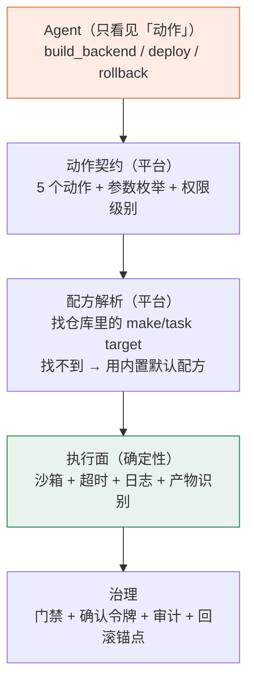

# CI/CD 方案替代与自创 · 决策文档 v1

> 日期：2026-11-07 ｜ 回答三个问题：必须做吗 / 有没有替代 / 能不能自创一套给 agent 用的
> 前置：[Jenkins 复刻规划](Jenkins能力复刻与复用-规划-v1.md) ｜ [开源 CI 调研](开源CI集成复用-调研-v1.md) ｜ [流水线设计](流水线设计-Java与Vue双栈.md)

---

## 0. 三个问题的直接回答

| 问题 | 回答 |
|---|---|
| **自研 CI 必须做吗？** | **不必须。** 它是"治理的载体"，不是目的。如果 Gitee Go 可用，可以直接用它当执行器，我们只做治理 |
| **有没有其它方案？** | **有，而且不止一个**（见 §2 的五种方案）。其中最省事的是"约定 + 仓库内配方 + 意图工具" |
| **能不能自创一套 agent 友好的？** | **能，但自创的应该是「动作契约」而不是「新语言」。** 用自然语言当流水线会在三个硬需求上直接失败（见 §3） |

**一句话**：你需要的是「**agent 说得清要什么、系统做得出一致结果**」，不是「一门 agent 读得懂的语言」。

---

## 1. 先把问题问对：CI 在解决什么

抛开 Jenkins 的具体实现，任何 CI 只要满足四件事：

| # | 刚需 | 如果不满足会怎样 |
|---|---|---|
| 1 | **可复现**：同样的代码，今天和明天构建结果一致 | 出问题无法判断是代码变了还是环境变了 |
| 2 | **可审计**：能回答"上次发布跑了什么、谁批准的" | 等保/复盘时无法举证 |
| 3 | **可授权**：能表达"这个动作需要人点头" | 无法把生产操作交给 AI |
| 4 | **可观测**：失败时知道停在哪一步、为什么 | 排障靠猜 |

**关键判断**：这四条里，只有第 4 条与"用什么语言写流水线"有关；前三条与语言无关，只与"**有没有确定性的中间表示**"有关。

> 所以我们真正要发明的东西是：**一个足够小、可校验、可回放的中间表示**，而不是一门语言。

---

## 2. 五种方案对比

| 方案 | 做法 | 平台侧工作量 | 可复现 | 可审计 | agent 友好 | 主要风险 |
|---|---|---|---|---|---|---|
| **A. PipelineSpec YAML**（原计划） | 自研声明式 DSL，agent 生成/人审 | ≈22 人日 | ✅ | ✅ | 🟡 要教它 schema | 长成半个 Jenkins |
| **B. 自然语言当流水线** | agent 每次自己决定步骤 | ≈8 人日 | ❌ | ❌ | ✅ | **不可复现、不可审计、注入面巨大** |
| **C. 用 Gitee Go** | 平台只做门禁/审计/确认 | ≈10–14 人日 | ✅ | ✅ | 🟡 需适配其 API | 套餐依赖、能力受平台限制 |
| **D. 约定 + 仓库内配方 + 意图工具**（**推荐**） | 平台定义"动作"，动作映射到仓库里的 `make/task` target 或内置配方 | **≈10 人日** | ✅ | ✅ | ✅ **天然友好** | 配方质量参差（有兜底，见 §5.4） |
| **E. 让 agent 写 shell 直接跑** | 无配方，agent 生成命令执行 | ≈5 人日 | ❌ | 🟡 | ✅ | 沙箱+审批也救不了"两次结果不同" |

**结论**：D 是唯一同时满足"省事 + 可复现 + 可审计 + agent 友好"的方案。B/E 在演示上很好看，在生产上一定会翻车。

---

## 3. 为什么「用自然语言当流水线」不行

这一节专门回答你那个很自然的直觉：*反正给 agent 用，干嘛不直接说人话？*

### 3.1 LLM 对结构化格式的理解本来就没问题

它读 YAML/JSON 的准确率远高于读散文。**"agent 友好"不等于"自然语言"**——真正对 agent 友好的是：

| 特性 | 自然语言 | 结构化 |
|---|---|---|
| 可枚举的取值（选一个，不是编一个） | ❌ | ✅ |
| 有默认值（不用每次都想） | ❌ | ✅ |
| 有稳定的错误码（能自查） | ❌ | ✅ |
| 可回放（同一输入同一输出） | ❌ | ✅ |
| 可被 diff / review | ❌ | ✅ |

### 3.2 三个致命点（不是理论，是必然发生的）

**① 不可复现**
"帮我把后端构建一下" —— 第一次它跑了 `mvn -DskipTests package`，第二次它加了 `-T 4C`，第三次它先跑了 `mvn clean`。**三次产物可能不同**，出问题时你无法归因。

**② 不可审计**
审计要回答的不是"agent 说了什么"，而是"**实际执行了哪条命令**"。自然语言的计划无法作为证据；而命令清单需要由**人写、被 review 过**。

**③ 不可授权**
"这次发布要不要批准"——如果计划每次都是模型现编的，审批人每次都在看一份**从没见过的新方案**。这等于每天重新评审一次流水线。

### 3.3 一个反例更能说明问题

假设生产事故复盘时问：「昨天 22:15 那次发布，和第 3 天前那次，跑的是同一套步骤吗？」

- 自然语言方案：只能翻聊天记录，然后说"应该是吧"；
- 配方方案：`build@v3`（仓库里 review 过的 target）+ git sha，**可以精确回答**。

> 这正是规约 §1 里那句「AI 只做决策，执行面是确定性代码」的由来。

---

## 4. 推荐方案 D：动作契约 + 仓库内配方 + 意图工具

### 4.1 三层结构



### 4.2 动作目录（平台侧只有 5 个）

| 动作 | 参数（枚举） | 级别 | 默认配方（仓库无覆盖时） |
|---|---|---|---|
| `backend_build` | `profile ∈ {dev,test,prod}` | L2 | `mvn -B -q -DskipTests package` |
| `frontend_build` | `mode ∈ {production,staging}` | L2 | `pnpm install --frozen-lockfile && pnpm build` |
| `image_package` | `tag`（自动带 git sha） | L2 | `docker build -t <tag> .` |
| `stack_deploy` | `env ∈ {test,staging,prod}` | **L3** | 窄控制器 8 步（摘流→换容器→健康→回填） |
| `stack_rollback` | `env`、`to_digest` | **L3** | 按 digest 重建 |

> **agent 永远只说这五个词**，不需要知道 `mvn` 还是 `gradle`，也不需要知道是 compose 还是 K8s。

### 4.3 配方住在仓库里（关键设计）

项目仓库根放一个 `ci/` 目录（或直接 `Makefile` / `Taskfile.yml`）：

```yaml
# ci/actions.yml —— 人写的、review 过的、版本化的
actions:
  backend_build:
    run: ["mvn", "-B", "-q", "-DskipTests", "package"]
    produce: ["target/*.jar"]
    timeout: 20m
  frontend_build:
    run: ["pnpm", "build"]
    produce: ["dist/index.html"]
    timeout: 15m
  image_package:
    type: docker-build
    dockerfile: Dockerfile
    tagPattern: "${version}-${gitSha7}"
```

或者更省事——**直接用 Makefile**（开发者本来就会写）：

```make
backend-build:
	mvn -B -q -DskipTests package

frontend-build:
	pnpm build
```

平台解析顺序：`ci/actions.yml` → `Taskfile.yml` → `Makefile` → 内置默认配方。

### 4.4 安全边界的关键区分（这条解决了"禁 shell"的矛盾）

| | 谁能写命令 | 谁能选命令 |
|---|---|---|
| 自然语言方案 | **模型** | 模型 |
| 配方方案 | **人**（review 过、进版本库） | **模型**（只能从动作目录里选） |

> 所以规约里那条「禁 shell」要精确化成：**禁止模型**生成命令，**允许人**在仓库里写命令。
> 这是本次方案里最重要的一次概念修正——不是放宽安全，而是把"写命令"的权限交给对的人。

### 4.5 agent 眼中的样子

```
agent:  我想构建后端
系统:   backend_build 可用，将执行 mvn -B -q -DskipTests package（来源：ci/actions.yml@a1b2c3）
        预计 3–5 分钟，产物 target/ruoyi-server.jar
agent:  跑
系统:   [流式日志] ... BUILD SUCCESS
```

**没有一个 DSL 出现在对话里**——这正是你要的"agent 友好"，但它底下仍然是确定性的。

---

## 5. 与现有文档的差异（要改什么）

| 文档 | 原内容 | 改为 |
|---|---|---|
| PRD §4.7 | 自研 `PipelineSpec`、agent 可提议 YAML | **动作契约 + 配方解析**；`PipelineSpec` 降级为"配方的内部表示" |
| 流水线设计 §1–§3 | 4 种 stage type 由人写 YAML | stage type 保留（执行层不变），但**入口从"写 YAML"变成"选动作"** |
| 执行器契约 | 不变 | 不变（它约束的是 stage 执行，不是作者体验） |
| Jenkins 复刻规划 | 复刻 21.5 人日 | 降到 **≈10 人日**（不做 DSL 编辑器、不做 schema 演进、不做参数表单） |

### 5.1 省下来的工作量去哪了

| 原计划 | 人日 | 新方案 | 人日 |
|---|---|---|---|
| PipelineSpec 设计与校验 UX | 4 | 动作目录（5 个动作 + 枚举） | 2 |
| 参数表单/枚举生成 | 2 | 配方探测（4 种文件 → 动作） | 2 |
| 模板与文档 | 2 | 内置默认配方（4 个） | 2 |
| 执行器内核（不变） | 12 | 执行器内核（不变） | 12 |
| **合计** | **22** | **合计** | **≈18** |

> 等等——只省 4 人日？是的，因为**执行层一点没省**（沙箱、日志、超时、产物、审计都必须有）。
> 真正的收益不在人日，而在**长期维护**：不用维护一门 DSL，不用为每个新项目教 agent 写 YAML。

### 5.2 真正被砍掉的是什么

- 不再有"流水线编辑器"；
- 不再有"schema 版本演进"；
- 不再需要给 agent 写"如何写 PipelineSpec"的提示词与示例（**少一大块提示词维护**）；
- 不再有"模型编了一个平台不认识的 stage type"这类错误。

---

## 6. 落地步骤

| 阶段 | 内容 | 人日 | 出口条件 |
|---|---|---|---|
| **D0** | 动作目录 + 配方解析（4 种来源）+ 内置默认配方 | 4 | 对现有仓库能正确识别出 5 个动作，并展示"来源文件@commit" |
| **D1** | 复用执行器内核（沙箱/超时/日志/产物） | 8 | 与 Jenkins 同提交产出相同 jar 校验和 |
| **D2** | 门禁与确认（复用 `confirmToken`）+ 回滚锚点 | 4 | 生产部署必须过人确认，回滚 ≤60s |
| **D3** | 前端面板（动作列表 + 实时日志 + 历史） | 3 | 无 CLI 也能完成一次构建与发布 |

### 验收（与方案无关的硬指标）

1. 同一 commit 两次构建，产物 sha256 一致；
2. 每次执行能回答"用了哪个配方、来自哪个文件、哪个 commit"；
3. 生产部署 100% 经确认令牌；
4. agent 全程没写过一条命令。

---

## 7. 风险与兜底

| # | 风险 | 兜底 |
|---|---|---|
| R1 | 仓库没有配方，或配方写得不对 | **内置默认配方兜底**；执行前把"将执行的 argv"回显给人看 |
| R2 | Makefile 是任意命令，等于开了口子 | 只允许执行**登记过的 target 名**；target 内容进版本库供 review；沙箱不变 |
| R3 | Windows 构建机没有 `make` | 优先 `ci/actions.yml`（纯数据）；其次 `Taskfile`（单二进制）；`make` 作为可选 |
| R4 | 配方与项目实际不符（改了 pom 但没改配方） | 产物缺失即失败并提示"配方可能过期"；不做静默兜底 |
| R5 | 动作目录膨胀（有人要加第 6 个动作） | 走评审；**动作数上限 8**，超了说明分层错了 |

---

## 8. 结论

| 判断 | 结论 |
|---|---|
| 必须自研 CI 吗 | **不必须**。它是治理的载体，不是目的 |
| 自创一套可以吗 | **可以，但自创的是「动作契约 + 配方载体」**，不是新语言 |
| 用自然语言写流水线 | **不可行**：不可复现、不可审计、不可授权 |
| 推荐 | **方案 D**：5 个动作 + 仓库内配方（`ci/actions.yml` / `Makefile`）+ 内置兜底 + 复用现有执行器 |
| 对 agent 的收益 | 它只需说 5 个词，不用学 DSL；平台侧少维护一门语言与一堆提示词 |
| 真正的成本 | 执行层一点没省（18 人日里 12 个在执行层）——**这才是 CI 的本体** |
