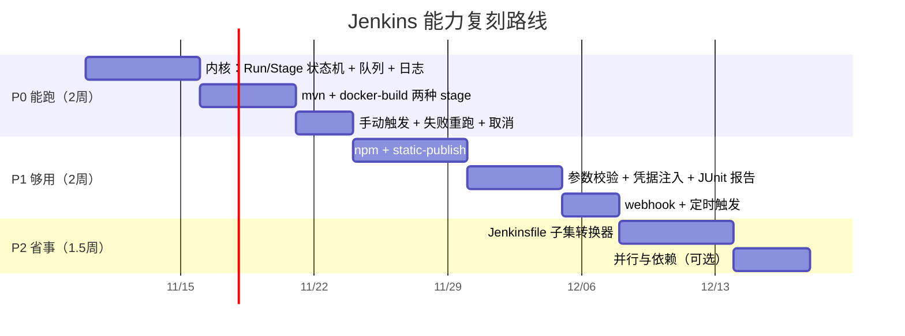

# Jenkins 能力复刻与复用 · 规划文档 v1.0

> 日期：2026-11-07 ｜ 结论：**复刻 5 项、复用 6 项、明确不做 6 项**，P0 约 22 人日
> 前置：[PRD v1.6](PRD-DevOps-Agent平台-v1.0.md) §4.7 ｜ [流水线设计 Java+Vue](流水线设计-Java与Vue双栈.md) ｜ [执行器契约](规约-流水线执行器-v1.0.md)

---

## 0. 结论先行

| 处置 | 项 | 一句话 |
|---|---|---|
| **复刻**（自研） | 描述层、编排层、执行层（窄）、状态层（降级）、触发层 | 只复刻"我们真的会用到"的五层，且每一层都**主动砍掉一半能力** |
| **复用**（不造） | Maven/npm/Docker/git、JUnit XML、镜像扫描、平台已有的沙箱/SSE/凭据/门禁/审计 | 这些重造一遍不会更好，只会更慢 |
| **不做** | Groovy DSL、插件体系、共享库、分布式 agent、多分支扫描、指纹/制品库 | 每一项都是"看起来很强、实际半年烂尾" |

**一句话**：我们要的不是 Jenkins，是**Jenkins 里那 20% 真被用到的能力**，加上**Jenkins 做不到的治理**。

---

## 1. 调研方法与证据等级

| 等级 | 说明 | 本次来源 |
|---|---|---|
| **B（官方文档）** | 直接抓取官方文档原文 | `jenkins.io/doc/book/**` 4 篇（本次实取） |
| C | 公开信息/行业共识，本环境**未联网核实** | GitHub Actions / GitLab CI / Drone / Tekton 的执行模型 |
| D | 我的推断 | 工作量、取舍建议 |

> 本环境 `web_search` 不可用（无凭据），因此**没有引用任何搜索摘要**；Jenkins 侧结论全部来自官网原文，文末附录给了链接与抓取日期。

---

## 2. 调研：Jenkins 的六层能力模型

以下事实均来自官方文档（B）：

### L1 描述层 —— Pipeline DSL / Jenkinsfile

- Pipeline 本质是**一组插件的集合**，通过 DSL 描述交付流水线；定义写在 `Jenkinsfile` 里并纳入版本控制（"Pipeline-as-code"）；
- 两种语法：**Declarative**（结构化，可读性好）与 **Scripted**（Groovy 脚本，`node {}` 包裹）；
- 官方列出的四大收益：自动为所有分支/PR 建立流水线、可评审、**审计轨迹**、单一事实源。

### L2 编排层 —— Stage / Step / 并行 / 暂停

- 四个核心概念：**Pipeline / Node / Stage / Step**；
- 官方强调的五项能力：**Code、Durable（可跨重启）、Pausable（等人工输入）、Versatile（fork/join、循环、并行）、Extensible（DSL 可扩展）**。

### L3 执行层 —— controller / agent / executor / workspace

- **controller 只调度不执行**：官方建议 controller 的 executor 数设为 `0`；
- **agent 提供 executor（并发槽）**，用 **label** 表达能力（如 `aarch64`、`docker`、`high-memory`）；
- 每个 Pipeline 会创建**workspace**（专属目录），且官方明确提示：workspace 可能不会被自动清理。

### L4 状态层 —— Durability（**这条最值得研究**）

- Pipeline 为了"能扛住重启"，会**非常频繁地把中间态写盘**，这是性能瓶颈之一；
- 三档：`PERFORMANCE_OPTIMIZED`（大幅减少 I/O）、`MAX_SURVIVABILITY`（默认，最慢最稳）、`SURVIVABLE_NONATOMIC`（每步写、不做原子写）；
- 官方建议：普通构建/测试用性能优化档；**生产部署与需审计的流水线用最高持久化档**；
- **脏关机（SIGKILL / OOMKill）会丢失运行中 Pipeline 的中间态**——即使最高档也救不了正在跑的那次。

> **对我们的直接含义**：Jenkins 花了巨大代价换"从中间继续执行"的能力。**我们不做这个**——只做"失败可重跑"，成本差一个数量级（见 §4.3）。

### L5 资源层 —— 凭据与产物

- 凭据 6 类：secret text / username+password / secret file / SSH key / certificate / docker host cert；
- **加密存在 controller 上，由 controller ID 派生密钥**；Pipeline 里只能用**凭据 ID** 引用，拿不到明文；
- 作用域分 Global / System；权限点是 `Credentials > Create`。

### L6 生态层 —— 插件 / 共享库 / 多分支 / 触发

- 插件体系是 Jenkins 的全部威力来源，也是全部运维负担来源；
- 共享库（Shared Libraries）把 Groovy 能力进一步放大；
- 多分支（Multibranch）自动发现分支与 PR；
- 触发：SCM webhook、定时、手动、上游/下游。

---

## 3. 逐项处置表（核心）

> 判定原则：**只有"我们每天都要用、且没有现成替代"的才复刻**；其余复用或不做。

| # | Jenkins 能力 | 层 | 我们要吗 | 处置 | 我们的做法 | 人日 |
|---|---|---|---|---|---|---|
| 1 | Pipeline 描述（Jenkinsfile） | L1 | ✅ | **复刻（换形态）** | `PipelineSpec` YAML（数据，非代码），可被 agent 提议 + schema 校验 | 2 |
| 2 | Stage / Step 编排 | L2 | ✅ | **复刻** | Stage 状态机 + 4 种 stage type | 3 |
| 3 | 并行 / fork-join | L2 | ❌ | **不做** | 单机串行；需要并行就起两个 Run（P2 再评估） | 0 |
| 4 | `input`（人工暂停） | L2 | ✅ | **复用** | 已有 `confirmToken` + 确认卡片，不重造审批 | 0 |
| 5 | controller/agent 分离 | L3 | ❌ | **不做** | 单机单进程；未来多机再抽 agent 协议 | 0 |
| 6 | executor 并发槽 + 队列 | L3 | ✅ | **复刻（极简）** | 全局并发上限 + 项目级串行 + 排队可见 | 1.5 |
| 7 | label 能力路由 | L3 | ❌ | **不做** | 只有一台构建机，无路由需求 | 0 |
| 8 | workspace 生命周期 | L3 | ✅ | **复刻** | 每 Run 独立 worktree；结束保留 N 天（可人工取回） | 1.5 |
| 9 | **Durability / 从中间恢复** | L4 | ❌（降级） | **不做** | 只做「stage 级落库 + 失败可重跑」，不追求 step 级续跑 | 0 |
| 10 | 凭据存储与按 ID 引用 | L5 | ✅ | **复用（平台已有）** | `project_credential` + AES-GCM + 执行面解密；不重造 | 1 |
| 11 | `withCredentials` 注入 | L5 | ✅ | **复刻（薄）** | 只注入 env，不落盘、不进日志 | 0.5 |
| 12 | 产物归档 `archiveArtifacts` | L5 | ✅ | **复用** | 复用对象存储/本地卷 + 平台 `ArtifactRef` | 1 |
| 13 | JUnit 报告聚合 `junit` | L5 | ✅ | **复用** | 直接解析 `target/surefire-reports/*.xml`（标准格式） | 1.5 |
| 14 | 指纹 / 制品库 | L5 | ❌ | **不做** | 用镜像 digest + 静态产物哈希即可 | 0 |
| 15 | 插件体系 | L6 | ❌ | **不做** | 只做 4 种 stage type，扩展走评审 | 0 |
| 16 | 共享库（Groovy） | L6 | ❌ | **不做** | 用 Skill / Runbook 表达团队约定 | 0 |
| 17 | 多分支自动发现 | L6 | ❌ | **不做** | 手动选分支 / webhook 指定分支 | 0 |
| 18 | 触发：手动 / webhook / 定时 | L6 | ✅ | **复刻** | 手动 + Gitee webhook + cron（复用平台调度） | 2 |
| 19 | 构建历史与日志 | — | ✅ | **复刻** | `run` / `run_stage` / 日志分段落库 + SSE 增量 | 2 |
| 20 | 构建参数与校验 | — | ✅ | **复刻** | 枚举/正则白名单（Jenkins 参数注入是 RCE 温床） | 1.5 |
| 21 | `sh`/`bat` 任意脚本 | L2 | ❌ | **不做** | `run` 只接受 argv，禁 shell（这是安全边界，不是省事） | 0 |
| 22 | `timeout` / `retry` | L2 | ✅ | **复刻** | 每 stage 超时 + 按错误类别决定是否重试（契约 §1.4） | 1 |
| 23 | `stash`/`unstash` | L2 | ❌ | **不做** | 单机共享 workspace，不需要搬运 | 0 |
| 24 | 构建徽章 / Blue Ocean UI | — | ❌ | **不做** | 平台自己的运行面板 | 0 |

**汇总**：复刻 ≈ **21.5 人日**；复用 ≈ 4 人日（接入而非重造）；不做 12 项直接省掉 60+ 人日。

---

## 4. 复刻设计（窄引擎）

### 4.1 对象模型（对齐 Jenkins 的概念，但不照搬）

```
PipelineRun   ← Jenkins 的 Pipeline（一次运行）
  └ StageRun  ← Jenkins 的 Stage（可含多个 Step，但我们一个 stage 只跑一条 argv）
      └ StepInvocation ← 记录：命令、退出码、耗时、日志区间
```

保留三层是因为**日志与 UI 需要按 stage 折叠**；但**不提供 Step 的可编程性**（没有 Groovy，也就没有"循环里套 stage"）。

### 4.2 队列与并发

| 概念 | Jenkins | 我们 |
|---|---|---|
| 并发单位 | executor（每 agent N 个） | 全局并发上限（默认 4）+ **项目级串行** |
| 排队 | 队列 + 超时 | 有界队列（满则拒绝并告知，而不是无限堆积） |
| 抢占 | 无 | 无（先来先跑） |

> 为什么项目级串行：同一项目同时跑两次构建会争抢缓存卷与工作区，收益远小于风险。

### 4.3 状态与恢复：主动放弃"从中间继续"

| | Jenkins | 我们 |
|---|---|---|
| 落盘粒度 | **每个 step 前后**（可通过 durability 档位调） | **每个 stage 结束**（成功/失败/超时） |
| 崩溃后 | 从最后一个 step 继续（取决于档位） | 标记为 `RUN_FAILED`，**只能重跑** |
| 代价 | 频繁 I/O，官方自己说这是主要瓶颈 | 无额外 I/O；恢复语义简单可验证 |
| 适用 | 长流水线、生产部署 | 我们的流水线 5 分钟内跑完，**重跑成本低** |

**判断依据**：一条 `mvn package` 崩溃后"续跑"意义不大——缓存还在，重跑往往比恢复更快、更可信。**这是本规划里最重要的一次"不做"**。

### 4.4 日志

- 追加写 `run_stage_log(run_id, stage_id, seq, ts, line)`；
- 保留策略：头 200 行 + 尾 500 行 + 全部命中错误模式的行（契约 §1.6）；
- SSE 增量推送：按 `seq` 续传（对齐平台 SSE 规约）。

### 4.5 取消与超时

`SIGTERM` → 等 10s → `SIGKILL`；退出码 143 / 124 分别映射取消与超时（契约 §1.5）。

---

## 5. 复用清单

### 5.1 外部成熟件（重造没有收益）

| 能力 | 复用 | 我们只做 |
|---|---|---|
| 编译 | Maven / npm / pnpm | 调 argv、收产物、判错误 |
| 打包 | `docker build` | tag 规则、digest 记账 |
| 源码 | `git` CLI（浅克隆 + worktree） | 目录与锁管理 |
| 单测报告 | **JUnit XML**（事实标准） | 解析与聚合展示 |
| 镜像扫描 | Trivy / Grype | 结果解读与门禁 |
| 依赖仓库 | Nexus / npm 镜像 / registry | 注入 `settings.xml` / `.npmrc` |

### 5.2 平台内部已有（别重复写）

| 能力 | 已有 | 复用方式 |
|---|---|---|
| 隔离执行 | `DockerSandboxConfig`（digest 钉镜像 / 非 root / pids/内存/CPU 限额 / socket ACL 校验） | stage 容器直接沿用这套约束 |
| 日志流 | 平台 SSE + `SseEmitter` | 复用同一套事件格式 |
| 凭据 | `project_credential` + AES-GCM + 执行面解密 | stage 执行前注入 env |
| 门禁 | `confirmToken` + 确认卡片 | **生产发布/高危构建**复用同一套确认 |
| 审计 | `run` / `run_stage` / `tool_call` | 构建动作自动进审计 |
| 作用域 | `ProjectContext`（projectId 服务端绑定） | 构建天然按项目隔离 |

> 这条是"复用"的真正价值：**流水线不需要新的沙箱、新的日志通道、新的凭据系统、新的审批**——它们全都在平台里了。

---

## 6. 故意与 Jenkins 不同的三点

| 维度 | Jenkins | 我们 | 为什么 |
|---|---|---|---|
| **描述语言** | Groovy（图灵完备） | YAML（声明式数据） | 代码不可静态校验、不可被 agent 安全生成；数据可以 |
| **扩展方式** | 插件（1800+） | 4 种 stage type + 评审 | 插件是供应链风险与升级地狱；我们的场景不需要 |
| **脚本执行** | `sh` 任意命令 | argv 数组，禁 shell | Jenkins 的参数注入是 RCE 经典路径；我们从类型上堵死 |

---

## 7. 迁移复用：Jenkinsfile → PipelineSpec（可选 P2）

**为什么值得做**：老项目的 Jenkinsfile 是资产，直接丢掉太浪费。但**只能做子集转换**。

| Jenkinsfile 结构 | 可转换 | 说明 |
|---|---|---|
| `agent any/none` | ✅ | 忽略（我们只有一台） |
| `stages { stage('x') { steps { sh '...' } } }` | ✅ | → `stages[].run`（需人工确认 argv 拆分） |
| `junit 'reports/**/*.xml'` | ✅ | → `reports` 字段 |
| `archiveArtifacts` | ✅ | → `artifacts` |
| `environment { }` | ✅ | → `env`（白名单过滤） |
| `post { always/success/failure }` | 🟡 | 只保留 `failure` → 通知；其余丢弃 |
| `when { branch 'main' }` | 🟡 | → `triggers` 过滤 |
| `options { timeout/retry }` | ✅ | → `timeout` / `retry` |
| **`script { }` 段** | ❌ | Groovy 代码，无法转换 |
| **共享库 `@Library`** | ❌ | 需人工重写 |
| **自定义插件 step** | ❌ | 记录到"未转换清单" |

**产物**：`PipelineSpec` + **未转换项清单**（逐行标注原因），交人补齐。**不做"尽力而为的静默降级"**——那会产出看起来能跑、实际漏步骤的流水线。

工作量：**+6 人日**（含 20 个真实 Jenkinsfile 的回归样例）。

---

## 8. 分期计划



| 期 | 交付 | 出口条件 |
|---|---|---|
| **P0** | 能构建 Java 项目并产出镜像 | 与 Jenkins 同提交产出**相同 jar 校验和**；失败可重跑；取消 3 秒内生效 |
| **P1** | 双栈 + 报告 + 触发 | 二次构建 ≤ 首次 40%；前端发布 0 个 404；报告条目数与 Jenkins 一致 |
| **P2** | 迁移工具 | 20 个真实 Jenkinsfile 转换，**未转换项全部显式列出** |

**总投入**：P0+P1 ≈ **22 人日**；P2 ≈ 10 人日。

---

## 9. 等价性测试（怎么证明"复刻成功"）

| # | 测试 | 判据 |
|---|---|---|
| E1 | 同一 commit，Jenkins 与我们各构建一次 | `target/*.jar` 的 sha256 一致（同 JDK/同依赖） |
| E2 | 单测报告 | JUnit XML 的用例数/失败数与 Jenkins 一致 |
| E3 | 失败语义 | 编译错误 → 不重试；拉镜像失败 → 重试 ≤2（对齐契约 §1.4） |
| E4 | 取消 | 3 秒内容器消失，状态为 `CANCELLED` |
| E5 | 缓存 | 第二次构建 ≤ 首次 40% |
| E6 | 隔离 | 构建容器访问公网失败；`/ws` 之外不可写 |
| E7 | 凭据 | 日志中不出现明文；`env` 注入了但不在 argv 中 |

> E1 是"复刻成功"的硬证据；其余是"能用"的证据。

---

## 10. 风险与退出策略

| # | 风险 | 对策 |
|---|---|---|
| R1 | **长出半个 Jenkins**（有人要并行、要插件、要 matrix） | 严守 §3 的"不做"清单；扩展走评审、默认拒绝 |
| R2 | 构建机资源被吃满（构建与业务同机） | 全局并发上限 + 构建容器资源限额 + 低峰调度 |
| R3 | 缓存卷损坏导致"明明改对了却构建失败" | 缓存可一键清空；失败信息提示"可能是缓存" 并提供清理入口 |
| R4 | 与 Jenkins 行为不一致（同样输入不同输出） | E1/E2 作为常驻回归；差异记入文档 |
| R5 | 单机不可扩展（构建变多） | 明确阈值：**日均构建 > 50 次或排队 > 10 分钟就该上多机/Jenkins** |

**退出策略（重要）**：如果出现以下任一情况，**老实装 Jenkins**，不要再自研：

1. 需要构建 3 种以上语言/工具链；
2. 需要跨机器分发（构建机 > 1 台）；
3. 需要插件才能完成的集成（如特定云厂商的制品上传）；
4. 团队里没人愿意维护 CI 引擎。

> 自研 CI 的唯一正当理由是"我们的场景足够窄"。**场景一变宽，自研立刻变成负债。**

---

## 附录：调研来源（2026-11-07 实取）

| 页面 | 用途 |
|---|---|
| [Pipeline](https://www.jenkins.io/doc/book/pipeline/) | 概念（Pipeline/Node/Stage/Step）、Declarative vs Scripted、五大特性（Code/Durable/Pausable/Versatile/Extensible） |
| [Using Jenkins agents](https://www.jenkins.io/doc/book/using/using-agents/) | controller/agent 分离、executor 槽位、label 路由、controller executor=0 建议 |
| [Scaling Pipelines](https://www.jenkins.io/doc/book/pipeline/scaling-pipeline/) | **Durability 三档与代价**、脏关机丢状态、生产部署用最高档的建议 |
| [Using credentials](https://www.jenkins.io/doc/book/using/using-credentials/) | 6 类凭据、按 controller ID 加密、Pipeline 只引用 credential ID |

> 说明：本环境 `web_search` 不可用，故未引用任何搜索摘要；GitHub Actions / GitLab CI / Drone / Tekton 的对比仅作定性参考（C 级），未在本文中作为论据使用。
