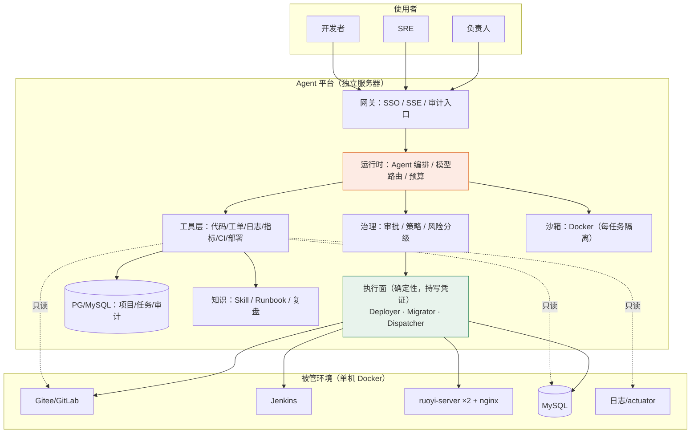
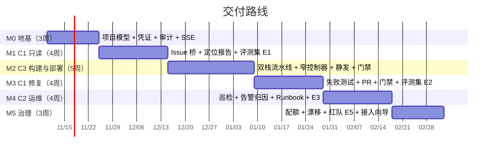

# 研发运维智能体平台 · 产品需求文档（PRD）

| 项 | 内容 |
|---|---|
| 文档版本 | v1.6（评审中） |
| 日期 | 2026-11-07 |
| 状态 | Draft — 待需求评审 |
| 产品形态 | **独立部署的 Agent 平台**（AgentScope Java），内网运行，与业务服务器分离 |
| 服务对象 | 开发人员 / 运维（SRE） / 项目负责人 |
| 覆盖能力 | ① 读取 Issue 改 Bug　② AI 自动化运维　③ 自动化部署项目 |
| **v1.1 变更** | 日志接入定为**文件日志**；凭证定为**平台内加密存储**（无 Vault）；登录**暂不做 SSO**（本地账号）。详见 §0.1 P7–P9、§4.8–§4.10 |
| **v1.2 变更** | CI 方案一度改为「可插拔引擎 + 统一门面 + 工具化」（详见下行 v1.3 修订原因） |
| **v1.3 变更（最终）** | CI **改为自研引擎，锁定 Java + Vue 双栈**（4 种 stage 类型），不再接外部 CI。双栈的部署语义、原子发布与成对回滚见新文档 [流水线设计](流水线设计-Java与Vue双栈.md)；PRD §4.7 已相应重写 |
| **v1.4 变更** | 关闭 T5/T6/T7：无镜像仓库（新增 A7 + §4.7.10 + 阻塞项 B1）、Maven/npm 走阿里云、单副本容量按保守假设 A6 设计；T8 仍待定 |
| **v1.5 变更** | ① **构建固定在平台服务器**（P10）→ 引出镜像跨机传递方案（§4.7.11）；② **取消用户角色**（P11）→ 改为「按动作设门禁 + 双人规则」（§2.1、§4.2、§4.10） |
| **v1.6 变更** | 取消"第二人确认"，改为**本人确认 + agent 提请**（§4.10 确认模型与四道技术守卫）；明确 **agent 无 confirm 能力**；残余风险与补偿控制（自动回滚、限速、高危二次密码） |
| 关联文档 | [多项目托管 v4](多项目托管设计-v4.md) ｜ [执行面设计](devops-agent-执行面设计-k8s-jenkins-flyway.md) ｜ [窄控制器](窄控制器设计-单机滚动部署器.md) ｜ [ruoyi-ai 拆解](ruoyi-ai-编程助手拆解.md) |

---

## 0. 假设与待确认项（请优先确认这一节）

> 本文档基于前序讨论已确认的决策编写。以下标 ⚠️ 的条目为**假设**，若不成立会影响对应需求，标 TBD 的需要你补充。

### 0.1 已确认的前提

| # | 前提 |
|---|---|
| P1 | 平台是**独立服务**，与 RuoYi-Vue 业务服务器分开部署，仅内网访问 |
| P2 | 平台**托管多个项目**（多项目为一级实体），首期为 1 个（RuoYi-Vue-Plus） |
| P3 | 工作项（需求/缺陷）**事实源在 Gitee / GitLab Issues**，平台不自建工单系统 |
| P4 | 部署形态：**单机 Docker / docker-compose，短期不上 K8s** |
| P5 | **CI/CD 自研**：平台内建流水线引擎，**锁定 Java(Maven) + Vue(pnpm/npm) 两栈**，靠 4 种 stage 类型扩展；不部署 Jenkins、不接外部 CI |
| P6 | 平台具备 AIOps 能力，但**生产写操作默认不自动执行**（L3 需审批） |
| P7 | 日志来源：**RuoYi-Vue-Plus 的文件日志**（logback → `./logs/sys-*.log`），无 Loki/ELK |
| P8 | **暂无 Vault 或等价密钥管理**，凭证由平台自身加密存储 |
| P9 | **暂不做 SSO**，平台使用本地账号 + 角色 |
| P10 | **构建在平台服务器执行**（不在业务宿主机）；构建机需具备 Docker 能力与构建缓存 |
| P11 | **不区分用户角色**：所有成员权限相同，改为**按动作设门禁**（action-gated），不再使用 RBAC 角色矩阵 |

### 0.2 假设（⚠️ 若不成立需重估）

| # | 假设 | 影响 |
|---|---|---|
| A1 | ⚠️ 使用人数 ≤ 50（开发者 + SRE），并发 agent 任务 ≤ 5 | 决定容量与队列设计（NFR-01） |
| A2 | ⚠️ 项目数 ≤ 8（单机 Docker 的内存约束） | 超过则需提前上多机/K8s（见 R-03） |
| A3 | ⚠️ 业务服务有 `/actuator/health` 且可用 Basic Auth 访问 | 否则健康门禁需另建（FR-C3-03） |
| A4 | ⚠️ 代码为 Java 技术栈（Maven 构建） | 影响构建镜像与沙箱镜像 |
| A5 | ⚠️ 允许调用**私有化部署或境内合规**的大模型 API | 决定合规路径（NFR-08） |
| A6 | ⚠️ **单副本扛不住 100% 流量**（尚未压测，按保守假设设计） | M2 预留第 3 个端口位（金丝雀位），见 §4.7.9 与 [流水线设计 §15](流水线设计-Java与Vue双栈.md) |
| A7 | ⚠️ **无私有镜像仓库**（T6） | 构建位置受限；镜像保留与回滚需特殊处理，见 §4.7.10 |

### 0.3 已关闭的待定项（v1.1）

| # | 原待定项 | 结论 | 影响 |
|---|---|---|---|
| T1 | 日志栈 | ✅ **文件日志**（RuoYi-Vue-Plus logback） | 需要「增量 tail + 轮转感知」的采集器，见 §4.9 |
| T2 | 密钥管理 | ✅ **暂无 Vault** → 平台内加密存储 | 见 §4.8；主密钥放环境变量/keystore，**不进代码库** |
| T3 | SSO | ✅ **暂不做** | 本地账号 + 角色，见 §4.10；预留 `identity_source` 便于后续接 SSO |
| T4（v1.1 结论，**已被下行修订**） | Jenkins | ~~不部署 Jenkins，改为内建流水线引擎~~ | 见 §4.7 |
| T4（**v1.3 结论，最终**） | CI 引擎形态 | ✅ **自研引擎，锁定 Java + Vue 双栈**；4 种 stage 类型；不接外部 CI、不嵌第三方 UI | 见 §4.7 与 [流水线设计](流水线设计-Java与Vue双栈.md) |

### 0.4 已关闭的待定项（v1.4）

| # | 原待定项 | 结论 | 影响 |
|---|---|---|---|
| T5 | 单副本容量 | ⚠️ **不清楚** → 按"扛不住"设计（A6） | M2 预留第 3 端口位；需半天压测定拐点 |
| T6 | 私有镜像仓库 | ✅ **没有** | 见 §4.7.10；**强烈建议加装 `registry:2`**（10 分钟、约 200MB） |
| T7 | Maven/npm 镜像 | ✅ **可访问阿里云** | Maven `settings.xml` + npm `npmmirror` 由平台注入；基础镜像建议预加载 |

### 0.5 仍待确认

| # | 待定项 | 影响 |
|---|---|---|
| T8 | 首场景选哪个项目、哪类 issue？ | M1 范围（建议先限 30 条真实 issue，见 §5.3） |
| **B1** | **构建在哪台机器执行？**（平台机 or 业务机） | 这是 T6 引出的**阻塞项**：无仓库时镜像不能跨机，见 §4.7.10；若采纳 `registry:2` 则此问题消失 |

---

## 1. Executive Summary

### 1.1 问题陈述

研发团队的日常时间有三块高耗低价值区：**① 定位问题**（报错在哪、为什么）、**② 判断变更安全**（这次发布会不会炸）、**③ 重复性运维动作**（发版、巡检、回滚）。现有工具各管一段——Issues 管工单不知道部署、监控管告警不懂代码、CI 工具会执行但不能判断——工程师被迫在 4–6 个系统之间手工对齐时间线。

同时，直接用通用 AI 工具存在三个企业级障碍：**拿不到业务上下文**（权限、数据范围、版本）、**不可审计**、**不敢让它动手**。

### 1.2 解决方案

建一个**内网的研发运维智能体平台**，把「项目」作为作用域边界，把「代码 / 环境 / 工单 / 日志 / 流水线」收敛到一处，用三类能力替代人工搬运：

- **C1 读取 Issue 改 Bug**：从 Gitee/GitLab Issue 出发，自动补证据 → 定位 → 复现 → 修复 → 提 PR → 回写结论；
- **C2 AI 自动化运维**：巡检、告警归因、根因假设与验证、Runbook 受限执行；
- **C3 自动化部署项目**：面板内构建与测试（引擎可插拔）、滚动部署、健康门禁、回滚、数据库迁移治理、变更编排。

**核心设计约束（贯穿全文）**：AI 只做决策与建议，**不持有任何写凭证**；所有写操作由**确定性执行器**在审批后执行。

### 1.3 成功指标（首期 6 个月）

| # | KPI | 目标 | 度量方式 |
|---|---|---|---|
| K1 | 缺陷平均定位时长（提单 → 定位结论） | **下降 ≥ 50%** | Issue 时间戳差 |
| K2 | Bug 定位准确率（人工确认定位到正确文件/模块） | **≥ 70%** | 抽样 50 条人工标注 |
| K3 | AI 修复 PR 首次接受率（未被打回修改即合并） | **≥ 40%** | Git 平台指标 |
| K4 | 发布期间前端 5xx | **0 个** | 压测 + 线上监控 |
| K5 | 变更失败率（含回滚） | **不高于人工基线** | 发布记录统计 |
| K6 | 周活（10 人试点） | **≥ 60%** | 平台埋点 |
| K7 | 生产事故归因于 agent | **0 起** | 事故复盘记录 |

---

## 2. User Experience & Functionality

### 2.1 用户角色：只有一种（全员同权）

**决策（v1.5）：不区分角色。所有人都是「平台成员」，权限相同。**

理由：团队小（≤10 人）、职责天然重叠，维护一套 RBAC 只会带来"谁能改什么"的扯皮。改为**按动作设门禁**（action-gated）：

| 动作 | 门禁 | 为什么 |
|---|---|---|
| 只读：代码 / 日志 / 指标 / 工单 / 运行记录 | 无 | 全员都需要 |
| 沙箱与测试环境执行（跑测试、改测试库、部署 test） | 无 | 出错代价低、可重来 |
| 建分支 / 提 PR / 触发构建 | 无 | 本来就该随时能做 |
| **生产发布 / 回滚** | **本人确认**（agent 提请 → 人点确认） | 影响用户；需人承担后果 |
| **生产 Runbook 执行** | **本人确认**（同上） | 同上 |
| **修改流水线定义** | 二次身份确认（重输密码）+ 审计 | 一改影响所有人 |
| **新增/修改凭证** | 二次身份确认 + 审计 | 泄露面最大 |
| **接入新项目 / 改端口段** | 二次身份确认 + 审计 | 影响资源分配 |

> **红线保留：发起人 ≠ 确认人**——此规则**在 v1.6 被修订为「本人确认」**，原因与替代控制见 §4.10。
>
> **一条不可让渡的原则**：agent 只能**提请**确认，**永远不能代替**确认。确认动作由人在 UI/API 层完成，服务端签发的确认凭证与人的会话绑定——**架构上不给模型"确认"能力**。

### 2.2 用户故事与验收标准

#### C1 · 读取 Issue 改 Bug

**US-C1-1｜作为开发者，我希望在 Issue 里 @ 平台，就能拿到一份带证据的定位结论，这样我不用翻 4 个系统对时间线。**

AC：
- [ ] Issue 评论 `@agent diagnose` 后 **10 分钟内**回写首条结论（含"正在分析"即时反馈 ≤ 30 秒）
- [ ] 结论必须包含：**定位文件:行号**、触发条件、证据（版本 sha、日志片段、相关 commit）
- [ ] 结论必须包含**已排除的假设**及排除依据（≥ 1 条）
- [ ] 信息不足时，输出**结构化补充清单**（需要什么日志/什么账号/什么环境），并 @ 提单人
- [ ] 回写为单条评论（同 Issue 1 分钟内合并更新，不刷屏）

**US-C1-2｜作为项目负责人，我希望平台能判断这个 bug 是否重复，减少重复排查。**

AC：
- [ ] 对同一项目内最近 90 天的 Issue 做相似度判定，命中时在结论里给出**候选重复 Issue 链接 + 相似依据**（异常类/堆栈帧/接口路径）
- [ ] 相似度阈值可配置；误判不影响主流程（仅建议不自动关闭）

**US-C1-3｜作为开发者，我希望平台能先写一个失败的测试来复现，再改代码。**

AC：
- [ ] 进入修复前，必须产出**能失败的测试**（单测优先），并在沙箱内执行、捕获失败输出
- [ ] 无法写出测试的问题（性能/并发/UI），**降级为只出方案**，不进入自动修复
- [ ] 修复后必须证明：原失败测试转绿 **且** 全量回归通过

**US-C1-4｜作为开发者，我希望平台提的 PR 我能放心评审。**

AC：
- [ ] 分支命名 `ai/<issue>-<slug>`；**禁止直推主干**（分支保护强制）
- [ ] PR 描述含：问题、根因、改动摘要、风险等级、`Fixes #<issue>`
- [ ] PR 由 CI 重新构建验证（不采信沙箱产物）
- [ ] 风险分级按**改动路径**判定（改 `pom.xml`/`*.sql`/`security/`/流水线 → 高危），不由模型自评
- [ ] 低风险类（仅文档/测试/注释/格式化）可自动合并；**高危类禁止进入自动流水线**

**US-C1-5｜作为 SRE，我需要知道 AI 放弃时排除了什么。**

AC：
- [ ] 连续 3 轮无进展 → 自动停手，输出"已排除假设 + 建议转人工"
- [ ] 打标签 `ai:needs-human`，并保留工作区快照 24h 供人接管

#### C2 · AI 自动化运维

**US-C2-1｜作为 SRE，我希望每天早上有一份只读巡检报告，而不是我挨个看。**

AC：
- [ ] 定时（默认每日 08:30）对每个项目每个环境执行巡检
- [ ] 巡检项固定：实例健康、错误日志 Top-N 模板、指标异常（错误率/P99/线程池/连接池）、磁盘、证书到期、定时任务失败、**数据库 schema 漂移**
- [ ] 报告按"需人工处理/建议关注/正常"三档分组，异常项附**证据链接**
- [ ] 巡检全程只读，不产生任何写操作（审计可证）

**US-C2-2｜作为 SRE，告警来了我希望平台先给我一条时间线，而不是一堆截图。**

AC：
- [ ] 输入告警（或手动指定服务+时间窗）后，**3 分钟内**产出：时间线、Top 错误模板（聚类去重）、时间窗内的变更列表（发布/配置/git commit）
- [ ] 输出 **2–3 个根因假设**，每个假设附**可执行的只读验证命令**
- [ ] 平台自动执行这些只读验证，并把结果回填，收敛到 1 个结论或标注"未能收敛"
- [ ] 误报（告警但无实际问题）需被识别并在报告中标注

**US-C2-3｜作为 SRE，常见故障我希望平台能按 Runbook 自动处置，但别乱来。**

AC：
- [ ] Runbook 以 Skill（Markdown）维护，含：判定条件、允许动作、回滚动作、影响面
- [ ] 生产环境自动处置**仅限白名单动作**：清理日志/临时文件、重启单实例（限流）、扩容只读副本
- [ ] 每个动作执行前必须输出 **dry-run 预演**（"将影响 X 个实例"）并留痕
- [ ] **禁止**：改配置、改库、删数据、降配、改 DNS/网关

**US-C2-4｜作为负责人，我希望发布后有问题能自动发现并回滚。**

AC：
- [ ] 发布完成后进入**观察窗**（默认 10 分钟），监控错误率、P99、健康端点、关键业务接口成功率
- [ ] 任一指标劣化超阈值 → **自动回滚**（无需人工），并通知发起人与 SRE
- [ ] 观察窗内 agent 只读，不允许再改

#### C3 · 自动化部署项目

**US-C3-1｜作为开发者，我希望一键把某个版本发布到测试环境，中途用户无感。**

AC：
- [ ] 滚动部署：先摘流 → 换容器 → 健康检查 → 回填，逐副本进行
- [ ] 健康判定：`/actuator/health` 连续 3 次 UP + 组件级检查（db/redis 若存在）
- [ ] 全程前端 **0 个 5xx**（200 QPS 压测下验证）
- [ ] 任一步失败自动回滚到**上一版 digest**，回滚后站点恢复
- [ ] 发布产出**变更报告**：镜像 before/after（digest）、每步耗时、是否回滚、操作人

**US-C3-2｜作为 SRE，我希望发布前平台告诉我这次变更的风险。**

AC：
- [ ] 发布计划生成时输出：改动文件清单、是否含 SQL 迁移、是否含依赖升级、影响的服务、回滚方式
- [ ] 含数据库迁移时，必须附**迁移脚本 + 回滚脚本 + 影响评估**（锁表时长、行数），否则拒绝提交审批
- [ ] 顺序强制：**DB（expand）→ 应用**；contract 类变更必须拆成两次发布

**US-C3-3｜作为 DBA/SRE，我不允许 agent 直接改我的库。**

AC：
- [ ] agent **不持有 DDL 凭证**（凭证只存在于 Migrator 执行器）
- [ ] 迁移必须通过 4 道机器检查：SQL 方言解析、锁表/耗时评估、**与上一版应用向后兼容**、回滚脚本存在
- [ ] `DROP` / `MODIFY TYPE` 类变更**不自动执行**，仅出方案
- [ ] 迁移执行后自动做**漂移对账**（生产 schema vs 迁移记录）

**US-C3-4｜作为项目负责人，我希望平台能接入新项目，但别让我配一天。**

AC：
- [ ] 项目接入向导：填仓库 → 探测环境 → 生成配置 → **跑一次 dry-run 自检**
- [ ] 接入一个新项目的耗时 **≤ 0.5 人日**
- [ ] 端口段自动分配且越界即拒（同一台机器上多项目不冲突）

**US-C3-5｜作为开发者，我希望在平台面板里就能完成构建与测试，不用跳到另一个系统。**

AC：
- [ ] 构建/测试全部在**平台面板内**完成（列表、参数表单、实时日志、取消、重跑），**不跳转、不 iframe 嵌套**
- [ ] **同时支持 Java(Maven) 与 Vue(pnpm/npm) 两种项目**，由 4 种 stage 类型实现（`mvn`/`npm`/`docker-build`/`static-publish`）
- [ ] 流水线以平台自有 `PipelineSpec`（YAML）登记；工具链（包管理器、Node 版本、JDK 版本）**自动探测，冲突即失败**
- [ ] 参数**只允许枚举/正则**（来自登记的 schema）；自由文本参数一律拒绝
- [ ] 实时日志增量推送（SSE），可取消；只对有权限的人可见
- [ ] 构建缓存生效：第二次构建耗时 ≤ 首次 **40%**（Maven 卷 + pnpm store 卷）
- [ ] 后端产物为 `版本-sha` 镜像（复用固定 tag 视为失败）；前端产物为带内容哈希的 `dist/`
- [ ] **agent 不能修改流水线定义**，只能触发与观察

### 2.3 Non-Goals（明确不做）

| # | 不做 | 理由 |
|---|---|---|
| N1 | 代码托管 | Git 平台是事实源 |
| N2 | 全功能项目管理（工时/甘特/自定义字段/多级审批） | 避免成为没人用的第二个 Jira |
| N3 | K8s 编排能力（调度/扩缩容/多机） | 单机 compose 为准；要做的是窄控制器 |
| N4 | 做一个通用 CI 产品 | 自研但**锁定 Java + Vue 两栈**（4 种 stage 类型）；不支持插件体系、分布式 agent、并行矩阵、任意语言；加栈必须走评审 |
| N5 | 多租户 SaaS / 对外开放注册 | 内网内部工具，合规成本会跳级 |
| N6 | L4 全自主（无人值守的写操作） | 6 个月内不做，见 §5 |
| N7 | GUI 自动化 / 视觉 CUA 作为主路径 | 脆弱、审计难；仅作演示 |

---

## 3. AI 系统需求

### 3.1 工具需求（Tool Surface）

> 原则：**agent 没有 shell、没有 kubectl、没有 psql**。所有能力都是强类型工具。

**C1 代码与工单**

| 工具 | 级别 | 说明 |
|---|---|---|
| `issue_read` / `issue_comment` / `issue_label` | L0/L1 | 适配 Gitee/GitLab |
| `code_search` / `code_read` / `code_symbols` | L0 | ripgrep 优先，符号表补位；返回带 `文件:行号` |
| `git_log` / `git_diff` / `git_blame` | L0 | 变更关联的证据来源 |
| `test_write` / `test_run` | L2 | **仅在沙箱** |
| `branch_create` / `patch_apply` / `pr_create` | L2 | 唯一对外出口是 PR |

**C2 运维**

| 工具 | 级别 | 说明 |
|---|---|---|
| `metrics_query` / `log_query` / `k8s_status`（compose 版为 `container_status`） | L0 | 只读 |
| `db_query` | L0 | 只读账号 + 强制 LIMIT + 无 DML |
| `runbook_run` | L2/L3 | 白名单动作 + dry-run |
| `container_restart` | L3 | 限流 + 双副本前置检查 |

**C3 部署与迁移**

| 工具 | 级别 | 说明 |
|---|---|---|
| `ci_run` / `ci_status` / `ci_log_digest` | L2/L0 | 触发与观察流水线（**引擎无关**）；参数只允许枚举 |
| `pipeline_propose` | L1 | 提议/修改流水线 YAML，需人审后生效 |
| `plan_release` / `apply_release` | L1/L3 | 后者由 Deployer 执行，agent 不持凭证 |
| `db_plan_migration` / `db_apply_migration` | L1/L3（仅 expand） | 后者由 Migrator 执行 |
| `db_drift_check` | L0 | 结构 diff |

### 3.2 上下文与知识

| 资产 | 来源 | 用途 |
|---|---|---|
| 项目规范 | 仓库内 `AGENTS.md` / `CLAUDE.md` / `.codex/skills/`（按优先级） | 编码约定、反例清单 |
| 通用方法论 Skill | repository-investigation / safe-refactoring / verification | 改代码前先建证据地图 |
| Runbook | 平台知识库 | 故障处置 |
| 事故复盘 | 平台知识库 | 归因参考 |

### 3.3 评测策略（Evaluation）

> 没有评测集的能力不允许上线。每次改提示词/换模型/换 harness 都要回归。

| 评测集 | 规模 | 指标 | 门槛 |
|---|---|---|---|
| E1 Bug 定位集（历史已修复 issue） | 50 条 | 定位到正确文件/模块的比例 | ≥ 70% |
| E2 修复集（可复现且已有测试） | 20 条 | PR 通过既有测试且不引入失败 | ≥ 60% |
| E3 告警归因集（历史告警 + 已知根因） | 20 条 | 根因假设命中 Top-3 | ≥ 70% |
| E4 部署演练（假应用） | 10 次 | 成功率 / 回滚正确率 | 100% |
| E5 安全红队 | 15 条 | 注入/越权拦截率 | 100% |

评测执行：离线跑批 + 人工标注，结果入库并出趋势图；**门槛不过不进下一阶段**。

---

## 4. Technical Specifications

### 4.1 架构总览



**三条不可协商的架构约束**：

1. **AI 决策面不持写凭证**：agent 只产出结构化计划，执行面不吃自由文本；
2. **项目作用域由服务端绑定**：`projectId` 不可由模型提供（防跨项目越权）；
3. **执行面不含 LLM**：执行器是确定性代码，可单测、可演练。

### 4.2 能力分级（L0–L3）

| 级别 | 定义 | 允许环境 | 审批 |
|---|---|---|---|
| L0 | 只读，无副作用 | 全部 | 无 |
| L1 | 产出方案/计划，人执行 | 全部 | 无（留痕） |
| L2 | 真执行，不碰生产 | 开发/测试/沙箱 | 轻审或无 |
| L3 | 真执行，影响用户 | 预发/生产 | **审批 + 观察窗 + 可回滚** |

### 4.3 集成点

| 集成 | 方式 | 凭证 | 备注 |
|---|---|---|---|
| Gitee / GitLab | REST API + Webhook | 按项目 token | webhook 用 `delivery_id` 幂等；回写限流 |
| 代码仓库 | clone（浅）+ `git worktree` | 按项目 token（走 `GIT_ASKPASS`） | **禁止 `ext::` / `file://` 协议** |
| **CI 引擎** | 适配器（`PipelineEngine`）；平台侧统一门面 | 按引擎（GitLab token / Jenkins 账号） | 见 §4.7；**不用 iframe 嵌第三方 UI**；参数只允许枚举 |
| 日志 | **文件读取**（SFTP/SSH 只读 或 共享卷），增量 tail + 轮转感知 | 只读账号 | 见 §4.9 |
| 密钥 | **平台内加密存储**（AES-GCM，主密钥来自环境/keystore） | 平台主密钥 | 见 §4.8；无 Vault |
| 业务服务 | `/actuator/**` | Basic Auth（**建议单建只读账号**） | 健康判定与只读诊断 |
| 数据库 | JDBC 只读账号 | 只读 | 禁 DML；强制 LIMIT |
| 数据库迁移 | Flyway（库方式，独立 Migrator） | **DDL 账号仅 Migrator 持有** | **禁用应用启动自动迁移**（双副本会并发） |
| 容器 | Docker Engine API / compose CLI | 仅 Deployer 持有 | docker.sock 经 **socket proxy 白名单** |

### 4.4 数据模型（概要）

```
project / project_env / project_member / project_credential   ← 项目与作用域
task（映射 issue）/ run / tool_call / approval                ← 执行与治理
release / change（变更单）/ migration_plan                    ← 部署与迁移
knowledge（skill/runbook/postmortem）/ quota                  ← 知识与配额
```

> 工单正文**不落库**，只存 `issue_external_id` + 执行态 + 证据快照。

### 4.5 安全与隐私

| 要求 | 措施 |
|---|---|
| 身份与鉴权 | 平台本地账号（暂不做 SSO，见 §4.10）；平台身份 ≠ 业务身份；**门禁按动作而非角色**（§2.1） |
| 确认机制 | 生产变更需**本人在结构化确认卡上确认**；agent 只能提请、**不能确认**（四道守卫见 §4.10） |
| 越权防护 | projectId 服务端绑定；凭证按 (project, env, capability) 切片 |
| 提示注入 | 日志/工单/代码注释视为**不可信数据**；先结构化再入上下文；能力集由配置决定 |
| 命令执行 | 沙箱镜像**按 digest 钉死**、非 root（65532）、pids/内存/CPU/tmpfs 限额、docker.sock 权限校验 |
| 审计 | 三件套：操作审计（谁让 AI 做了什么）、变更审计（PR + 发布记录 + 配置 diff）、决策审计（事件流回放） |
| 留存 | 审计日志 **≥ 6 个月**；不满足导出标识要求时须留痕（对齐《AI 生成合成内容标识办法》） |
| 数据出境 | 模型必须私有化或境内合规；关闭供应商训练/留存 |
| 脱敏 | 日志入模型前脱敏（手机号、身份证、token、密钥、连接串） |
| 密钥 | 只存引用（Vault/env），不落库明文，不进日志 |

### 4.6 非功能需求

| ID | 类别 | 要求 |
|---|---|---|
| NFR-01 | 容量 | 支撑 ≤ 50 用户、≤ 8 项目、并发 agent 任务 ≥ 5（A1/A2） |
| NFR-02 | 时延 | 对话首 token ≤ 3s（P95）；代码检索 ≤ 1.5s（10 万文件）；诊断首结论 ≤ 10min |
| NFR-03 | 可用性 | 平台自身 ≥ 99.5%；执行器幂等可重入；进程崩溃后无半完成状态 |
| NFR-04 | 成本 | 单任务 token 预算可配；按项目归集；超限熔断 |
| NFR-05 | 可维护 | 执行面 **0 处 shell 字符串拼接**；全部 argv 数组 |
| NFR-06 | 密钥 | 支持外部密钥管理；单条凭证可独立吊销 |
| NFR-07 | 可观测 | 平台自身有指标/日志/告警（谁看住看门人） |
| NFR-08 | 合规 | 等保三级对齐；模型境内/私有化；源码与日志不出内网 |
| NFR-09 | 可测试 | 核心链路可在充气环境（假应用 + 假后端）完整演练 |

---

### 4.7 流水线：自研引擎（锁定 Java + Vue 双栈）

> **v1.3 修订（最终）**：**自研**，不再接外部 CI 引擎。但吸取 v1.2 的两条好设计：
> **① 平台自有 `PipelineSpec`（数据，不是代码）**——agent 可提议、可校验、可审批；
> **② 统一工具面**——agent 只看见平台语义（`build/test/deploy`），看不见实现细节。
>
> **锁定范围**：只支持 **Maven/Java** 与 **pnpm/npm/Vue** 两栈，靠 **4 种 stage type**（`mvn` / `npm` / `docker-build` / `static-publish`）实现。加栈 = 加一种 stage type + 一个镜像，**引擎不改**。
> 详细设计见 [流水线设计 · Java 与 Vue 双栈](流水线设计-Java与Vue双栈.md)。

#### 4.7.1 范围锁定（写死，防"长成半个 Jenkins"）

| ✅ 支持 | ❌ 不支持 |
|---|---|
| Java：Maven + JDK（版本来自 `pom.xml`） | Gradle / 多模块矩阵构建 |
| Vue：pnpm/npm/yarn（按锁文件自动识别）+ Vite | 其他前端框架的特殊构建链 |
| 4 种 stage type | 插件体系 / 共享库 / DSL 脚本 |
| 单机串行、单阶段顺序执行 | 分布式 agent / 并行矩阵 / 多分支自动发现 |
| 两种交付物：容器镜像 + 静态站点 | 制品仓库（除非已有 Harbor/Nexus） |

> 任何"能不能支持 X 语言/加个插件"的提案**一律走评审，默认拒绝**。这条是防止自研引擎失控的唯一屏障。

#### 4.7.2 平台自有 Pipeline IR（引擎无关，这是真正的资产）

| | Jenkinsfile（Groovy） | Pipeline YAML |
|---|---|---|
| 本质 | **代码** | **数据** |
| 能否静态校验 | 不能 | 能（JSON Schema） |
| agent 能否安全生成 | **不能**（等于给它 RCE 通道） | 能（生成后被 schema 约束） |
| 能否 diff / 审批 / 回滚 | 难 | 易 |

> 一句话：**「数据」能被治理，「代码」不能。** 这也是为什么"复刻 Jenkins"不现实，"复刻它的 20%"很现实。

#### 4.7.3 PipelineSpec v2（双栈示意）

```yaml
# 后端：产出容器镜像
id: ruoyi-server
stages:
  - { id: build, type: mvn, image: "…maven@sha256:…", run: ["mvn","-B","-q","-DskipTests","package"], cache: ["m2"] }
  - { id: test,  type: mvn, image: "…maven@sha256:…", run: ["mvn","-B","-q","test"], cache: ["m2"] }
  - { id: package, type: docker-build, tagPattern: "${version}-${gitSha7}" }
deliverable: image

# 前端：产出静态站点
id: plus-ui
toolchain: { packageManager: auto, nodeVersion: auto }   # 按 .nvmrc / 锁文件识别
stages:
  - { id: install, type: npm, image: "…node@sha256:…", run: ["pnpm","install","--frozen-lockfile","--ignore-scripts"], cache: ["pnpm-store"] }
  - { id: build,   type: npm, image: "…node@sha256:…", run: ["pnpm","build"], cache: ["pnpm-store"] }
  - { id: publish, type: static-publish, target: "/docker/nginx/html", keepVersions: 5 }
deliverable: static
```

**校验规则（硬性）**：`run` 中出现 `sh` / `bash` / `cmd` / `powershell` 或 shell 元字符 → 拒绝；`image` 必须是 digest 且命中项目白名单；`tagPattern` 必须含 git sha；**锁文件与 `package.json` 不一致 → 构建失败**（不静默修复）。

#### 4.7.4 执行模型

```
① Run 调度     项目级串行（concurrency=1）+ 全局并发上限 + 队列可见
② Stage 执行   每 stage 一个一次性容器：镜像按 digest 钉死、非 root、内存/CPU/pids 限额
              （**运行在平台机**；Docker 由执行器组件持有，经 socket proxy 白名单）
③ 产物         docker-build 由执行器执行（不经沙箱）；static-publish 由 publisher 执行
④ 日志         容器 stdout/stderr 逐行 → SSE 推送 + 落库（头尾保留、中间折叠）
```

**网络**：构建网络 `build-net` 只允许访问 Nexus / npm 镜像 / 私有 registry，**禁止公网**（防供应链拉取与外传）。

#### 4.7.5 stage 类型与工具链探测

| type | 基础镜像 | 产出 | 缓存 |
|---|---|---|---|
| `mvn` | `maven:3.9-eclipse-temurin-21@sha256` | `target/*.jar` | `m2` 命名卷 |
| `npm` | `node:22-bookworm-slim@sha256` | `dist/` | `pnpm-store` / `.npm` 卷 |
| `docker-build` | 执行器调用 | image + digest | 层缓存 `--cache-from` |
| `static-publish` | `alpine + rsync + curl` | nginx 站点目录 | 版本目录保留 N 份 |

**工具链探测（防"锁文件漂移"）**：包管理器按 `pnpm-lock.yaml` → `npm-shrinkwrap/package-lock.json` → `yarn.lock` 识别；Node 版本按 `.nvmrc` → `package.json engines` → 项目配置；**多处冲突即失败，不猜**。

> **未来若改接外部引擎**（GitLab CI 等），只需实现同样的 4 种 stage 映射，工具面与 `PipelineSpec` 不变——这是 v1.2 留下的可逆性。

#### 4.7.6 工具面（agent 看见的只有这些）

| 工具 | 入参 | 级别 | 说明 |
|---|---|---|---|
| `ci_list_pipelines` | — | L0 | 当前项目可用流水线（**平台语义**：build / test / package / deploy） |
| `ci_pipeline_schema` | `pipelineId` | L0 | 参数 schema（枚举值），供模型填写 |
| `ci_run` | `pipelineId` + 按 schema 的参数 | L2 | 触发，返回 `runId` |
| `ci_status` | `runId` | L0 | 结构化：阶段 / 耗时 / 失败阶段 / 失败摘要 |
| `ci_log_digest` | `runId` + `stage` | L0 | **摘要**（错误行 + 上下文 10 行），不是原文 |
| `ci_cancel` | `runId` | L2 | 取消 |
| `ci_artifacts` | `runId` | L0 | 产物（镜像 digest / 报告路径） |

> **刻意不提供的**：`ci_update_pipeline`（不能改流水线定义）、`ci_engine_config`（不能碰引擎配置）、任何读引擎凭据的能力。
> 这样"换引擎"时，工具面与提示词**一行都不用改**。

#### 4.7.7 缓存与耗时（决定体验成败）

| 缓存 | 做法 | 目标 |
|---|---|---|
| Maven 依赖 | 命名卷 `m2-<project>`；或挂 Nexus 镜像的 `settings.xml` | 二次构建 ≤ 首次 **40%** |
| pnpm 依赖 | 命名卷挂 **store 目录**（不缓存 `node_modules`），`--prefer-offline` | 同上 |
| Docker 层 | `--cache-from` 上一次同名 tag | 同上 |
| 工作区 | 每 run 独立 worktree（不共享，避免脏文件） | — |
| 前置条件 | 构建机必须能访问 **Maven/Nexus 与 npm 镜像**（T7） | 否则每次 5–10 分钟，功能等于没用 |

> ⚠️ **如果没有 Maven 镜像（T7）**，每次构建 5–10 分钟，工程师等两次就不用了。这条是"必需项"，不是优化项。

#### 4.7.8 与部署的衔接（两种交付物、两种语义）

| 交付物 | 发布方式 | 回滚方式 | 时长 |
|---|---|---|---|
| **后端镜像** | 窄控制器：摘流 → 换容器 → 健康检查 → 回填 | 按 **digest** 重建容器 | 30–60s |
| **前端静态** | 传 assets（不删除旧文件）→ 原子替换 `index.html` | **换回上一版 `index.html`** | **1–5s** |

**Release Train（成对发布）**：一次发布单同时绑定 `backend digest` + `frontend dist hash`。
- 发布顺序：**后端 → 前端**（旧前端必须兼容新后端，即 API 向后兼容）；
- 回滚顺序：**前端 → 后端**；
- ⚠️ **只回滚后端不回滚前端 = 白屏**（新前端调不存在的 API）。这是双栈最容易被忽略的事故。
- 只允许发布**绿灯产物**：build + test 全绿才允许 `apply_release`。

> 前端原子发布的原理与算法见 [流水线设计 §6](流水线设计-Java与Vue双栈.md)：靠 Vite 的**内容哈希文件名**做到"旧 index + 旧 assets 始终自洽"，因此不需要 symlink、不需要改 nginx、回滚是秒级。

#### 4.7.9 工作量与"长歪"风险

| 方案 | 工作量 |
|---|---|
| 只支持 Java | 12–18 人日 |
| **Java + Vue 双栈（本方案）** | **18–26 人日**（净增 6–8，主要在 `npm` stage 与静态发布） |
| 每增加一种新栈（如 Go） | +4–6 人日 + 一个新镜像 |

- **最大风险：慢慢长成半个 Jenkins**。守住 §4.7.1 的锁范围，任何扩展走评审、默认拒绝。
- 次大风险：**前后端版本错配**（R-14）。靠 Release Train + 发布/回滚顺序解决。

#### 4.7.10 无镜像仓库的落地约束（T6 = 没有）

平台机 ≠ 业务机，**没有 registry 镜像就无法跨机传递**。由此引出四个连锁问题，详见 [流水线设计 §13](流水线设计-Java与Vue双栈.md)：

| # | 问题 | 不解决的后果 |
|---|---|---|
| 1 | `docker build` 在哪台机器执行（**阻塞项 B1**） | 平台机构建 → 镜像到不了业务机；业务机构建 → 平台需远程调度（Docker API over TLS / SSH） |
| 2 | 回滚依赖本地镜像存在 | 被 `prune` 掉 → **回滚失败**，只能重新构建 |
| 3 | 磁盘无上限增长 | 每版约 400–500MB，10 版 ≈ 5GB |
| 4 | 不能加第二台机器 | 扩容时整套发布链要重做 |

**两条路，选一条**：

| | 路 A（**推荐**）：加装 `registry:2` | 路 B：真·无仓库 |
|---|---|---|
| 成本 | 1 个容器 + 约 200MB + 10 分钟 | 0 |
| 构建位置 | 自由 | **必须与部署同机** |
| 回滚可靠性 | 高（digest 在仓库） | 需 preflight 校验镜像仍在本地，否则拒绝发布 |
| 磁盘 | 可 GC | 脚本保留最近 N≥3 版 + 被 Release 引用的版本 |
| 扩容 | 支持 | 不支持 |

> **建议直接上路 A**。`registry:2` 没有外部网络、没有账号体系，不算"引入外部依赖"——它解决的是 B1 这个阻塞项，而不是增加复杂度。
> 若坚持路 B，以下五条为硬约束：① 构建必须在业务宿主机执行；② preflight 校验 `previousDigest` 存在；③ 脚本化保留策略；④ **禁止 `docker image prune -a` 进入自动化**（红线）；⑤ 接受单机天花板。

**磁盘估算（决策依据）**：单项目约 2–4GB（基础镜像共享 + 5 版应用镜像 + m2/pnpm 卷）；8 项目约 16–32GB → 部署机根分区建议 ≥ 100GB，水位 70% 告警。

#### 4.7.11 镜像跨机传递（P10：构建固定在平台机）

构建在平台机、部署在业务机、又没有仓库 → **镜像必须跨机**。两条路：

| 方案 | 做法 | 单次耗时 | 评价 |
|---|---|---|---|
| **A. 平台机跑 `registry:2`（推荐）** | 平台构建 → push 到平台内网地址 → 业务机 pull | 5–10s | ✅ **不需要额外机器**，平台机顺带就是私有仓库；digest 天然存在；可 GC |
| B. `docker save \| ssh \| docker load` | 流式传输，不落盘 | 20–40s（约 450MB） | 可行但慢；断线需重传；**无 RepoDigest**，只能用 image id |

**推荐 A**：registry 绑平台机内网 IP，仅业务机可访问，无账号体系、无外部网络——这不算引入外部依赖，却一次性解决"跨机、回滚、保留、扩容"四个问题。

若坚持选 B，Release 状态机增加一步：

```
ACQUIRE_IMAGE:
  if registry: docker pull <ref>
  else:        docker save <image> | ssh <biz-host> 'docker load'
```

硬约束：
- 传输前校验业务机磁盘 ≥ **3 倍镜像大小**；
- 传输后比对两端 `docker inspect` 的 **image id 一致**（防截断）；
- 失败重试 ≤ 2 次，仍失败则中止——**此时尚未摘流，零影响**。

**磁盘影响**：构建缓存（m2/pnpm 约 2.5GB/项目）与镜像从业务机挪到平台机 → **平台机需 ≥100GB**；业务机反而省下约 1GB（不再需要 maven/node 构建镜像）。

---

---

### 4.8 凭证与密钥（无 Vault 的最小方案）

| 项 | 设计 |
|---|---|
| 存储 | `project_credential(project_id, env, capability, ciphertext, iv, key_version, rotated_at)` |
| 加密 | **AES-256-GCM**；主密钥 `PLATFORM_MASTER_KEY` 来自环境变量或 keystore 文件（权限 0600） |
| 解密位置 | **只在执行器进程内**；LLM 与工具层永远拿不到明文 |
| 注入方式 | 一次性写入子进程环境变量（不落盘、不进日志），进程退出即失效 |
| 脱敏 | 输出前过 redactor：正则 + **已知密钥值全文匹配**（双保险） |
| v1 支持类型 | `git_token`、`db_readonly`、`actuator_basic`、`ssh_readonly` 四类，够用即可 |
| 轮换 | `key_version` 支持主密钥轮换；单条凭证可独立吊销 |
| 红线 | 主密钥**不进代码库、不进明文备份**；启动时校验主密钥存在且权限正确，否则拒绝启动 |

> 没有 Vault 也够用，前提是：**主密钥与密文分离存放**，且解密只发生在执行面。

---

### 4.9 日志接入（文件日志方案）

**现状（A 级核实）**：`/docker/server1/logs` 与 `/docker/server2/logs` 挂载到容器内 `./logs`，文件为 `sys-console.log` / `sys-info.log` / `sys-error.log`（滚动 + 异步 appender），**双副本各一份**。

| 方案 | 做法 | 评价 |
|---|---|---|
| **B（推荐）** | 共享卷（同机 bind / NFS）给平台直接读 | 最简单、无额外服务、无新攻击面 |
| A | SSH/SFTP 只读拉取（只读账号 + 路径白名单） | 跨机时可用，需维护密钥 |
| C | 业务侧暴露只读日志端点 | ❌ 不推荐：新增攻击面 |

**采集器实现要点（决定成败）**：

1. **增量读取**：按 `(inode, offset)` 记录位点，只读新行；
2. **轮转感知**：inode 变化或 size 变小 → 重新打开（RuoYi 按大小/时间滚动）；
3. **多实例**：目录区分为 `server1` / `server2`，查询结果标注实例；
4. **结构化解析**：把 `%d [%thread] %-5level %logger - %msg` 解析成 `{ts, level, logger, thread, exceptionClass, firstLine}`；
5. **只回摘要**：给模型的是**结构化条目 + 截断堆栈前 N 行**，不返回原始全文（防注入 + 控上下文）；
6. **保留**：平台侧只缓存最近 7 天解析结果，原始文件仍在业务机。

**查询接口**：`log_query(service, instance?, from, to, level?, pattern?, limit≤200)`。

---

### 4.10 登录、账号与门禁（无 SSO、无角色）

| 项 | 设计 |
|---|---|
| 账号 | 本地账号：用户名 + 密码（**BCrypt**）；**无角色，全员同权** |
| 扩展位 | `user.identity_source`（`local`/`oidc`/`ldap`）+ `user.is_service`（服务账号标记，供执行器使用，**不可登录 UI**） |
| 会话 | JWT（短期）+ 刷新令牌；登出即失效；支持多端 |
| 门禁 | 按**动作**配置（§2.1），存 DB 且变更需审计；不走 RBAC |
| 审计 | 记录 `operator`（人）+ `action` + `confirmed_by`（本人）+ `presented_by`（agent）+ `plan_hash` |
| 密码策略 | ≥12 位、复杂度校验、失败 5 次锁定 15 分钟 |

**确认模型（v1.6：单人确认 + agent 提请）**

```
Agent 产出 ChangePlan（planHash / 镜像 digest / 影响实例 / 回滚方式 / 风险标记）
  ↓  tool: request_confirmation(changeId)          ← agent 只能"请求"
UI 弹结构化确认卡（展示字段，不是 agent 的措辞）
  ↓  POST /changes/{id}/confirm（需登录态；高危要求二次密码）
服务端签发 confirmToken{ changeId, planHash, userId, exp=5min, nonce }
  ↓  tool: apply_change(changeId, confirmToken)    ← 执行器校验后执行
Deployer → 观察窗 → 成功 / 自动回滚
```

**四道技术守卫（缺一不可）**：

| 守卫 | 做法 | 防什么 |
|---|---|---|
| **无 confirm 工具** | agent 工具集中**没有** `confirm`，只有 `request_confirmation` | 模型自确认 |
| **令牌与人绑定** | `confirmToken` 由**用户会话**签发、绑 `userId`、一次性、5 分钟过期 | 伪造 / 复用 |
| **计划哈希绑定** | token 记 `planHash`，执行前校验未变 | 确认 A、执行 B |
| **结构化确认卡** | 展示 digest / 影响实例数 / 是否含 SQL / 是否含依赖升级 / 回滚方式——**不是自然语言摘要** | 被诱导点确认 |

**残余风险（必须承认）**：单人确认意味着**账号被盗或手滑即可变更生产**。补偿控制：

- 观察窗（10 分钟）+ 指标劣化**自动回滚**；
- **一键回滚**（≤2 次点击；后端 30–60s / 前端 1–5s）；
- 生产发布**限速**（默认每小时 ≤ 3 次，可配）；
- 全量审计（`operator` + 确认时间 + `planHash` + 结果）；
- 高危变更（含 SQL / 依赖升级 / 安全配置）确认卡**标红 + 二次密码**。

> **不做"冷却期"**：确认了却不执行会让人困惑，而"快速回滚"能覆盖绝大部分场景——**回滚比冷却更有价值**。

---

## 5. Risks & Roadmap

### 5.1 分期路线（按"风险从低到高"，不是按你列的顺序）



> **为什么 C1 拆成两段**：读 Issue 给结论（M1）风险极低、价值最高，先落地建立信任；改代码（M3）依赖测试覆盖度，必须后置。

| 里程碑 | 交付范围 | 出口条件 |
|---|---|---|
| **M0** | 项目/环境/成员/凭证、审计、SSE、SSO | 跨项目请求 100% 被拒 |
| **M1** | US-C1-1/2：Issue 接入、定位报告、去重 | E1 ≥ 70%；10 人周活 ≥ 60% |
| **M2** | US-C3-1/2/**5**：双栈流水线（Java+Vue）、滚动部署、前端原子发布、健康门禁、成对回滚 | 后端发布 0 个 5xx；**前端发布 0 个 404、回滚 ≤10s**；二次构建 ≤ 首次 40% |
| **M3** | US-C1-3/4/5：失败测试、PR、风险分级 | E2 ≥ 60%；PR 接受率 ≥ 40% |
| **M4** | US-C2-1/2/3/4：巡检、归因、Runbook、观察窗 | E3 ≥ 70%；MTTR 下降 ≥ 50% |
| **M5** | 迁移治理、漂移、配额、接入向导、红队 | E5 100%；接入 ≤ 0.5 人日 |

### 5.2 风险登记册

| # | 风险 | 概率 | 影响 | 信号 | 对策 |
|---|---|---|---|---|---|
| R-01 | **测试覆盖不足**导致自动修复产出"假绿" | 高 | 致命 | PR 打回率 > 60% | 先做 M1（只读）；M3 前先上"测试补全"；写不出测试即降级为建议 |
| R-02 | **提示注入**（日志/工单/代码注释） | 中 | 致命 | 红队用例失败 | 不可信数据隔离 + 能力分离 + 参数白名单 + 沙箱 + dry-run |
| R-03 | 单机资源不足（> 8 项目） | 中 | 高 | 加到第 5 个项目变慢 | 资源台账 + 容量红线，超限改多机/K8s |
| R-04 | 双副本滚动时单副本扛不住 | 中 | 高 | 发布期间 P99 抬升 | 压测确认；不足则加第 3 副本位（T5） |
| R-05 | 镜像 tag 复用导致回滚失效 | 中 | 高 | 回滚后仍是新 bug | CI 改打 `版本-sha`；控制器按 digest 回滚 |
| R-06 | 凭证爆炸/泄露 | 中 | 高 | 无法定位泄露源 | 三维切片 + 引用存储 + 单条吊销 |
| R-07 | Jenkins 参数注入（RCE） | 低 | 致命 | 审计出现异常命令 | 参数枚举/正则；禁拼 shell |
| R-08 | docker.sock = 宿主 root | 中 | 致命 | — | socket proxy 白名单 + 仅内网 + mTLS |
| R-09 | 成本失控 | 中 | 中 | 月账单超预算 | 模型分级 + 预算熔断 + 结果缓存 |
| R-10 | 需求未验证（开发者不愿用） | 中 | 致命 | M1 后周活 < 40% | 首场景选"高频+只读"；周活为硬门槛 |
| R-11 | **自研引擎失控，长成"半个 Jenkins"** | 高 | 高 | 出现"能不能支持 Go / 加个插件 / 并行构建" | 锁死 §4.7.1 的 4 种 stage 类型；扩展走评审，默认拒绝 |
| R-14 | **前后端版本错配**（新前端 + 旧后端 = 白屏） | 中 | 致命 | 发布后出现接口 404 | Release Train：一次发布绑定两产物；发布**后端→前端**，回滚**前端→后端**；只回后端属违规 |
| R-15 | **单人确认的残余风险**（账号被盗或手滑即可变更生产） | 中 | 高 | 出现无预兆的生产变更 | 四道技术守卫（§4.10）+ 观察窗自动回滚 + 一键回滚 + 发布限速 + 高危二次密码；**审计报表不得把「本人确认」记为「审批」** |
| R-16 | 跨机镜像传输中断/截断 | 中 | 中 | 发布卡在 ACQUIRE 或容器起不来 | 传后比对 image id；失败重试 ≤2；失败时**未摘流**，零影响 |
| R-12 | 无 Maven 镜像导致构建 5–10 分钟 | 中 | 高 | 二次构建仍 > 5 分钟 | 强制接 Nexus 镜像 + m2 命名卷；**未达标不进 M3** |
| R-13 | 文件日志采集丢行/重复（轮转、双副本） | 中 | 中 | 归因时时间线有缺口 | inode+offset 位点 + 轮转检测 + 缺口标注 |

### 5.3 开放问题（需评审决策）

1. **M1 的首场景选哪个项目、哪类 issue？** 建议先选一个模块（如 system 模块），限定 30 条真实 issue 验证。
2. **观察窗阈值定多少？**（错误率 +X%、P99 +Y%）需要基线数据。
3. **AI 提交的 PR 是否计入 KPI？** 会影响开发者使用意愿。
4. **是否允许 agent 在测试环境执行任意 Runbook 动作？**（当前设计是白名单）

---

## 附录 A：需求追溯表

| 能力 | 用户故事 | 需求来源 |
|---|---|---|
| C1 | US-C1-1 ~ 5 | 用户诉求①②；[ruoyi-ai 拆解](ruoyi-ai-编程助手拆解.md) 的审批/计划/恢复设计 |
| C2 | US-C2-1 ~ 4 | 用户诉求（监测/分析/自动运维）；v3 平台分析 |
| C3 | US-C3-1 ~ 4 | 用户诉求③；[窄控制器](窄控制器设计-单机滚动部署器.md)、[执行面设计](devops-agent-执行面设计-k8s-jenkins-flyway.md) |
| X（横切） | 项目/审批/审计/配额 | [多项目托管 v4](多项目托管设计-v4.md) |

## 附录 B：术语

| 术语 | 含义 |
|---|---|
| 窄控制器 | 单机 compose 滚动部署器（不调度、不扩缩容、不跨主机） |
| 绿灯批次 | 编译/单测/SAST 全绿后合入的代码批次（而非逐 commit 卡审） |
| expand-contract | 数据库向后兼容的两次发布法：先加列双写，后删旧列 |
| L0–L3 | 平台能力分级（观察/建议/隔离执行/生产执行） |
| 不确定态 | 工具可能已执行但未记账的状态（崩溃恢复必须显式处理） |
