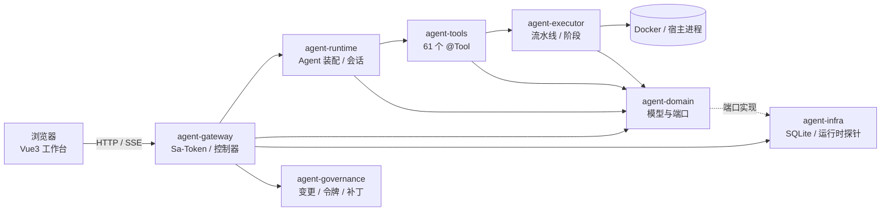

# 架构索引

> 本目录只放「图与边界」，详细类/函数说明在 [Code Wiki](../Code-Wiki.md)（唯一事实源，避免双份维护）。

## 1. 系统全景



## 2. 信任边界（最重要的四道线）

1. **模型只读默认**：生产会话注入 `readOnlyToolkit`，无任何写工具；
2. **写必经确认**：L2/L3 动作由平台层签发一次性令牌（见 [ADR-0005](../adr/0005-安全边界放在平台层.md)）；
3. **密钥只以引用形式流动**：`secret://` 解密仅发生在注入时刻，接口与工具只返回 `****`（见 [ADR-0003](../adr/0003-环境配置三层与环境模板.md)）；
4. **环境门控**：prod 的部署/配置变更需要更高确认等级，dev/test 的便利不延伸到生产。

## 3. 模块依赖（只允许向下）

```
gateway → runtime → tools → executor → domain
   ↘ infra ↗（实现 domain 端口）
governance → domain
```

由 `spec-checks` 的 ArchUnit 规则强制（A1 分层 / A2 domain 零框架 / A3 executor 无 LLM / A4 决策面无容器客户端），细节见[规约自动化检查](../规约自动化检查-v1.0.md)。

## 4. 关键运行链路

| 链路 | 入口 | 说明 |
|---|---|---|
| 对话 | `POST /api/v1/chat`（SSE） | 事件流 → 前端归约；运行落账本 |
| 工作区编排 | `POST /workspaces/{id}/super/stream` | 调度 Agent 只读答题 + 派发子会话 |
| 状态推送 | `GET /workspaces/{id}/events` | 聚合 SSE，断开才回退轮询（[ADR-0006](../adr/0006-工作区事件驱动与降级.md)） |
| 流水线 | `POST /ci/pipelines/{id}/run` | 预检 → 阶段执行 → 账本终态 |
| 缺陷修复 | `POST /bugfix/issues/{id}/fix` | 阶段流转 → 补丁提案 → 人工确认 |

## 5. 设计约束速查

- 新增引擎必须接运行账本（[ADR-0004](../adr/0004-统一运行账本而非重写编排.md)）；
- 新增写工具必须声明级别并接入 `ActionService` 门禁；
- 新增外部依赖若影响部署形态，先写 ADR；
- 前端不得绕过 `src/api/*` 直接拼 URL 发请求。
