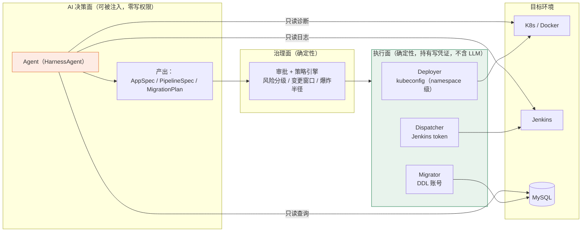
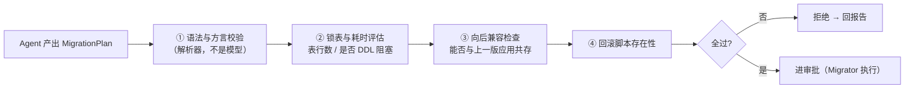
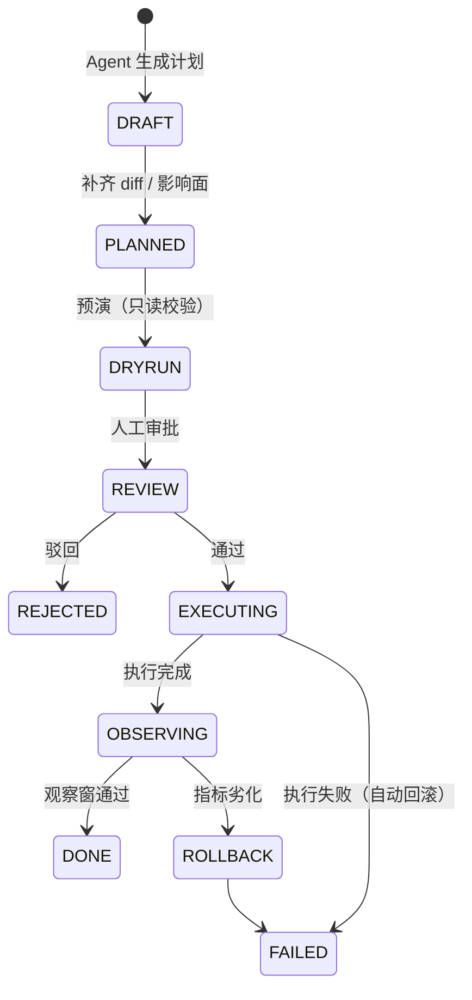

# 执行面设计：K8s / Jenkins / Flyway
## 「拥有类似能力」的三条路线与推荐方案

> 日期：2026-11-07 ｜ 前置：[v3 独立平台可行性分析](devops-agent-独立平台-可行性分析-v3.md)
> 你的要求：**不是调用现成工具，而是让平台"拥有类似的能力"** —— 管理容器、自动化 CI/CD、管理数据库迁移

---

## 0. 结论先行

**「拥有类似能力」有三种做法，三层引擎的正确答案完全不同：**

| 引擎 | ❌ 不要做 | ✅ 应该做 | 一句话理由 |
|---|---|---|---|
| **K8s / 容器** | 自研调度器、ReplicaSet、控制器循环 | **复用引擎（k3s 或 Docker API）+ 自建「意图层」** | 调度与状态收敛是十年工程，自研必然残缺且无人敢用 |
| **Jenkins / CI** | 重写执行器、插件体系、凭据管理 | **复用执行器 + 自建「Pipeline IR + 门禁」** | Jenkins 的价值在插件生态，重写等于从零种一片生态 |
| **Flyway / DB** | 自己发明迁移框架 | **嵌入 Flyway 库 + 自建「迁移治理」** | Flyway 核心只有几千行，但治理（回滚/审批/漂移）它不管，那才是你的价值 |

**最反直觉的一条**：三层里**收益最高、成本最低、风险最需要管**的是 **Flyway 这一层**。因为数据库变更**不可逆**，而恰恰是它最好做（8–12 人日）。

**最重要的一条架构原则**（贯穿全文）：**AI 决策面与确定性执行面必须分离——agent 不持有任何写凭证。**

---

## 1. 先厘清「拥有类似能力」的三种含义

| 层次 | 含义 | 例子 | 自研成本 | 建议 |
|---|---|---|---|---|
| **A. 自研引擎（reimplement）** | 自己实现调度、执行、状态机 | 写一个 mini-K8s；写一个 Jenkins | 120–200+ 人日，且要长期养 | ❌ 除极少数场景外不做 |
| **B. 控制面（own the control plane）** | 引擎做机械动作，**你拥有意图、策略、审批、审计、UX** | `AppSpec` + fabric8 → K8s | 8–20 人日 | ✅ **主路线** |
| **C. 适配层（port/adapter）** | 引擎可替换，你的 DSL 不变 | `PipelineSpec` → Jenkins 或 Tekton | +3–5 人日 | ✅ 与 B 一起做 |

**判断标准**：问一句「**这个能力的"难"在哪里**」——
- K8s 的难在**状态收敛与资源调度** → 别碰，用 B；
- Jenkins 的难在**执行器生态与凭据** → 别碰，用 B+C；
- Flyway 的难在**版本一致性与不可逆** → 一半可碰（治理），一半用 B。

---

## 2. 核心原则：AI 决策面 / 确定性执行面 分离

这是整个设计的地基。**如果 agent 自己拿着 kubeconfig、Jenkins token、DDL 账号，那么任何一次提示注入都等于生产事故。**



**三条硬规则**：

1. **agent 只持只读凭证**；写凭证只存在执行面的三个组件里，且组件**不接受自由文本命令**，只接受**结构化计划**（`AppSpec` / `PipelineSpec` / `MigrationPlan`）；
2. 计划必须经过 **plan → diff → dry-run → 审批** 才能执行；
3. 执行面**不调用 LLM**，纯确定性代码——这样"AI 出错"最多是"计划错了"，而不是"命令跑飞了"。

> 这条设计让「提示注入」的后果从"kubectl delete"降级为"生成了一份被拒绝的计划"。**收益远大于任何提示词工程。**

---

## 3. 容器编排层（K8s / Docker）

### 3.1 你们现在的真实形态（A 级，逐文件核实）

| 事实 | 出处 | 含义 |
|---|---|---|
| `docker-compose` 起 **ruoyi-server1 / ruoyi-server2** 两个副本 | `script/docker/docker-compose.yml` | 已经是"双活"，但不是编排 |
| nginx `upstream server { 127.0.0.1:8080; 127.0.0.1:8081; }` | `script/docker/nginx/conf/nginx.conf` | **单机、端口区分、轮询**，无主动健康检查 |
| compose 里**没有 `healthcheck`**、没有 `restart:` 策略 | 同上 | Docker 只认"进程活着"，**没有就绪门禁** |
| 配置 `include: '*'`，但 actuator 有 Basic Auth | `application.yml` + `SecurityConfig` | 已有可用的健康端点，只是没接进部署流程 |

**结论**：你们现在缺的**不是"容器管理"，而是"滚动里的就绪门禁与排空"**。这四个字（就绪、排空）就是 K8s 帮人省下的最值钱的部分。

### 3.2 三条路线对比

| | A. 自研 mini-K8s | B1. 迁移到 k3s / K8s | B2. 保持 compose + 窄控制器 |
|---|---|---|---|
| 能力完整度 | 永远缺一块 | 完整（滚动、探针、自愈、回滚） | 只覆盖你们的拓扑 |
| 工作量 | **120+ 人日**且持续维护 | **8–12 人日**（迁移 + 对接） | **15–20 人日** |
| 风险 | 高（自研调度器是事故源） | 中（迁移一次，之后生态成熟） | 低（不动现有拓扑） |
| 长期收益 | 负 | 高（镜像化、可复制、可上多环境） | 低（只解决当下） |
| 适用前提 | — | 允许引入 K8s（哪怕单节点 k3s） | **明确禁止 K8s**、或只有一台机器且短期不扩 |

**推荐**：
- 能上 K8s → **k3s 单机起步**（二进制 ~70MB，资源占用低），平台通过 fabric8 客户端对接；
- 不能上 → **B2 窄控制器**，但必须承认它是"**单机滚动部署器**"，不是编排器，并且把范围写死。

### 3.3 若走 B2：窄控制器必须实现的 6 个动作（缺一个就是事故）

```
1. preflight   取当前镜像 tag 存档（回滚锚点）+ 确认另一副本健康
2. pull        预拉镜像（失败则中止，不进入排空）
3. drain       nginx upstream 摘除该端口 → `nginx -s reload` → 等待 in-flight 连接排空（sleep 或看 access log）
4. swap        docker stop/rm 旧容器 → docker run 新镜像（复用 volume/network/env）
5. verify      /actuator/health = UP + 冒烟请求（登录接口 + 一个业务只读接口）
6. rollback    任何一步失败 → 用存档 tag 反向执行 2–5
```

**硬约束**：
- 同一时刻只允许一个部署（分布式锁）；
- 双副本时 `maxUnavailable = 0`（先起新的，再停旧的）；
- **必须有变更窗口**（避免业务高峰）；
- 6 个动作**逐步落审计**（每步一行记录，含耗时与输出摘要）。

> 这套东西大约 500 行 Java + 一份 nginx 模板，可测、可审计。**它是"窄"的：不调度、不扩缩容、不跨主机。**

### 3.4 若走 B1：K8s 侧的权限设计（这里最容易出事）

| 项 | 做法 | 原因 |
|---|---|---|
| RBAC | Deployer 用 **namespace 级 Role**：`get/list/watch` + `patch`（只对 `deployments`）+ `get pods`；**不给 `create pods`、不给 `secrets`、不给 `exec`** | 有 `create pods` 就能起特权 Pod 逃逸到节点 |
| agent 只读 | 单独 ServiceAccount：`get/list/watch`（pods/deployments/events/logs） | 诊断够用，改不了 |
| 沙箱隔离 | **agent 沙箱与业务 workload 不同 namespace** + `NetworkPolicy` 默认拒绝 | 沙箱跑的是 AI 生成的代码 |
| 资源 | 沙箱 namespace 设 `ResourceQuota` + `LimitRange` | 防止 agent 把集群吃满 |
| 变更 | `maxUnavailable: 0`、`maxSurge: 1`、`readinessProbe` 指 `/actuator/health` | 零停机滚动 |

> 顺带一个协同点：**AgentScope 的 K8s 沙箱后端本身就用 fabric8 `kubernetes-client`**（core 依赖里已有）。同一套客户端可以既管沙箱、又管业务 workload——但**必须两套 RBAC、两个 namespace**，不能图省事共用一个 ServiceAccount。

---

## 4. CI/CD 层（Jenkins）

### 4.1 为什么不能"重写 Jenkins"

Jenkins 的价值不在"跑 shell"，而在：**凭据绑定（Credentials Binding）、构建代理动态供给、制品归档、数千个插件、以及团队已有的肌肉记忆**。重写执行器 = 从零种一片生态，且第一个月就会遇到"某个插件的行为我们没实现"。

### 4.2 你真正该拥有的资产：**Pipeline IR**

不要生成 Jenkinsfile，也不要让 agent 拼 shell。定义一层内部表示：

```yaml
# PipelineSpec（平台自有，引擎无关）
id: ruoyi-server-release
params:                      # 只允许枚举/白名单，禁止自由文本
  env:        { type: enum, values: [dev, test, staging, prod] }
  image_tag:  { type: imageTag }        # 正则校验
  db_migrate: { type: bool, default: false }
stages:
  - id: build
    steps: [ "mvn -B -DskipTests package", "docker build -t ${image_tag} ." ]
  - id: verify
    steps: [ "mvn -B test", "trivy image ${image_tag}" ]
  - id: publish
    steps: [ "docker push ${image_tag}" ]
artifacts: [ "${image_tag}" ]
gates:                        # 门禁是 IR 的一部分，不是流水线里的 if
  - require: [ "verify.passed", "no_high_vuln" ]
```

**收益**：Jenkins 只是其中一种执行器；换成 Tekton/Argo/JGitLab CI 时，你的 IR、门禁、审计、UI 都不动。

### 4.3 Jenkins 对接的五个坑（都会真的踩到）

| # | 坑 | 表现 | 解法 |
|---|---|---|---|
| 1 | **CSRF Crumb** | 直接 POST 触发接口返回 403 | 先 `GET /crumbIssuer/api/json`，把 `crumbRequestField:crumb` 加进请求头 |
| 2 | **两段式轮询** | 触发后拿到的是 `queue/item/{id}`，不是 build number | 轮询 `queue/item/{id}/api/json` 拿 `executable.number`，再轮询 `job/{n}/api/json` 看 `building:false` |
| 3 | **consoleText 巨大且含源码** | 一次拉几十 MB，且是**提示注入面** | 只拉增量（`/consoleText` + `start` 偏移）→ **结构化解析**（阶段/耗时/失败原因）→ 只把摘要给模型 |
| 4 | **参数注入 = RCE** | 若 Job 里有 `sh "deploy.sh ${PARAM}"`，agent 传的任意字符串就是命令 | **只允许枚举/正则约束的参数**；禁止把 agent 输入插进 shell；Job 侧用 `env` 而非字符串拼接 |
| 5 | **Jenkins 重启会打断构建** | 平台侧误判为"构建失败"，触发无意义重试 | 区分 `ABORTED` / `NOT_BUILT` / 连接失败，重试策略单独设计 |

**红线**：**agent 永远不能修改流水线定义**（`Jenkinsfile`、Job 配置）。门禁是 IR 的一部分，由平台注入，不由 agent 生成。

### 4.4 什么时候该换掉 Jenkins

| 信号 | 含义 | 换什么 |
|---|---|---|
| 构建排队严重、代理静态且难扩 | 执行器弹性不足 | Tekton / Argo Workflows / K8s 动态 agent |
| 流水线定义散落上百个 Job，无法 code review | 治理失效 | Jenkinsfile-as-code → 再迁 Tekton |
| agent 需要"每次任务一个干净环境" | Jenkins 的 workspace 复用是负担 | 一次性 Pod（K8s 动态 agent / Tekton TaskRun） |

> 只要还满足"稳定、能跑、团队熟"，**就先别换**——把 IR 做好，换的时候是配置改动，不是重写。

---

## 5. 数据库层（Flyway）

### 5.1 你们现在的迁移约定（A 级证据）

| 现状 | 说明 |
|---|---|
| 全仓 **无 Flyway / Liquibase 依赖** | 迁移是手工的 |
| `script/sql/ry_vue.sql`、`ry_job.sql`、`ry_ai.sql`、`ry_workflow.sql` | 初始化脚本（按模块拆） |
| `script/sql/update/update_6.0.0-6.1.0.sql` | **升级脚本，命名即版本区间** |

> 这其实已经是一套**事实上的迁移约定**：`update_<from>-<to>.sql`。引入 Flyway 不是"换体系"，而是**把约定形式化**：`V6_1_0__update_from_6_0_0.sql`。

### 5.2 嵌入 Flyway（推荐）而不是自研

| 维度 | 嵌入 Flyway | 自研 |
|---|---|---|
| 工作量 | 8–12 人日（含治理） | 20–30 人日 |
| 版本表与校验和 | 现成（`flyway_schema_history`） | 自己设计（很容易漏校验和） |
| 多数据库 | MySQL/PG/Oracle/SQLServer 模块现成 | 每种自己适配 |
| 基线（已有库接入） | `baseline` 现成 | 自己写 |
| 许可 | Apache-2.0 核心 | — |
| **它不做的** | **回滚、漂移检测、审批、影响评估** | ← **这才是你的价值** |

**关键实现细节（做错会直接出事）**：

1. **不要在应用启动时迁移**。Spring Boot 的 Flyway 自动配置会在**每个副本启动时**跑迁移——双副本 = 并发迁移 = 锁冲突甚至脏状态。**必须关掉应用内的 flyway 自动配置，迁移由独立的 Migrator 组件执行**；
2. **Flyway 有锁表**（`flyway_schema_history` 的锁），但 **MySQL 的 DDL 不吃事务**：一条失败的 `ALTER` 可能留下半截状态 → 每个迁移文件都要写「**失败后如何人工恢复**」；
3. **已应用的迁移永不修改**（校验和会变，`validate` 直接失败）——只能新增；
4. **基线**：用 `baselineVersion=6.1.0` 接管存量库，别让 Flyway 从 V1 重放 30 个历史脚本。

### 5.3 Flyway OSS **没有 undo** —— 回滚是纪律问题，不是工具问题

Flyway 社区版只有 forward。所以平台必须强制：

| 规则 | 做法 |
|---|---|
| 高风险迁移必须配回滚脚本 | 同目录 `U6_1_0__rollback.sql`（Flyway 不认，但你的 Migrator 认）；**没有回滚脚本 → 拒绝提交审批** |
| 不可回滚的变更单独标记 | 如 `DROP COLUMN`、`MODIFY TYPE` → 风险级直接判"禁止自动执行"，只出方案 |
| 迁移前自动备份 | 至少 `mysqldump --no-data` + 目标表数据备份；大表用 `pt-archiver` 类工具 |
| 记录"已执行到哪一版" | 平台侧存 `schema_version` 快照，与 `flyway_schema_history` 对账 |

### 5.4 双副本 + 零停机：必须用 expand-contract（这是最容易出事故的地方）

假设你要把 `user_name` 改名为 `username`，并且有两个副本在跑。**直接 `ALTER ... RENAME COLUMN` 会让旧代码在新库上立刻报错**。正确做法是分三次发布：

| 发布 | 数据库 | 应用 | 兼容性 |
|---|---|---|---|
| N | `ADD COLUMN username`（可空） | 双写：同时写 `user_name` 与 `username` | 旧代码仍可跑 |
| N+1 | 回填 `username`；`ADD INDEX` | 读改用 `username` | 旧代码仍可跑（还不删旧列） |
| N+2 | `DROP COLUMN user_name` | — | 此时旧代码已不存在 |

**通用规则**：**任何迁移都必须与"上一个版本的应用"兼容**——因为滚动发布期间，两个版本同时在跑。

> 这条规则直接决定了「自动修复」里能不能让 agent 改 schema：**能，但只能做 expand 类变更；contract 类必须单独一次发布，且人工审。**

### 5.5 漂移检测（Drift）：Flyway 不管，但这才是运维最痛的

- `flyway validate` 只能校验**迁移文件**与**历史表**，**不能发现"有人手工改了生产库"**；
- 平台应做：`information_schema` 快照 vs 期望 schema 的**结构 diff**（表/列/索引/字符集），发现漂移就告警；
- 这是"AI 巡检"里价值很高的一条：**「生产库和代码库不一致」是排查故障时的常见死因**。

### 5.6 AI 生成迁移脚本的四道机器检查（缺一不可）



- **①** 用真正的 SQL 解析器（MyBatis-Plus 生态里已有 JSqlParser；RuoYi-Vue-Plus 就在用）校验，**不要用模型自评**；
- **②** `ALTER` 在大表上可能锁表数分钟——必须给出预估并限制在变更窗口内；
- **③** 见 5.4，**这是拒绝率最高的一道**；
- **④** 见 5.3。

---

## 6. 三者统一：变更编排（Change Orchestrator）

### 6.1 为什么要统一

K8s 发布、Jenkins 构建、Flyway 迁移，**本质都是"变更"**，都要：计划 → 预演 → 审批 → 执行 → 观察 → 回滚。做成三个独立功能会有三套审批、三套审计、三种状态机——最后没人说得清"这次发布到底做了什么"。

**统一成一个变更单（Change）**，三个引擎是三种 executor：



### 6.2 执行顺序矩阵（这张表能避免大多数事故）

| 变更组合 | 执行顺序 | 回滚顺序 | 备注 |
|---|---|---|---|
| 仅代码 | app | app（旧镜像） | 最简单 |
| 代码 + expand 迁移 | **DB → app** | app → 保留新列 | 迁移必须向后兼容 |
| 代码 + contract 迁移 | **分两次发布** | contract 不可回滚 | 先发 N（停用旧列），再发 N+1（删列） |
| 仅配置 | 备份 → 改 → reload → 验证 | 恢复备份 | nginx/环境变量 |
| 配置 + 代码 | 配置先（向后兼容）→ app | app → 配置 | 新配置旧代码要能忽略 |
| 依赖大版本升级 | 单独一次，独立窗口 | 回滚镜像 | 不与其他变更混 |

### 6.3 观测窗（这是"自动化"与"自动惹祸"的分界线）

执行完成后**不能立刻算成功**，要有一个观察窗（如 10 分钟）：
- 错误率、P99、`/actuator/health`、关键业务接口成功率；
- 任一劣化超阈值 → **自动触发回滚**（不需要人）；
- 观察窗内 agent **只读**，不许再改。

---

### 6.4 执行面的工具面（agent 能看到的只有这些）

| 工具 | 入参（**结构化**，非自由文本） | 级别 | 备注 |
|---|---|---|---|
| `k8s_status` / `k8s_events` | namespace / workload | L0 | 只读诊断 |
| `container_logs` | 服务名 / 时间窗 / 行数 | L0 | 返回**结构化摘要**，非原始全量 |
| `ci_run` | `pipeline_id` + 枚举参数 | L2 | 只触发，不改定义 |
| `ci_status` / `ci_log_digest` | `run_id` | L0 | 归一化为 `BuildResult` |
| `plan_release` | `AppSpec` | L1 | 产出计划 + diff + 影响面 |
| `apply_release` | `plan_id` + `approval_id` | **L3** | 由 Deployer 执行，agent 不持凭证 |
| `db_plan_migration` | `MigrationPlan` | L1 | 产出前向/回滚脚本 + 影响评估 |
| `db_apply_migration` | `plan_id` + `approval_id` | **L3**（仅 expand 类） | 由 Migrator 执行 |
| `db_drift_check` | schema 名 | L0 | 结构 diff 报告 |

> 注意：**没有 `shell`、没有 `kubectl`、没有 `psql`**。agent 拿不到命令通道，这是设计出来的，不是漏掉的。

---

## 7. 能力矩阵：自建 vs 复用（含成本估算，D 级）

| 能力 | 自建 | 复用 | 采用 | 估算 |
|---|---|---|---|---|
| Pod/容器调度 | 极高 | K8s / k3s | **复用** | 8–12 人日（接入） |
| 单机滚动重启 | 中 | Docker Engine API | **自建窄控制器** | 15–20 人日 |
| 服务发现/负载 | 中 | nginx / K8s Service | **复用** | 2–3 人日（显式 `max_fails`/`fail_timeout` + 主动探测） |
| 健康与就绪 | 低 | actuator `/health` | **自建探针封装** | 2–3 人日 |
| 流水线执行 | 极高 | Jenkins | **复用** | 5–8 人日（对接） |
| 流水线语义/门禁 | 中 | — | **自建 IR** | 8–12 人日 |
| 制品与缓存 | 中 | Harbor + Nexus | **复用** | 3–5 人日 |
| 迁移执行 | 低 | Flyway lib | **嵌入** | 3–5 人日 |
| 迁移治理（回滚/漂移/审批） | 中 | — | **自建** | 8–12 人日 |
| 凭据 | 高 | Vault / K8s Secret / Jenkins Credentials | **复用** | 3–5 人日 |
| 审批与审计 | 中 | — | **自建**（v3 已有） | 已在 P1 预算内 |
| 变更编排 | 中 | — | **自建** | 10–15 人日 |

**合计（执行面）**：约 **55–80 人日**，可分三期投入。

---

## 8. 红线清单（每个引擎都有"一票否决"项）

| 引擎 | 红线 |
|---|---|
| **K8s** | 不给 `create pods` / `secrets` / `exec` ；沙箱与业务不同 namespace + NetworkPolicy；不允 agent 改 CRD/Operator |
| **Jenkins** | 不允许改流水线定义与 Job 配置；参数只允许枚举/正则；禁止把 agent 输入拼进 shell；不允许 agent 拿 Jenkins 管理员 token |
| **Flyway** | agent **不持有 DDL 账号**；`DROP`/`MODIFY` 类变更不自动执行；无回滚脚本不批；不允许应用启动时自动迁移 |
| **共性** | 生产 L3 必须审批 + 观察窗 + 一键回滚；一次变更只做一类事；所有执行步骤逐步审计；执行面不调用 LLM |

---

## 9. 分期落地（与 v3 路线图融合）

| 期 | 内容 | 交付 | 人日 |
|---|---|---|---|
| **P2-a** | Flyway 治理（最高性价比） | 迁移计划 IR + 4 道检查 + 回滚脚本纪律 + 漂移检测 | 10–15 |
| **P2-b** | Jenkins 对接 + IR | 触发/轮询/日志结构化 + 门禁注入 + 参数白名单 | 10–15 |
| **P2-c** | 容器滚动部署 | k3s 接入（或窄控制器）+ 就绪门禁 + 排空 + 回滚 | 15–20 |
| **P3** | 变更编排器 | 统一变更单 + 顺序矩阵 + 观察窗 + 自动回滚 | 10–15 |

**为什么 Flyway 排第一**：
1. 成本最低（10–15 人日）；
2. **风险最高**（不可逆）——治理缺位时，一次误操作就是数据事故；
3. 收益立刻可见（「这次发布的迁移安全吗」是每次发布都会被问的问题）；
4. 它是 agent **唯一不该持有凭证**的领域，做成模板后其他两层照抄。

---

## 10. 结论

| 问题 | 答案 |
|---|---|
| 要不要自研 K8s？ | **不要**。要么 k3s/K8s（8–12 人日），要么写一个 500 行的"单机滚动部署器"（15–20 人日） |
| 要不要重写 Jenkins？ | **不要**。自建 Pipeline IR + 适配器（10–15 人日），Jenkins 只当执行器 |
| 要不要自研 Flyway？ | **不要造轮子，但要造治理**。嵌入 Flyway 库（3–5 人日）+ 自建治理（8–12 人日） |
| 「拥有类似能力」到底是什么 | **拥有语义与治理（意图、计划、审批、审计、回滚），复用执行引擎** |
| 最关键的架构决策 | **AI 不持有任何写凭证**；执行面是确定性代码，只吃结构化计划 |
| 最容易被低估 | **执行顺序**（DB→app）与**向后兼容**（expand-contract）；以及 nginx 没有健康检查这件事 |

> 最后一句：这三个集成的技术难度都不高，**难在"谁有权让它发生"**。把权限、顺序、回滚这三件事写进代码，剩下的都是配置。
