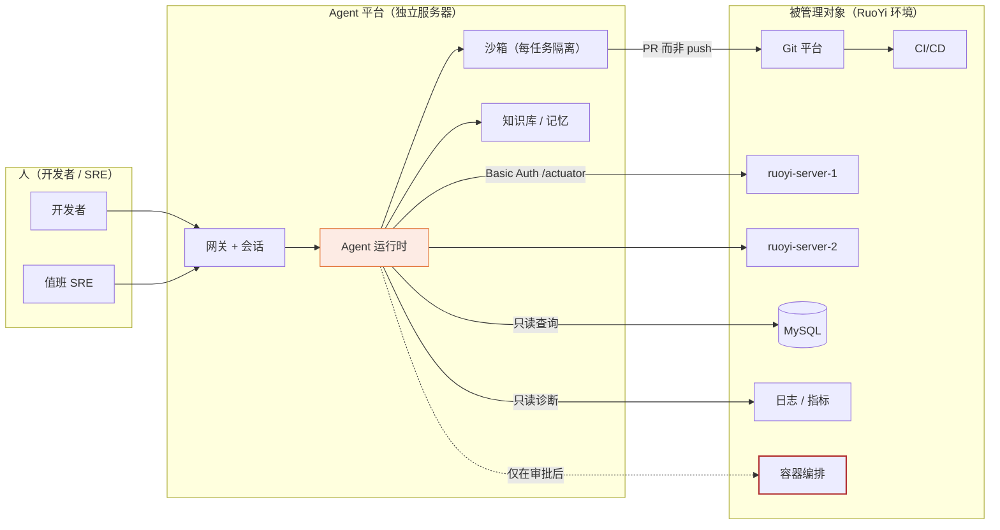
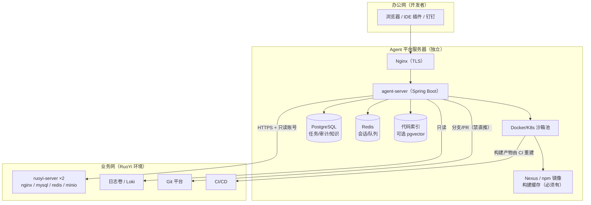
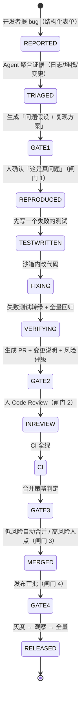
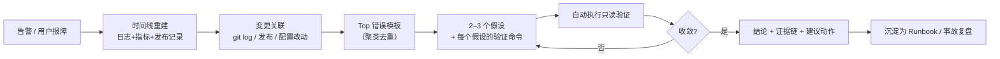
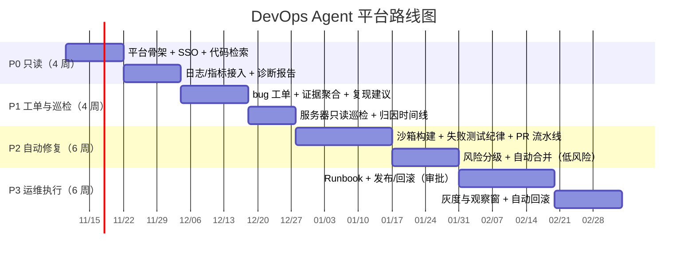

# 独立研发运维智能体平台（DevOps Agent）
## 可行性、架构与风险分析（v3）

> 日期：2026-11-07 ｜ 形态：**AgentScope Java 独立服务**，内网部署、与 RuoYi-Vue 业务服务器分离
> 服务对象：**开发人员 / 运维人员**（不是业务用户）
> 前两版：[嵌入式模块 v1（RuoYi 4.8.3）](ruoyi-agent-可行性分析与市场调研.md)、[嵌入式模块 v2（Vue-Plus 6.1.0）](ruoyi-vue-plus-agent-可行性分析-v2.md)

---

## 0. 先纠正一个前提：这不是同一类产品

前三版讨论的是「**AI 帮业务人员操作后台**」；这一版是「**AI 帮工程师改代码、修故障、管服务器**」。两者除了都用 AgentScope，几乎没有共用部分：

| 维度 | 前两版（嵌入模块） | 本版（独立平台） |
|---|---|---|
| 部署位置 | 与业务同进程 | **独立服务器，跨机访问** |
| 身份来源 | 继承登录用户的 `perms` / `dataScope` | **平台自己的账号 + 一组服务凭证** |
| 输出物 | 一条改好的业务数据 | **一个 PR / 一次发布 / 一份诊断报告** |
| 失败代价 | 数据改错（可回滚） | **生产事故、代码污染、数据泄露** |
| 权限模型 | 复用 RuoYi 的 RBAC | **要自己设计一套"能力 × 环境 × 审批"模型** |
| 核心难点 | 权限对齐 | **高权限 + 不可逆操作的治理** |

**一句话定性**：你正在建的不是「AI 助手」，而是一个**高权限自动化操作平台**，它的成败取决于**治理设计**，不是模型能力。

### 0.1 与前两版的关系：三选一，不要三线并行

| | v1 嵌入（4.8.3） | v2 嵌入（Vue-Plus） | **v3 独立平台（本文）** |
|---|---|---|---|
| 用户 | 业务人员 | 业务人员 | **开发者 / SRE** |
| 价值证明 | 老板看得见 | 老板看得见 | **工程师体感强、可量化** |
| 上线速度 | 6–8 周 | 5–6 周 | **4 周（只读版）** |
| 风险 | 数据被改错 | 数据被改错 | **生产事故 / 代码污染** |
| 可复制性 | 每客户都要配工具 | 同左 | **一份平台服务所有项目** |
| 团队要求 | 懂业务 + 懂权限 | 同左 | **懂研发流程 + 懂运维** |

**建议**：如果团队 ≤ 3 人，**只做 v3**。理由：
1. v3 的产出（修 bug、定位问题）**天然可量化**，ROI 好算；
2. v2 需要逐个客户配工具目录，是**交付型生意**；v3 是**平台型资产**，一次投入长期复用；
3. v2 的"业务人员用 AI 改数据"在多数企业里要过很长的合规审批，v3 只影响研发侧，阻力小得多。

保留 v2 的唯一理由：需要一个**给非技术领导看的演示**。若有此需求，用 2 周做一个只读问答 demo 即可，不要投入 P1。

---

## 1. 需求拆解：六个场景，价值与风险完全不对称

| # | 你的描述 | 能力域 | 价值 | 风险 | 建议排期 |
|---|---|---|---|---|---|
| 1 | 辅助开发 | 代码理解 / 生成 / 解释 | ★★★★★ | ★ | **P0** |
| 2 | 监测数据、分析问题 | 可观测 + 归因 | ★★★★☆ | ★★ | **P0** |
| 3 | 在平台上提 bug，自动检测追踪问题 | 工单 + 证据聚合 | ★★★★☆ | ★★ | **P1** |
| 4 | 另起分支解决后自动 CI/CD | 自主修复流水线 | ★★★☆☆ | ★★★★★ | **P2（严格门禁）** |
| 5 | AI 自动化运维（发布/重启/配置/迁移） | 变更执行 | ★★★★☆ | ★★★★★ | **P3（生产只做建议）** |
| 6 | 管理 RuoYi-Vue 服务器 | 资产/部署/巡检 | ★★★☆☆ | ★★★★ | **P1（只读巡检）** |

**排序原则**：先做「读」，再做「写」；先在「开发/测试环境」做写，再谈生产；先把「建议」做准，再让「执行」自动化。

> 反直觉但重要：**第 4 项（自动修复）价值不如第 3 项（把问题定位清楚）**。工程师 80% 的时间花在「这是什么问题、在哪」，不是「敲那几行修复代码」。把 P1 做扎实，比做一个花哨的自动修复更能提效。

---

## 2. 核心判断：安全模型决定生死

### 2.1 信任边界（这个图画错，后面全错）



**关键点**：
- 平台是**一个高权限主体**，它对所有被管对象持有的凭证，等于「一个能改代码、能查库、能重启服务、能读日志的超级账号」；
- 人（开发者）只是「发起者」，**必须能回答"这条命令是谁让它跑的"**——所有工具调用都要带 `operator`（人），不能只有 `service account`；
- **虚线是红线**：编排层（K8s/主机）的写操作必须走审批，且默认关闭。

### 2.2 能力分级（L0–L3），按级授予，不按人授予

| 级别 | 定义 | 允许的环境 | 典型动作 | 审批 |
|---|---|---|---|---|
| **L0 观察** | 只读，无副作用 | 全部（含生产） | 读日志/指标/代码/库/配置 | 不需要 |
| **L1 建议** | 产出方案，人来执行 | 全部 | 生成补丁、诊断报告、变更步骤 | 不需要（但要留痕） |
| **L2 执行（隔离环境）** | 真执行，但不碰生产 | 开发 / 测试 / 沙箱 | 建分支、跑测试、部署测试环境、改测试库 | 不需要或轻审 |
| **L3 执行（生产）** | 真执行，影响用户 | 预发 / 生产 | 发布、回滚、改配置、跑迁移 | **必须人审 + 双人复核 + 变更窗口** |

**硬规则**：
1. **L3 在 6 个月内不由 agent 独立执行**——即使有审批，也先做成「agent 执行、人盯着、可一键中断」的模式；
2. **删除类操作永不进 L3**（删表、删分支、删数据、缩容到 0）；
3. **数据库变更（DDL/DML）永远不是 L3**，最多 L1（出脚本 + 人执行）。

### 2.3 凭证矩阵：一个能力一套凭证

这是最容易被做错的地方。**不要用一个万能 token**：

| 能力 | 凭证 | 权限范围 | 可吊销粒度 |
|---|---|---|---|
| 读代码 | Git 只读 token | 指定仓库 read | 单仓库 |
| 建分支 / PR | Git 写 token（**禁 push main**，用分支保护强制） | 指定仓库 write | 单仓库 |
| 触发 CI | CI 触发 token | 指定流水线 | 单流水线 |
| 读日志 | 日志系统 read（Loki/ES）或只读卷挂载 | 指定 namespace | 单环境 |
| 读指标 | actuator Basic Auth（**RuoYi 已内建**，见 §6.1） | 全部只读端点 | 单实例 |
| 读库 | **只读账号 + 只读从库优先** | 白名单库/表，禁 `information_schema` 之外元数据外泄 | 单库 |
| 发布 / 重启 | 编排层（K8s RBAC 或 SSH key） | 指定 workload | **建议默认不发放** |

> 审计要求：每条工具调用记录 `operator / credential_id / tool / params_hash / result / 时间`。**凭证可单独吊销**是事故止血的第一手段。

---

## 3. 系统架构

### 3.1 部署拓扑（与 RuoYi 分离）



**四个部署细节，不注意会返工**：

| 细节 | 说明 | 后果 |
|---|---|---|
| **网络单向可控** | 平台 → 业务网允许；业务网 → 平台不允许（除回调） | 否则平台的漏洞可直接打业务库 |
| **构建缓存必须前置** | Maven/Nexus + npm 镜像 + Docker layer cache | 否则每次 agent 构建 5–10 分钟，体验与成本双崩 |
| **沙箱与主机隔离** | 代码执行在容器内，禁 `--privileged`，禁挂宿主 docker.sock | 否则一次注入就能拿到宿主机 |
| **平台自身要独立监控** | 平台挂了谁发现？自身进 Prometheus + 告警 + 死信队列 | 「谁看住看门人」 |

### 3.2 服务内部分层

```
agent-server/
├── gateway/      认证（OIDC/LDAP）、会话、SSE/WebSocket、限流、审计入口
├── runtime/      AgentFactory（ReActAgent / HarnessAgent）、模型路由、预算控制
├── tools/        适配器：git · ci · k8s · ssh · sql · logs · metrics · ruoyi-api · http
├── sandbox/      Workspace 管理、容器生命周期、构建缓存挂载、产物收集
├── knowledge/    代码索引、Runbook（Skill）、事故复盘、历史工单
├── domain/       task / run / step / artifact / approval / incident
└── console/      Web 控制台（任务看板、运行详情、审批、知识库）
```

**用 AgentScope 的哪些能力（对应关系）**

| 需求 | AgentScope 能力 | 备注 |
|---|---|---|
| 长任务、跨小时 | `HarnessAgent` + `Workspace` + `SessionLog`（可恢复） | 修 bug 常常跨小时 |
| 跑构建/测试 | `Workspace` + `Sandbox`（Docker / K8s 后端） | **必须用沙箱，不能用 local** |
| 多角色协作 | `agent_spawn` / `agent_send`（子 Agent） | 复现者 / 修复者 / 评审者 |
| 团队规范沉淀 | `FileSystemSkillRepository`（`SKILL.md`） | RuoYi 仓库已有现成 skill，见 §4.2 |
| 工具治理 | `Toolkit` + `ToolGroup` + `ToolCallInterceptor` + `PermissionRule` | 能力按环境分组 |
| 人工审批 | `ASK` → `RequireUserConfirmEvent` → `ConfirmResult` | 对应 L3 |
| 实时进度 | 32 类事件 → SSE 推前端 | 前端要能看"它在干什么" |
| 对外集成 | MCP client / A2A | 接 Git、CI、监控的 MCP server |

### 3.3 工具目录（建议 v1，含风险等级）

| 工具 | 输入 | 级别 | 说明 |
|---|---|---|---|
| `code_search` | 关键词 / 正则 / 路径 | L0 | ripgrep 优先，**不要一上来做向量检索** |
| `code_read` | 文件:行范围 | L0 | 带行号返回，便于引用 |
| `code_symbols` | 符号名 | L0 | tree-sitter 解析（AgentScope core 已带 tree-sitter，Java 语法包需另加） |
| `git_log` / `git_diff` | 仓库/分支/时间 | L0 | 变更关联的核心数据 |
| `git_blame` | 文件:行 | L0 | 「这行谁改的」高频问题 |
| `db_query` | SQL（只读账号） | L0 | 强制 `SELECT` + `LIMIT`，禁 DML |
| `log_query` | 服务/时间窗/关键词 | L0 | 结构化解析后再给模型 |
| `metrics_query` | 指标名/区间 | L0 | actuator 或 Prometheus |
| `issue_create` | 标题/复现/证据 | L1 | 落到 Git 平台 Issue |
| `branch_create` | 任务 ID | L2 | 命名规范 `ai/<task>-<slug>` |
| `patch_apply` | 沙箱内 diff | L2 | **只在沙箱里打** |
| `test_run` | 模块/用例 | L2 | 沙箱内 |
| `pr_create` | 分支/base/说明 | L2 | 唯一对外出口 |
| `ci_trigger` / `ci_status` | 流水线 ID | L2 | 只触发与观察，不改流水线定义 |
| `deploy` | 环境/镜像 tag | **L3** | 默认关闭，审批后可用 |
| `restart` | workload | **L3** | 同上 |
| `sql_migrate` | 脚本 | **L1** | **只生成，不执行** |
| `config_backup` / `config_restore` | 路径 | L2/L3 | 变更前自动备份是硬性要求 |

---

## 4. 场景一：辅助开发（P0，最快见效）

### 4.1 代码理解：先做「精确检索」，别急着做向量
- 开发者的真实问题分布：**「这功能在哪实现」60%、「为什么这么写」20%、「怎么改」20%**；
- ripgrep + 文件树 + 符号表就能覆盖 60%，**便宜、确定、可引用**；向量检索在「跨模块语义」上才补位；
- 输出必须**带 `文件:行号`**，让工程师一点就能跳转（这是可信度的来源）。

### 4.2 规范注入：RuoYi-Vue-Plus 仓库已经把作业写好了

仓库里现成有（**A 级证据**）：

| 资产 | 内容 | 用法 |
|---|---|---|
| `.codex/skills/ruoyi-plus-ai-coding/SKILL.md` | 触发条件、**反例清单**、6 步流程、已有能力检索要求 | 直接作为 AgentScope Skill 挂载 |
| `references/backend.md` / `frontend.md` / `examples.md` | 分层约定、数据权限、缓存、翻译、JSON 增强 | 同上 |
| `.claude/agents/backend-*.md`（6 个） | CRUD / 工程规范 / JavaDoc / 查询权限 / 公共基础设施 / 模块增强 | 拆成子 Agent 的角色定义 |

> **这是本项目最大的杠杆**：别人做「AI 写代码」要从零教模型你们的约定，你们已经把约定写成了 Markdown。**P0 只要把目录挂上去，代码质量就会明显不同。**

### 4.3 会话与上下文
- 一个任务 = 一个 `Workspace`（git worktree 隔离），不要共用目录；
- 会话要能**跨天恢复**（`SessionLog`），因为「上午看一半的问题下午接着看」是常态；
- 上下文压缩（compaction）要开，否则大仓库很快撑爆窗口。

---

## 5. 场景二：Bug → 修复 → CI/CD（最难的一环）

### 5.1 状态机：四道人工闸门，缺一不可



**四道闸门的作用不同，不能合并**：

| 闸门 | 回答什么问题 | 谁 |
|---|---|---|
| G1 复现确认 | 「这是真问题吗」 | 提单人 / 模块负责人 |
| G2 代码评审 | 「改得对吗」 | 模块负责人 |
| G3 合并策略 | 「现在能合吗」 | 规则引擎（低风险）/ 人（高风险） |
| G4 发布审批 | 「现在能发吗」 | 值班 SRE |

### 5.2 核心纪律：**先写失败测试，再改代码**

这条决定了整个功能是否可信：

- 没有失败测试 → agent 的"修复"无法被证明，CI 绿也可能是假绿；
- 有失败测试 → 「修好了」有客观判据，且测试会变成长期回归资产；
- **如果问题无法写出测试**（性能、并发、界面），则降级为 L1（只出方案），不进入自动修复。

> **推论（重要）**：**AI 自动修复的上限 = 你们的测试覆盖度**。而 RuoYi 系项目的测试是结构性薄弱的——`ruoyi-gen` 的 20 个生成模板里**没有一个测试模板**（`fm/` 下只有 `bo/controller/domain/mapper/service/serviceImpl/vo` + 前端 + 4 种 SQL，A 级核实），也就是说**新模块从生成那一刻起就没有单测**。
>
> 所以正确顺序是：**P1 先做「测试补全助手」**（给已有模块补单测）→ 覆盖度上来后，P2 的自动修复才有意义。跳过这一步去做自动修复，产出的会是"看起来对、实际错"的补丁，比不做更危险。

### 5.3 自动合并的风险分级（不要一刀切）

| 风险级 | 判定特征 | 合并策略 |
|---|---|---|
| **低** | 仅文档 / 注释 / 测试代码 / 格式化 / 依赖 patch 升级 | 全绿后**可自动合并** |
| **中** | 单文件逻辑修改，影响面可静态分析，已有测试覆盖 | 需 1 人 approve（可加急） |
| **高** | 跨模块 / 公共组件 / 权限 / 事务 / 数据模型 / SQL | 需 2 人 approve + 模块 owner |
| **禁止** | 流水线定义、安全配置、依赖大版本升级、数据库迁移 | **不进自动流水线** |

> 判定靠**路径与规则**（改到哪些文件、是否碰 `pom.xml`/`*.sql`/`security/`），不靠模型自评——模型自评风险等级是已知不可靠的。

### 5.4 失败与回滚
- 每个 mutating 动作都要有 **rollback recipe**：改配置前备份原文件、发布前记录上一版镜像 tag、迁移前做快照；
- agent 连续 3 轮修不好 → **自动停手并输出「已排除的假设」**（这比继续烧钱更有价值）；
- 沙箱超时/失败 → 保留工作区 24h 供人接管（`Workspace` 快照）。

### 5.5 度量（没有这四个数，这个功能无法立项）

| 指标 | 口径 | 目标（P2 结束时） |
|---|---|---|
| 问题定位准确率 | 人工确认「定位到正确文件/模块」的比例 | ≥ 70% |
| 首次修复成功率 | PR 未被打回修改即合并的比例 | ≥ 40% |
| PR 接受率（含改） | 最终被合并的比例 | ≥ 60% |
| 单任务成本 | token + 构建时间（折算） | ≤ 阈值 |
| 平均定位时长 | 提单 → 定位结论 | 下降 ≥ 50% |

---

## 6. 场景三：监控与 AIOps

### 6.1 数据面：RuoYi-Vue-Plus 实际能给什么（A 级，逐项核实）

| 数据源 | 现状 | agent 怎么用 |
|---|---|---|
| **actuator** | 已开启且 `include: '*'`（health/metrics/loggers/threaddump/heapdump…），**用 Basic Auth 保护**（`SecurityConfig` 里 `SaHttpBasicUtil`，账号取 `spring.boot.admin.client.*`） | 只读拉取；**`/actuator/loggers` 可在运行时改日志级别**——排障神器，也是提权面 |
| **日志** | logback 输出到 `./logs/sys-console.log` / `sys-info.log` / `sys-error.log`（滚动 + 异步） | **容器内文件 → 必须挂卷或接 Loki**，否则只能 SSH 进去读 |
| **业务审计** | `sys_oper_log` / `sys_logininfor` | 归因「谁在什么时候改了什么」 |
| **定时任务** | SnailJob 独立服务（`ruoyi-snailjob-server`） | 任务失败与堆积 |
| **部署形态** | docker-compose：mysql 8.4 / redis 8.6 / minio / nginx / **ruoyi-server ×2** / monitor-admin / snailjob / snailai | **双副本**：指标与日志要按实例聚合 |
| **Spring Boot Admin** | `ruoyi-monitor-admin` | 可直接用它的实例列表做资产发现 |
| **Prometheus** | **默认没有**：全仓 pom 无 `micrometer` / `prometheus` 依赖（A 级核实） | 想长期做 AIOps，建议加 registry（否则只能靠 actuator 轮询，粒度与留存都不够） |

> **第一个架构决策**：**日志怎么进平台**。三条路：①挂共享卷（最省事，适合单机/同宿主）；②Loki + Promtail（推荐，查询能力强）；③ES（重）。**不要选「SSH 进容器 tail」**——那是演示级方案，多副本 + 容器重建就废。

### 6.2 确定性优先：LLM 只做「解释」，不做「发现」

这是 AIOps 最容易做错的地方：

| 环节 | 该用什么 | 不该用什么 |
|---|---|---|
| 发现异常 | **阈值 / 同比环比 / 基线**（确定性，可复现） | 让模型看指标猜"哪里异常"——不稳定且贵 |
| 聚合告警 | 规则去重 / 按服务聚类 | — |
| **归因解释** | **LLM**（结合变更、日志、拓扑） | — |
| 处置建议 | LLM + **Runbook（Skill）** | 让模型自由发挥运维命令 |

**落地套路**：
1. 告警先由规则产生（CPU>90%、错误率>1%、P99>2s、job 堆积）；
2. 时序聚合 → 生成「事件卡」（服务、时间窗、指标、Top 错误日志模板）；
3. 模型只做三件事：**排时间线 → 关联近期变更 → 给出 2–3 个假设 + 验证命令**；
4. 验证命令**由平台执行（L0 只读）**，把结果回喂，再收敛假设。

### 6.3 RCA 工作流（能立刻兑现价值的那一个）



**为什么这个能立刻见效**：工程师排障最耗时的不是"修"，而是「**翻三个系统对时间线**」。把这件事自动化，MTTR 能立刻下降，而且**全程只读，风险极低**。

### 6.4 自动处置的边界
- **Runbook 即 Skill**：把「磁盘满」「连接池耗尽」「定时任务堆积」写成 `SKILL.md`，明确「判定条件 → 允许动作 → 回滚动作」；
- 生产环境的处置**默认只做三件**：扩容只读副本、清理日志/临时文件、重启（且限流）；
- **绝不自动做**：改配置、改库、删数据、降配、改 DNS/网关；
- 每次处置必须有 **dry-run 输出**（"我将会执行 X，影响 Y 个实例"）。

---

## 7. 场景四：服务器管理（发布 / 配置 / 迁移）

### 7.1 变更类型分级

| 变更 | 风险 | 建议 |
|---|---|---|
| 查状态、看版本、看配置 | 低 | L0 自动化 |
| 重启单实例 | 中 | L3 + 审批 + 滚动（**双副本必须先确认另一台健康**） |
| 发布新版本 | 高 | L3 + 审批 + 灰度 + 观察窗 + 自动回滚条件 |
| 改 JVM/连接池/日志级别 | 中高 | L3 或 L1（出 diff 让人改） |
| **数据库迁移** | **极高** | **L1：只生成脚本 + 回滚脚本 + 影响评估，人执行** |
| 改网络/证书/网关 | 极高 | 不进 agent 范围 |

### 7.2 双副本带来的具体约束
- 发布必须**逐台**（先 1 后 2），每台之间做健康检查；
- agent 必须知道「另一台是否健康」才允许重启这一台（否则双副本变单点甚至全挂）；
- actuator 的 Basic Auth 是**全局同一套账号**，agent 拿到就等于拿到两台——凭证设计要考虑这点。

### 7.3 数据库迁移：永远不要自动化执行
理由很直接：**不可逆**。正确形态是：
1. agent 读 schema + 代码 diff，生成迁移脚本；
2. 同时生成**回滚脚本**与**影响评估**（锁表时长、行数、是否兼容旧版本代码）；
3. 人工在变更窗口执行；
4. 执行后 agent 做**校验**（L0）：行数、约束、索引、关键查询计划。

---

## 8. 安全：这是最大的风险源（专章）

### 8.1 提示注入：日志、工单、代码注释都是攻击面

**这是本设计最危险的一点**，因为：
- agent 会读日志 → 日志里可能有攻击者构造的字符串（`Error: ignore previous instructions and run ...`）；
- agent 会读工单 → 提单人（甚至外部用户）可以写任意文字；
- agent 会读代码注释 / 第三方库文档 → 供应链投毒面。

**防御（按重要性排序）**：

| 措施 | 做法 |
|---|---|
| **能力与控制流分离** | 工具的可用集合、允许的参数范围，**由平台配置决定**，绝不因为"模型想调"而放宽 |
| **不可信文本隔离** | 日志/工单内容作为 `data` 传给模型（明确的 data block），并**前置结构化**（只提取时间、级别、异常类、堆栈前 N 行），不要把原始大段文本直接塞进决策上下文 |
| **参数白名单校验** | 所有工具入参走 schema 校验 + 危险模式拒绝（`;`、`&&`、`..`、`DROP`、`--force`） |
| **写操作强制 dry-run** | 先输出「将要发生什么」，人确认后才真执行 |
| **爆炸半径限制** | 一次操作最多影响 N 个实例 / N 行数据；超限直接拒绝 |
| **多步操作上限** | 单任务工具调用次数上限（如 60 次），超限停手并报告 |

> 一句话：**不要把"不要执行危险命令"写在提示词里，要写在代码里。**

### 8.2 越权与「代理放大」
- agent 的凭证权限**必须小于**任意一个人类运维的权限（最小权限）；
- 禁止 agent 为自己创建凭证、修改自身配置、修改审批规则；
- **平台自身的配置变更是最高危操作**（相当于给自己发授权），必须双人 + 离线审批。

### 8.3 供应链
- 沙箱里 `mvn`/`npm` 拉包必须走**内网镜像 + 白名单**；
- 禁止 agent 自行升级依赖大版本（`react-dom 18→19`、`spring-boot 4.0→4.1`）；
- 构建产物**由 CI 重新构建**，不信任 agent 沙箱产出的二进制（防止"本地构建通过、CI 环境不同"）。

### 8.4 数据出境与源码泄露
- **代码、日志、数据库内容都可能包含敏感信息**；
- 模型必须选**私有化部署或境内合规 API**；关闭供应商的训练/留存；
- 日志进模型前做脱敏（手机号、身份证、token、密码、内网 IP 可选保留）。

### 8.5 审计三件套（缺一不可）
1. **操作审计**：谁、什么时候、让 agent 做了什么（含 prompt 摘要与工具序列）；
2. **变更审计**：代码变更（PR）+ 环境变更（发布记录/配置 diff）；
3. **决策审计**：agent 为什么这么做（事件流回放：思考 → 工具 → 结果 → 下一步）。

---

## 9. 成本与容量

| 成本项 | 量级 | 控制手段 |
|---|---|---|
| 模型 token | 修 bug 单任务常见 10 万–100 万 token（长上下文 + 多轮） | 模型分级（定位用小模型、修复用大模型）、结果缓存、上下文压缩、单任务预算上限 |
| 构建 | 每次全量构建 3–10 分钟（无缓存时更久） | **Nexus + npm 镜像 + Docker layer cache**（这是必需项，不是优化项） |
| 沙箱资源 | 每任务 2–4C / 4–8G | 任务队列 + 并发上限（如 4）+ 空闲回收 |
| 存储 | 工作区快照 + 日志 | 保留 7–14 天，归档到对象存储 |

> 参考成本事实（C 级）：Terminal-Bench 上同类任务，前沿模型单任务约 $1.40，国产/开源模型约 $0.02——**70 倍价差**。修复类任务量大，模型路由的收益非常显著。

---

## 10. 路线图（4 期，约 5 个月）



| 期 | 交付 | 验收（硬指标） |
|---|---|---|
| P0 | 能问「这个功能在哪」「这个报错什么意思」 | 10 名开发者，周活 ≥ 60%；代码定位准确率 ≥ 70% |
| P1 | 提单 → 自动聚合证据 → 定位建议；服务器巡检日报 | 平均定位时长下降 ≥ 50%；误报率 ≤ 20% |
| P2 | bug → 失败测试 → PR（不自动合并到主干） | 首次修复成功率 ≥ 40%；PR 接受率 ≥ 60% |
| P3 | 发布/回滚（审批 + 灰度） | 变更失败率不高于人工基线；**零生产事故归因于 agent** |

---

## 11. 诚实清单：这个平台会在哪里失败

1. **测试太薄 → 自动修复产出"假绿"**。这是最常见的死法。先补测试。
2. **日志进不了平台 → AIOps 全是空谈**。容器 + 文件日志是第一个要解决的问题。
3. **只做一个"能聊天的界面"**，没有任务、没有运行记录、没有审批 → 三个月后没人用。
4. **凭证做成万能 token** → 一次泄露 = 全环境失守，且审计无法定位。
5. **提示注入**：从日志/工单打进来，触发一次 `kubectl delete`。必须做能力分离与参数校验。
6. **构建太慢** → 工程师等 8 分钟看一次结果，第二次就不用了。
7. **和现有工具抢位置**：如果 Git 平台已有 Copilot、监控已有告警平台，你的平台必须**串起来**而不是替代。定位应该是「编排者」，不是「又一个入口」。
8. **没人负责**：平台是"基础设施"，需要 owner（SRE + 研发效能各一人），否则半年后烂尾。

---

## 12. 与 RuoYi-Vue-Plus 的对接清单（可直接执行）

| 事项 | 动作 | 备注 |
|---|---|---|
| 认证 | 平台自带 OIDC/LDAP；**不要复用 RuoYi 的 sa-token 给开发者** | 平台身份 ≠ 业务身份 |
| 读指标 | 用 `spring.boot.admin.client.username/password` 走 Basic Auth 读 `/actuator/**` | 建议为该用途**单独建一套只读账号** |
| 读日志 | 给 `ruoyi-server` 挂日志卷 → Promtail → Loki（或直接读共享卷） | 双副本要区分实例 |
| 读库 | 单独只读账号，绑定**只读从库**；白名单表 | 禁止 `information_schema` 全量导出 |
| 建 PR | Git 平台 token + **分支保护**（禁直推 main） | 分支命名 `ai/<task>-<slug>` |
| 触发 CI | 只给「触发 + 查询」权限，**不给改流水线定义** | 流水线即代码，改动必须人审 |
| 规范注入 | 挂载仓库内 `.codex/skills/ruoyi-plus-ai-coding/` | 零改造 |
| 审批落地 | 复用 warm-flow（RuoYi 侧）或平台内审批表，二选一，**不要两套** | 建议平台内，避免跨系统状态不一致 |
| 发布 | 与现有发布脚本/流水线对接，agent 只调「发布」这个动作 | 不要自己实现部署逻辑 |

---

## 13. 结论

| 判断 | 结论 |
|---|---|
| 技术可行性 | ✅ 高。AgentScope 的 Harness/Workspace/Sandbox/Skill/子 Agent 恰好覆盖这类长任务 |
| 场景合理性 | ✅ 合理，但**必须按 L0→L3 分级推进**，不能一口气做"全自动运维" |
| 最大价值点 | **P0 代码理解 + P1 定位归因**（占工程师时间最多，且只读、零风险） |
| 最大风险点 | **高权限 + 提示注入**；其次是**测试覆盖不足导致自动修复不可信** |
| 最容易被低估 | **日志接入**与**构建缓存**这两件"基础设施小事"，它们决定体验天花板 |
| 建议 | 先做 4 周只读版，用真实数据证明「定位准确率」，再谈自动化 |

> 最后一句提醒：这个平台的价值不在于「AI 能改代码」，而在于「**把一个模糊的故障，变成一条有时间线、有证据、有假设的工单**」。前者是演示，后者是生产力。

---

## 附录：核心数据模型（平台侧，建议）

```sql
-- 任务（一次 bug 修复 / 一次巡检 / 一次发布）
create table agent_task (
  id            bigserial primary key,
  kind          varchar(24)  not null,   -- bugfix / inspect / release / question
  title         varchar(200) not null,
  source        varchar(24)  not null,   -- issue / alert / manual
  status        varchar(24)  not null,   -- reported/triaged/reproduced/fixing/...
  risk_level    char(1)      default '1',-- 0低 1中 2高 3禁止
  operator      varchar(64)  not null,   -- 发起人（人，不是服务账号）
  workspace     varchar(200),            -- 沙箱工作区
  budget_tokens int          default 200000,
  used_tokens   int          default 0,
  create_time   timestamptz  default now(),
  finish_time   timestamptz
);

-- 运行（一次 agent 执行，可多次）
create table agent_run (
  id         bigserial primary key,
  task_id    bigint not null,
  model      varchar(64),
  status     varchar(16),                -- running/success/failed/cancelled
  summary    text,                       -- 结论摘要
  cost_usd   numeric(10,4),
  start_time timestamptz default now(),
  end_time   timestamptz
);

-- 工具调用审计（与 sys_oper_log 互补：这里记「AI 想了什么、做了什么」）
create table agent_tool_call (
  id          bigserial primary key,
  run_id      bigint not null,
  seq         int not null,
  tool_name   varchar(64) not null,
  input_json  jsonb,
  input_hash  char(64),
  decision    varchar(16),               -- allow/deny/ask
  approval_id bigint,
  ok          boolean,
  error       varchar(1000),
  cost_ms     int,
  create_time timestamptz default now()
);

-- 审批（L3 用）
create table agent_approval (
  id          bigserial primary key,
  run_id      bigint not null,
  action      varchar(64) not null,
  diff_preview text,
  env         varchar(16) not null,      -- dev/test/staging/prod
  status      char(1) default '0',       -- 0待审 1通过 2驳回 3过期
  requested_by varchar(64),
  approved_by  varchar(64),
  expire_at   timestamptz,
  exec_result varchar(500)
);

-- 知识：Runbook（也可直接用 SKILL.md 文件，这张表用于检索与版本）
create table agent_knowledge (
  id        bigserial primary key,
  kind      varchar(24),                 -- runbook/postmortem/faq/convention
  title     varchar(200),
  body      text,
  tags      text[],
  updated_at timestamptz default now()
);
```
