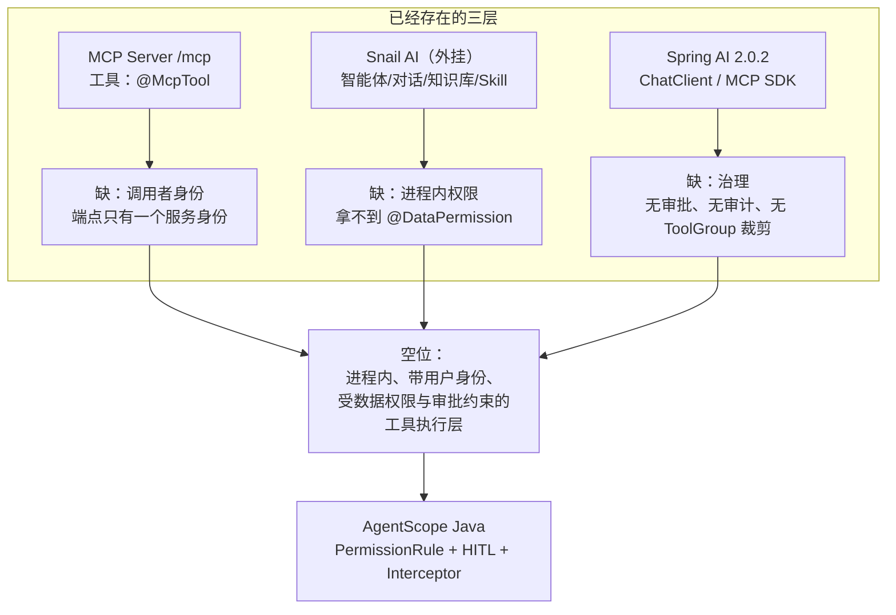
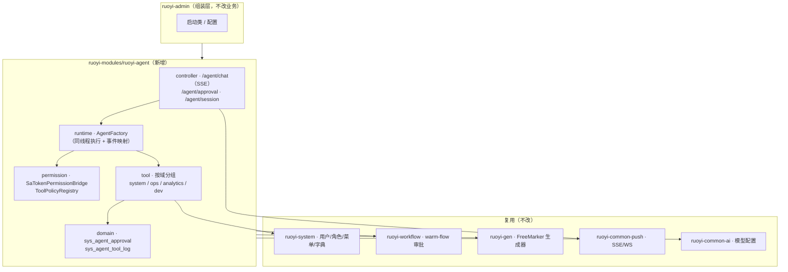
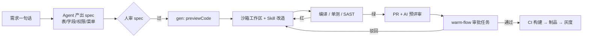
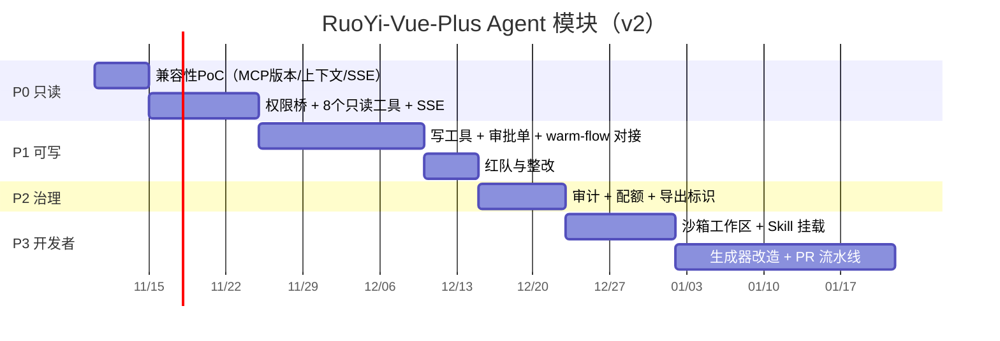

# 换底座重评：RuoYi-Vue-Plus 6.1.0 × AgentScope Java
## Agent 增强模块 · 可行性分析（v2）

> 日期：2026-11-07 ｜ 底座：`RuoYi-Vue-Plus 6.1.0`（本地克隆 `RuoYi-Vue-Plus/`，commit `835246e`）
> 上一版：基于 `RuoYi 4.8.3`（Thymeleaf + Shiro）的 [`ruoyi-agent-可行性分析与市场调研.md`](ruoyi-agent-可行性分析与市场调研.md)
>
> 📌 **链接说明**：文中 `../RuoYi-Vue-Plus/`、`../agentscope-java/` 指向分析时本地检出的参考仓库，不随本项目提交；未检出时这些证据链接不可打开，结论本身不受影响。

---

## 0. 一页结论：换底座之后，四个判断变了

| # | 上一版（RuoYi 4.8.3） | 本版（RuoYi-Vue-Plus 6.1.0） | 为什么变 |
|---|---|---|---|
| 1 | 「给若依加 AI」是空白 | **这个底座已经有 AI 了**：Spring AI 2.0.2 + Snail AI（23 张 `sai_*` 表）+ MCP Server/Client | 见 §2，问题从「加不加」变成「补哪层」 |
| 2 | 最大技术红利是「权限模型结构同构」 | 仍然成立，而且**更强**：`@SaCheckPermission("system:user:list")` 与 `PermissionRule` 同样一一对应，且 `LoginUser` 里**已缓存** `menuPermission` / `rolePermission` / `dataScopeRoleMap` | 见 §5，权限桥从 ~120 行降到 ~80 行 |
| 3 | 高危点：代码生成器**直接写宿主磁盘** | **消失了**。生成器只出 `previewCode` / zip（`writeCodeToZip`），零副作用 | 见 §3.1，P3 的风险等级下调一档 |
| 4 | 主路径是「工具调用 + 审批」 | 仍然成立，但**多了一条更省事的路径**：登录用户 → Sa-Token token 会话 → 同线程执行 → 数据权限天然生效 | 见 §3.3，这是 Java 21 + 前后端分离带来的红利 |

**新的三个判断**：

1. **不要做一个「AI 模块」，要做一个「操作治理层」**。这个底座已经有模型配置、智能体、对话、知识库、Skill、MCP、用量统计（`sai_*` 全套）。你要是再做一个聊天框 + 一套对话表，等于重复造轮子，而且会和 Snail AI 抢同一块屏幕。
2. **Snail AI 是「外部平台」，MCP 是「无身份通道」，两者都拿不到 `@DataPermission`**。中间那一层——**以当前登录用户的身份、在同一个 JVM 与同一个事务里、受数据权限与审批约束地执行工具**——是空的。AgentScope 补的正是这层。
3. **底座越强，模块就越小、越晚能证明价值**。上一版估 105–145 人日；这一版 **P0 约 3 周、P0+P1 约 6 周**（约 60–80 人日），因为流式通道、前端框架、生成器、审批引擎、技能库全都是现成的。

---

## 1. 底盘对照：12 项关键差异

| 维度 | RuoYi 4.8.3（上版） | RuoYi-Vue-Plus 6.1.0（本版） | 对 Agent 模块的影响 |
|---|---|---|---|
| 框架 | Spring Boot **4.1.0** / JDK **17** / Tomcat | Spring Boot **4.1.2** / JDK **21** / **Jetty** | 与 AgentScope BOM（Boot 4.0.4）差距略扩大；但 JDK 21 + Jetty 让虚拟线程可用（见 §3.3） |
| 鉴权 | Shiro 3.0（`SecurityUtils`） | **Sa-Token 1.46.0**（`StpUtil` / `SaHolder`） | 同类上下文依赖，但 Sa-Token 支持**按 token 显式取用户** |
| 权限注解 | `@RequiresPermissions("system:user:list")` | `@SaCheckPermission("system:user:list")` | **字符串格式完全一致**，权限桥逻辑不变 |
| 用户上下文 | Shiro `Subject` → `SysUser` | **`LoginUser`（含 `menuPermission`/`rolePermission`/`dataScopeRoleMap`）就存在 token 会话里** | 桥接时**不需要再查库**，直接读缓存 |
| 数据权限 | `DataScopeAspect` 切面改查询参数 | **`@DataPermission` + JSqlParser 拦截器**（`PlusDataPermissionHandler`） | 能力更强（支持多列/SpEL），但仍是线程上下文依赖（见 §3.2 坑1） |
| 前端 | Thymeleaf + Layui（同仓） | **独立仓 plus-ui**（Vue3 + ElementPlus，另有 React/AntD、vben5、soybean 变体） | UI 要提 PR 到另一个仓库；但能做真正的聊天界面 |
| 长连接 | 无 | **`ruoyi-common-push`：SSE + WebSocket 双通道**（`sse-timeout: 86400000`） | 流式输出**有现成基建**，不用自己造 |
| AI 能力 | 无 | **Spring AI 2.0.2 + Snail AI**（`ruoyi-common-ai` + `ruoyi-modules/ruoyi-ai` + `ruoyi-extend/ruoyi-snailai-server`） | 问题性质改变，见 §2 |
| 工具暴露 | 无 | **`@McpTool` / `@McpToolParam`，`/mcp` 端点**（`spring-ai-starter-mcp-server-webmvc`） | 已有「外部 LLM 调若依」的通道 |
| 工作流 | 无（只有 Quartz） | **warm-flow 2.1.1**（任务、抄送、催办、事件等待、SPEL 规则、全局监听） | 审批闸门现成，见 §6 |
| 代码生成 | Velocity，**直写磁盘** | **FreeMarker**（`fm/java/*.ftl` + `fm/react/*.ftl`），**只出 zip** | 高危点消失 |
| 调度 | Quartz（DB 驱动） | **SnailJob 2.0.2**（独立调度服务） | 定时 agent 承载力更强 |
| AI 编码规范 | 无 | **`.codex/skills/ruoyi-plus-ai-coding/`（+3 份 reference）、`.claude/agents/backend-*.md`（6 个）** | 开发者 Agent 的**知识层已现成**，见 §6 |

> 证据等级同上一版：**A** = 本地代码可验证；**B** = 官方文档；**C** = 公开信息；**D** = 推断。

---

## 2. 最重要的发现：这个底座已经有 AI 了

### 2.1 已有能力盘点（A 级，逐个文件读过）

| 能力 | 证据 | 说明 |
|---|---|---|
| **MCP 服务端** | `McpDemoServerTool`（`@McpTool`/`@McpToolParam`/`@McpResource`），`spring-ai-starter-mcp-server-webmvc`，端点 `/mcp` 与 admin 同端口 | 能把若依能力暴露给任何 MCP 客户端（Claude/Cursor/其他平台） |
| **MCP 客户端** | `ruoyi-common-mcp` 的 `McpClientTemplate` + `McpAutoConfiguration`，`spring-ai-starter-mcp-client` | 能反向调用外部 MCP 工具 |
| **AI 平台（外挂）** | `SnailAiConfig`（`@ConditionalOnProperty(snail-ai.enabled)`）+ `SnailAiController` + `ruoyi-extend/ruoyi-snailai-server` | aizuda Snail AI，独立服务 |
| **AI 数据模型** | `script/sql/ry_ai.sql`：`sai_agent`、`sai_agent_conversation(_record)`、`sai_model_config/provider`、`sai_agent_usage_stat`、`sai_rag*`、`sai_mcp_server`、`sai_skill(_file)`、`sai_app`、`sai_client_node`…**本次数到 23 张** | 智能体、对话、模型、用量、RAG、MCP、Skill **全都有** |
| **用户身份映射** | `SnailAiController.registerCurrentUser()`：把 `LoginHelper.getUserId()` 注册为 OpenAPI 的 `externalId` | Snail AI **知道「是谁」**，但**不知道「他能看什么」** |
| **流式推送** | `ruoyi-common-push`：`PushHelper.sendMessage(userId, payload)`、`SseController`（`/resource/message`）、`SseEmitterSessionManager`、`WebSocketSessionManager` | 按用户定向推送 + 断线重连基础设施 |
| **工作流** | `ruoyi-modules/ruoyi-workflow`：`IFlwTaskService`、`CompleteTaskBo`、`WorkflowEventPublisher`、`WorkflowGlobalListener` | 审批链路可被 agent 触发与回填 |

### 2.2 「差一层」论证：三个现有能力各自缺什么



| 现有能力 | 它能做什么 | 它做不到什么（关键） |
|---|---|---|
| **MCP Server** | 让外部 LLM 调若依 | MCP 端点没有「登录用户」概念——要么匿名、要么一个服务账号。工具内部即使调 Service，`LoginHelper.getLoginUser()` 也是空 → **数据权限失效**。代码注释自己也写了：「真实业务中不要在 MCP 工具里直接访问 Mapper，应保留权限、租户、脱敏、审计和幂等」——但**框架没提供这层** |
| **Snail AI** | 智能体、知识库、Skill、用量统计 | 独立服务 + 独立库（`sai_*`）。它知道 `externalId`，但**不知道 `menuPermission`**。要操作若依只能走 MCP/HTTP，等于**又一次跳出进程**，事务、审计、数据权限全部断开 |
| **Spring AI** | ChatClient、Tool Calling、MCP 集成 | **没有权限引擎、没有 ASK（人工审批）、没有 ToolGroup 按角色裁剪、没有工具调用审计**。它只负责「把工具给模型」，不负责「该不该给」 |

> 这就是本模块存在的唯一理由，也是最容易被客户听懂的一句话：
> **「你的 AI 能查数，但它不知道你现在登录的是谁。」**

### 2.3 定位修正：从「AI 模块」改为「操作治理中间件」

| 不要做 | 要做 |
|---|---|
| 再造一套对话/知识库/模型配置表 | 复用 `sai_model_config`、`sai_agent_usage_stat`（或直接接 Spring AI 的模型配置） |
| 再造一个聊天入口和 Snail AI 抢屏幕 | 做**内嵌式操作**（列表页/详情页里的「让 AI 帮我改」按钮 + 侧边对话） |
| 做通用问答 | 只做「**要做那件事**」：查、改、发起审批、跑报表 |

一句话：**Snail AI 负责「聊」，本模块负责「动」。**

---

## 3. 可行性重估

### 3.1 消失了的高危点（A 级）

| 上版的坑 | 本版状态 | 证据 |
|---|---|---|
| 代码生成器 `FileUtils.writeStringToFile` 直写宿主磁盘 | **不存在**：只有 `previewCode(Long)` 与 `downloadCode(...)` → `writeCodeToZip` | `GenTableServiceImpl`（`ruoyi-gen`） |
| CSRF `csrfValidateFilter` 拦 POST、Shiro `kickout`/`onlineSession` 干扰 SSE | **不存在**：前后端分离 + Token 鉴权；SSE 端点独立（`SseController`，`produces=text/event-stream`） | `SseController` |
| Thymeleaf 页面无法承载流式聊天 | **不存在**：前端是独立 Vue3/React 仓，可正常做 SSE 组件 | README 前端仓说明 |
| 无审批引擎，要自建状态机 | **大幅减轻**：warm-flow 已有任务、会签、催办、事件；可把「AI 发起的写操作」当成一个流程节点 | `ruoyi-workflow` |

> 这四条让 P3（开发者场景）的风险等级从「高危」降到「中」——最危险的那条路（LLM 决定往服务器写文件）在底座层面就被堵死了。

### 3.2 新的四个坑（按危险度排序）

**坑 1（最危险）：Sa-Token 上下文 + 数据权限，在异步线程上双失效**

`PlusDataPermissionHandler` 取当前用户的方式是：

```java
// PlusDataPermissionHandler:189-197
private LoginUser currentUser() {
    LoginUser currentUser = DataPermissionHelper.getVariable("user");   // 存在 SaStorage
    if (ObjectUtil.isNull(currentUser)) {
        currentUser = LoginHelper.getLoginUser();                        // 读 Sa-Token token 会话
        DataPermissionHelper.setVariable("user", currentUser);
    }
    return currentUser;
}
```

而 `DataPermissionHelper.getContext()` 的第一步是 `SaHolder.getStorage()`——**Sa-Token 的请求级存储，绑在 ThreadLocal 上**。

所以工具一旦跑在 Reactor 调度线程（`subscribeOn` / `publishOn` 之后），会出现两种失败：

| 失败模式 | 表现 | 后果 |
|---|---|---|
| `SaHolder.getStorage()` 取不到上下文 | 抛 `SaTokenContextException` 或 NPE | 工具报错，用户看到「AI 出错了」 |
| `LoginHelper.getLoginUser()` 返回 null | 处理器跳过数据范围过滤 | **越权读到全量数据，且日志看起来一切正常** |

> 这比上一版（Shiro）**更隐蔽**：Shiro 至少会在 `SecurityUtils.getSubject()` 上抛 `UnavailableSecurityManagerException`；Sa-Token 在部分路径下是静默返回 null。

**坑 2：MCP SDK 版本冲突（新）**
- AgentScope 显式钉 `io.modelcontextprotocol.sdk:mcp-core` **2.1.0**（`agentscope-dependencies-bom`）；
- RuoYi-Vue-Plus 通过 **Spring AI 2.0.2** 间接管理同一个 artifact，并同时引入 `spring-ai-starter-mcp-server-webmvc` + `mcp-client`。

两边**在同一个类路径上抢同一个 SDK**。必须在接入前跑：

```bash
mvn -q dependency:tree -pl ruoyi-modules/ruoyi-agent -Dincludes=io.modelcontextprotocol.sdk
mvn -q dependency:tree -pl ruoyi-admin -Dincludes=io.modelcontextprotocol.sdk
```

**坑 3：AOP 自调用会让权限注解静默失效（工具层最容易犯）**

`@DataPermission` 是靠 `DataPermissionAdvice` 在 **Mapper 代理**上织入的，`@SaCheckPermission` 也是 AOP。而工具类最常见的写法是「把 Service 逻辑抄进 Tool，或者 `this.xxx()` 内部转调」——**一旦绕开 Spring 代理，注解就完全不起作用，且没有任何报错**。

```java
// ❌ 反例：工具里自调用，注解失效
public class UserTools {
    @Autowired private SysUserMapper mapper;
    public String query(String kw) { return toJson(doQuery(kw)); }
    private List<?> doQuery(String kw) { return mapper.selectList(...); }  // 同一实例内调用
}
```

**铁律**：
1. 工具**只做三件事**——参数校验、调 Service、结果脱敏与摘要；**绝不写查询逻辑**；
2. 一律注入 `ISysUserService` 这类**接口代理**，不要注入 Mapper；
3. 写一条单测：用两个数据权限不同的用户调同一个工具，**断言结果集不同**（这条单测就是坑 1 的回归防线）。

**坑 4：前端在另一个仓库（流程级）**
`plus-ui` 是独立仓（还有 React/AntD、vben5、soybean 等成员版本）。Agent 的 UI 组件要按他们的目录规范提 PR，且要兼容多套前端。**建议 P0 只做一套（Vue3 + ElementPlus），不要一开始就铺 React。**

> 顺带澄清一个容易误判的点：本项目**用的是 Jetty**（`ruoyi-common-web` 显式排除 Tomcat、引入 `spring-boot-starter-jetty`），不是 Undertow（pom 里那句 undertow 注释是历史遗留）。Jetty 对虚拟线程是支持的，所以 §3.3 的方案没有容器障碍。

### 3.3 最大红利：Java 21 让「同线程执行」变成可行方案

上一版我给的方案是「把 `LoginUser` 抓成 POJO 塞进 `RuntimeContext`」。这一版有更省事的做法：

> **让整条 Agent 链路跑在请求线程上**——在 Controller 里 `agent.call(...).block()`（或对事件流 `toIterable()` 顺序消费），工具调用就不跨线程，`SaHolder`/`LoginHelper`/`DataPermission` **全部天然有效**。

- 代价：一个请求占用一个线程 30–90 秒；
- 可接受性：这是后台「让人等结果」的交互，并发量本来就不高；且本项目**用的是 Jetty**（Spring Boot 对 Jetty 的虚拟线程支持完整），只要把 `spring.threads.virtual.enabled` 从 `false` 改成 `true`，阻塞成本就降到可忽略；
- 对比：跨线程方案要写 `SaTokenContext` 传播器（~50 行 + 容易漏清理），并且每次工具调用都要 bracket。

**建议**：P0/P1 一律同线程；等到确有高并发需求，再引入「线程 + 上下文传播」方案。**不要一开始就追求异步。**

```java
// ruoyi-agent 的入口（示意）
@PostMapping(value = "/agent/chat", produces = MediaType.TEXT_EVENT_STREAM_VALUE)
public SseEmitter chat(@RequestBody ChatBo bo) {
    LoginUser user = LoginHelper.getLoginUser();        // 请求线程上取，稳妥
    SseEmitter emitter = new SseEmitter(180_000L);
    // 关键：不要 subscribeOn 到别的调度器
    agent.streamEvents(bo.getText(), buildContext(user))
         .toIterable()                                   // 顺序消费，保持线程
         .forEach(ev -> emitter.send(toSse(ev)));
    return emitter;
}
```

### 3.4 工作量重估

| 阶段 | 上版（4.8.3） | 本版（Vue-Plus 6.1） | 变化原因 |
|---|---|---|---|
| P0 只读问答 | 15–20 人日 | **10–12 人日** | SSE 基建、前端框架、菜单权限都已就绪 |
| P1 写操作 + 审批 | 25–30 人日 | **15–20 人日** | warm-flow 承担流程，只需做「AI 操作单」的映射 |
| P2 治理 | 10–15 人日 | **8–12 人日** | 日志/异常/限流基础设施齐备 |
| P3 开发者 Agent | 40–60 人日 | **30–45 人日** | 生成器无写盘风险；`.codex/skills` 可直接当 Skill 复用 |
| P4 渠道 | 15–20 人日 | **10–15 人日** | push 通道已抽象 |
| **合计** | 105–145 | **73–104 人日** | **约省 30%** |

---

## 4. 架构 v2

### 4.1 模块落位



**只新增 2 张表**（其余全部复用）：

| 表 | 作用 | 为什么不能省 |
|---|---|---|
| `sys_agent_approval` | AI 写操作的审批单（`approval_id`/`tool`/`input_hash`/`diff_preview`/`expire_at`/`executed_at`） | warm-flow 管「业务流程」，这张表管「**AI 操作凭证**」——两者不是一回事：审批要能回答「哪次对话、哪个工具、什么参数、谁批的」 |
| `sys_agent_tool_log` | 每次工具调用的决策与结果（`decision`/`approval_id`/`cost_ms`/`token_used`/`oper_name`） | 等保要求「可追溯」，且是算成本与算准确率的唯一数据源 |

> 对话与消息**不要再建表**：直接用 Snail AI 的 `sai_agent_conversation(_record)`，或复用 `AgentStateStore` 的 MySQL 实现。**避免两套会话历史**，这是最容易埋雷的地方。

### 4.2 与 Snail AI 的边界（建议写进方案，避免内部打架）

| 事项 | Snail AI | 本模块 |
|---|---|---|
| 面向谁 | 业务用户的「知识问答/文案/通用助手」 | 后台操作者的「**把这件事办完**」 |
| 入口 | 独立 AI 应用页 | 列表页/详情页的内嵌按钮 + 侧栏 |
| 工具 | 外部 MCP / 内置能力 | **进程内 Service（带 `@SaCheckPermission` + `@DataPermission`）** |
| 权限 | 无（只有 externalId） | **完整继承若依权限** |
| 审计 | 平台侧用量 | **业务侧操作留痕 + 审批单** |
| 模型配置 | `sai_model_config` | 复用（不另建） |

---

## 5. 权限桥 v2（Sa-Token 版，约 80 行）

比上一版更简单：**权限集合已经在 `LoginUser` 里，不需要再查库**。

```java
@Component
@RequiredArgsConstructor
public class SaTokenPermissionBridge {

    private final ToolPolicyRegistry registry;

    /** 把当前登录用户翻译成 AgentScope 的权限上下文 */
    public PermissionContextState build(LoginUser user) {
        PermissionContextState.Builder b = PermissionContextState.builder();

        // 1) 角色级护栏：审计角色 → 只读；定时任务 → 无人值守
        Set<String> roles = user.getRolePermission();
        if (roles.contains("auditor")) {
            b.mode(PermissionMode.EXPLORE);          // 框架级只读，写与命令一律拒绝
        } else if (roles.contains("agent_job")) {
            b.mode(PermissionMode.DONT_ASK);         // ASK 自动降级为 DENY
        } else {
            b.mode(PermissionMode.DEFAULT);
        }

        // 2) 逐工具按 @SaCheckPermission 的权限码决定 ALLOW / ASK / DENY
        Set<String> perms = user.getMenuPermission();
        for (ToolPolicy p : registry.all()) {        // p.ruoyiPerm() 例如 "system:user:edit"
            if (!perms.contains(p.ruoyiPerm())) {
                b.addDenyRule(p.toolName(),
                    new PermissionRule(p.toolName(), null, PermissionBehavior.DENY, "ruoyi"));
            } else if (p.mutating()) {
                b.addAskRule(p.toolName(),           // 写操作一律先问人
                    new PermissionRule(p.toolName(), null, PermissionBehavior.ASK, "ruoyi"));
            } else {
                b.addAllowRule(p.toolName(),
                    new PermissionRule(p.toolName(), null, PermissionBehavior.ALLOW, "ruoyi"));
            }
        }
        return b.build();
    }
}
```

**三个必须写死的配套规则**

1. **工具内部不读 `LoginHelper`**：`LoginUser` 从 `RuntimeContext` 注入（`put(AgentPrincipal.class, ...)`），避免跨线程失效；
2. **数据权限靠注解，不靠模型**：工具方法上照常标 `@DataPermission`，让 MyBatis 拦截器拼 where——前提是第 3 点；
3. **同线程执行**（§3.3），否则第 2 条会静默失效。

---

## 6. 开发者场景 v2：底座已经把最难的两块准备好了

上一版这块要从零搭。这一版有两块现成资产：

### 6.1 知识层：`.codex/skills/ruoyi-plus-ai-coding/` 可直接当 AgentScope Skill 用

仓库里已经有：

| 文件 | 内容 |
|---|---|
| `SKILL.md` | 触发条件、**反例清单**（框架升级/实验性模块/第三方中间件不要套 CRUD 规则）、6 步执行流程、已有能力检索要求 |
| `references/backend.md`、`frontend.md`、`examples.md` | 分层约定（`domain`/`domain.bo`/`domain.vo`/`mapper`/`service`/`controller`）、数据权限、缓存、翻译、JSON 增强 |
| `.claude/agents/backend-*.md`（6 个） | 已拆好的子角色：CRUD、工程规范、JavaDoc、查询权限、公共基础设施、模块增强 |

**做法**：把整个目录挂成 `FileSystemSkillRepository`，`SKILL.md` 的 frontmatter 就是 AgentScope 需要的格式（`name` + `description`）。**零改造**。

> 这是本版最大的隐性资产：别人做「AI 写代码」要从零教模型你们的约定，你们已经把约定写成了文档。

### 6.2 生成层：FreeMarker + 双端模板

- 模板在 `ruoyi-modules/ruoyi-gen/src/main/resources/fm/`：`java/*.ftl`（bo/controller/domain/mapper/service/serviceImpl/vo）**+ `react/*.ftl`（api.ts/index.tsx/index-tree.tsx/types.ts）**；
- 输出走 `previewCode` / `downloadCode`（zip），**不落地**；
- 因此 Agent 的标准动作是：**读表 → 调整 `GenTable` 字段配置 → `previewCode` → 生成 diff → 提 PR**。

### 6.3 审批层：warm-flow 已经能承接「AI 发起的变更」

`ruoyi-workflow` 有 `WorkflowEventPublisher`、`WorkflowGlobalListener`、`CompleteTaskBo`、`FlwEventWaitService`——可以把「AI 生成的代码变更」映射成一个流程实例：



**沿用上一版的结论**：审「绿灯批次」而不是「每个 commit」；红线（禁 force push、禁改流水线、禁读生产配置）做成硬编码 DENY。

---

## 7. 市场：底座自带的 AI，改变了你的竞争位置

| 观察 | 影响 |
|---|---|
| **RuoYi-Vue-Plus 6.1 已经内置 AI**（Snail AI + MCP + Spring AI） | 「给后台加 AI」这件事在头部衍生版里**已经不稀缺**了。你的方案如果只是「再加个聊天框」，客户会说「这个我已经有了」 |
| 但它内置的是**平台型 AI**（智能体/知识库/对话），**不是执行型 AI** | 空位仍在，而且更清晰：**「能动手、且动手合规」** |
| MCP 已经内建 | 好消息：对外集成不用自己造；坏消息：**别人也能用 MCP 接进来**，你的护城河只能是「治理」，不是「连接」 |
| 生态里已有 `ruoyi-ai`（5.1K★）、芋道 `yudao-module-ai`、RuoYi Office（商业，100+ 客户） | 需求被验证过；但**没人把「权限 + 审批 + 审计」做成闭环** |
| 使用强度事实：AI 办公 Agent 头部产品**月人均 19 次** | 不要指望「人人天天用」。定位成「**关键时刻的工具**」（改单据、查异常、跑月报），而不是「日常入口」 |

**结论**：本项目的商业叙事应该是——

> 「RuoYi-Vue-Plus 自带 AI，但它只敢让你**聊**；我们让它敢让你**批**。」
> 卖点不是模型、不是对话，而是**「AI 动过的手，都有单据、有日志、有回滚」**。

---

## 8. 路线图 v2（更短）



**P0 的 5 天 PoC 只验四件事**（任一不过就不要往下走）：

1. `mvn dependency:tree` 确认 MCP SDK 只有**一个版本**、Spring Boot 仍是 4.1.2；
2. 在请求线程上 `agent.call(...).block()`，工具里调一个带 `@DataPermission` 的 Service 方法，**用两个数据权限不同的账号对比结果**（必须不同；相同就说明数据权限被绕过了）；
3. `SseEmitter` 能推流到 plus-ui 页面（跨域、心跳、断线重连）；
4. 一个 `@Tool` 包装 `SysUserServiceImpl.selectPageUserList`，确认 `@SaCheckPermission` 语义与工具权限一致（**权限码要能自动对齐，不靠手工维护**）。

---

## 9. 决策建议

| 项 | 结论 |
|---|---|
| 换底座是否更好 | ✅ **明显更好**：省约 30% 工作量，且最危险的技术点（写盘、CSRF、无前端）都消失了 |
| 是否值得做 | ✅ 值得，但**范围要更窄**：只做「操作治理」，不做「AI 平台」 |
| 最大风险 | ⚠️ **定位撞车**：内部已有 Snail AI，若边界不清，会变成两个聊天框抢用户。**必须先定边界（§4.2）** |
| 次大风险 | ⚠️ 数据权限静默失效（坑 1）。这是唯一能造成**生产事故**的技术点，PoC 第 2 项专治 |
| 建议节奏 | P0（3 周）→ 内部 5 人试用 → P1（3 周）→ 红队 → P2 |

### 三个「不要做」（相对上一版的修订）

1. **不要再建一套对话/知识库表**（上一版没提，因为底座没有；这一版必须提）。
2. **不要跨线程跑 agent**（除非先写好上下文传播器）。
3. **不要在 P0 阶段碰开发者场景**（虽然成本降了，但它仍是另一条产品线）。

---

## 附录 A：与上一版（RuoYi 4.8.3）的结论差异清单

| 上一版结论 | 本版 | 处理 |
|---|---|---|
| 「若依生态 AI 仍是空白」 | 6.1.0 已内置 AI（Snail AI/MCP/Spring AI） | **作废**，见 §2 |
| 「生成器直写磁盘是高危点」 | 已改为 zip 输出 | **作废**，见 §3.1 |
| 「P0+P1 需 6–8 周」 | 约 5–6 周 | 修订，见 §3.4 |
| 「Shiro ThreadLocal 导致 dataScope 失效」 | 换成 Sa-Token 版本，**问题依然存在且更隐蔽** | **保留**，见 §3.2 坑 1 |
| 「Harness 的 `SessionLogStore` 无 DB 实现」 | 仍存在；但本版推荐运营场景用纯 `ReActAgent`，影响缩小 | 保留（降级） |
| 「前端要用 SseEmitter + Thymeleaf」 | 改为 plus-ui（Vue3）组件 + 复用 `ruoyi-common-push` | 修订，见 §3.2 坑 4 |
| 「权限桥约 120 行」 | 约 80 行（`LoginUser` 已缓存权限集合） | 修订，见 §5 |
| 市场调研（五层格局/定价/合规） | **基本不变**，仅补「底座自带 AI」这一条 | 沿用上一版 §6 |

## 附录 B：配套材料

- 汇报稿（9 页）：[`ruoyi-vue-plus-agent-汇报-v2.pptx`](ruoyi-vue-plus-agent-汇报-v2.pptx)
- 上一版报告（RuoYi 4.8.3 基线，仍可作对照）：[`ruoyi-agent-可行性分析与市场调研.md`](ruoyi-agent-可行性分析与市场调研.md)
- 市场调研（两版通用，未变）：[编程 Agent 调研](../_research/ai-coding-agent-pipeline-research-2026-11-07.md) ｜ [平台市场调研](../_research/企业级AI-Agent平台市场调研-2026-11.md)

## 附录 C：证据索引

**A 级（本地代码，可复核）**
- 根 POM（Boot 4.1.2 / JDK21 / Sa-Token 1.46 / Spring AI 2.0.2 / warm-flow 2.1.1）：[`RuoYi-Vue-Plus/pom.xml`](../RuoYi-Vue-Plus/pom.xml)
- Sa-Token 登录用户与权限缓存：[`LoginHelper.java`](../RuoYi-Vue-Plus/ruoyi-common/ruoyi-common-satoken/src/main/java/org/dromara/common/satoken/utils/LoginHelper.java)、[`LoginUser.java`](../RuoYi-Vue-Plus/ruoyi-api/src/main/java/org/dromara/system/api/model/LoginUser.java)
- 权限实现：[`SaPermissionImpl.java`](../RuoYi-Vue-Plus/ruoyi-common/ruoyi-common-satoken/src/main/java/org/dromara/common/satoken/core/service/SaPermissionImpl.java)
- 数据权限（**坑 1 的证据**）：[`PlusDataPermissionHandler.java`](../RuoYi-Vue-Plus/ruoyi-common/ruoyi-common-mybatis/src/main/java/org/dromara/common/mybatis/handler/PlusDataPermissionHandler.java)、[`DataPermissionHelper.java`](../RuoYi-Vue-Plus/ruoyi-common/ruoyi-common-mybatis/src/main/java/org/dromara/common/mybatis/helper/DataPermissionHelper.java)
- 权限注解示例：[`SysUserController.java`](../RuoYi-Vue-Plus/ruoyi-modules/ruoyi-system/src/main/java/org/dromara/system/controller/system/SysUserController.java)
- MCP 工具示例：[`McpDemoServerTool.java`](../RuoYi-Vue-Plus/ruoyi-modules/ruoyi-demo/src/main/java/org/dromara/demo/mcp/McpDemoServerTool.java)
- SSE/推送：[`SseController.java`](../RuoYi-Vue-Plus/ruoyi-common/ruoyi-common-push/src/main/java/org/dromara/common/push/controller/SseController.java)、[`PushHelper.java`](../RuoYi-Vue-Plus/ruoyi-common/ruoyi-common-push/src/main/java/org/dromara/common/push/helper/PushHelper.java)
- 生成器（**无写盘**）：[`GenTableServiceImpl.java`](../RuoYi-Vue-Plus/ruoyi-modules/ruoyi-gen/src/main/java/org/dromara/gen/service/GenTableServiceImpl.java)、模板目录 [`fm/`](../RuoYi-Vue-Plus/ruoyi-modules/ruoyi-gen/src/main/resources/fm/)
- AI 数据模型：[`script/sql/ry_ai.sql`](../RuoYi-Vue-Plus/script/sql/ry_ai.sql)
- Snail AI 接入：[`SnailAiConfig.java`](../RuoYi-Vue-Plus/ruoyi-common/ruoyi-common-ai/src/main/java/org/dromara/common/ai/config/SnailAiConfig.java)、[`SnailAiController.java`](../RuoYi-Vue-Plus/ruoyi-modules/ruoyi-ai/src/main/java/org/dromara/ai/controller/SnailAiController.java)
- 运行配置：[`application.yml`](../RuoYi-Vue-Plus/ruoyi-admin/src/main/resources/application.yml)（`spring.threads.virtual.enabled: false`、`message.transport: sse`、`sse-timeout`、`spring.ai.mcp`）
- AI 编码规范：[`.codex/skills/ruoyi-plus-ai-coding/SKILL.md`](../RuoYi-Vue-Plus/.codex/skills/ruoyi-plus-ai-coding/SKILL.md)、[`.claude/agents/`](../RuoYi-Vue-Plus/.claude/agents/)

**B 级（AgentScope 侧，同上一版）**
- [能力盘点（1492 行，逐条 `文件:行号`）](../_research/AGENTSCOPE_JAVA_能力盘点_RuoYi接入评估.md)
- [Tool / Permission 官方文档](../agentscope-java/docs/v2/zh/docs/building-blocks/permission-system.md)

**免责**：本次克隆为 Gitee 最新 `6.1.0`（2026-11-07），未验证与贵方实际使用的分支/版本差异；若实际版本低于 6.1.0，§2 的「已有 AI」与 §3.1 的「无写盘」都需要重新核对。
