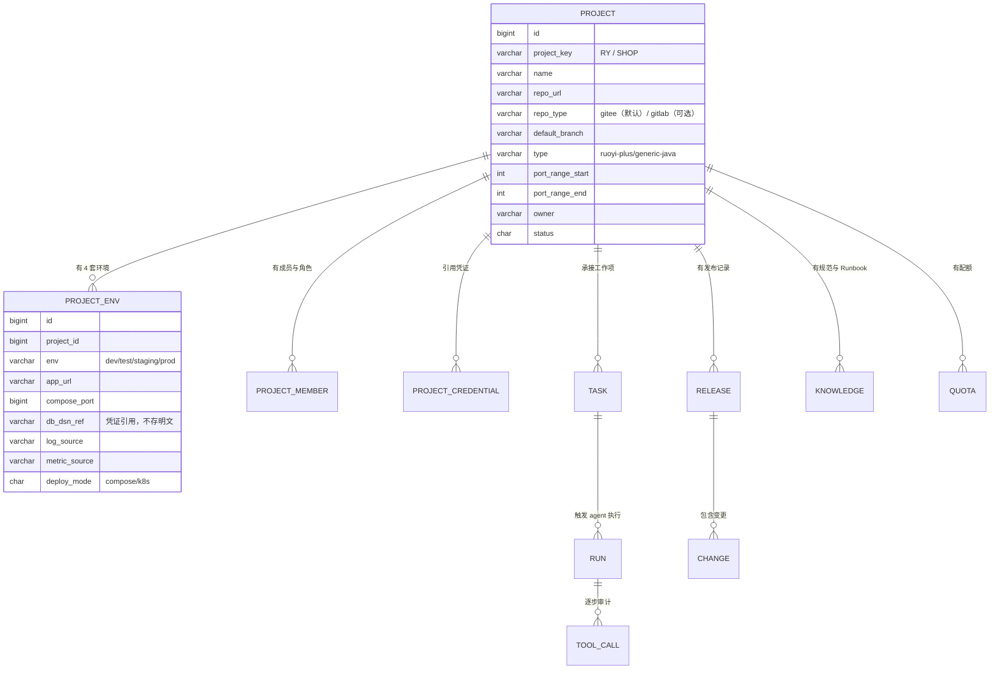
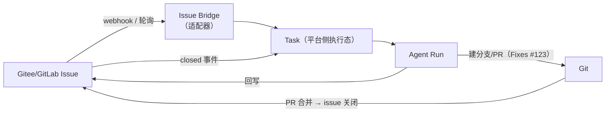
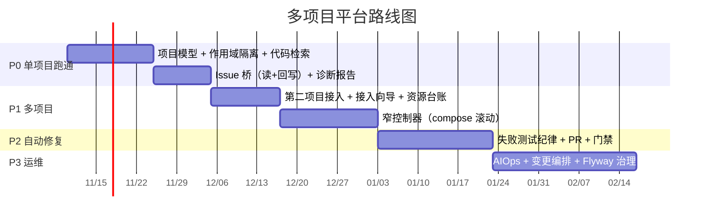

# 多项目托管设计（v4）
## 项目作为一级实体 · 工作项托管在 Gitee/GitLab

> 日期：2026-11-07 ｜ 前置：[v3 平台可行性](devops-agent-独立平台-可行性分析-v3.md)、[执行面设计](devops-agent-执行面设计-k8s-jenkins-flyway.md)、[窄控制器](窄控制器设计-单机滚动部署器.md)
> 本次决策：**A. 多项目托管** + **工作项事实源 = Gitee/GitLab Issues**

---

## 0. 这次补齐的是什么

之前三篇文档默认「平台上只有一个 RuoYi-Vue 项目」，把项目当成了配置项。**实际上项目才是这个平台的一等公民**：

| 之前 | 现在 |
|---|---|
| 一个仓库、一套环境、一套凭证 | **N 个项目，每个项目自带仓库/多环境/凭证/端口段/知识/配额** |
| 平台自己存 bug 工单 | **工单仍在 Gitee/GitLab Issues**，平台只做「证据增强 + 状态桥」 |
| 部署控制器只服务一个 compose | **按项目分发**：不同项目不同 compose 目录、不同端口段 |
| agent 只有一套工具 | **工具与知识按项目装配**，跨项目即越权 |

**一句话**：平台是「多项目的控制台」，项目是「权限、资源、知识、成本的边界」。

---

## 1. 核心模型



**关键设计**：`project.type` 决定**能力集**（不是所有项目都长一样）：

| type | 启用哪些能力 |
|---|---|
| `ruoyi-plus` | 全部：actuator 指标、`sys_oper_log` 审计查询、`/mcp`、warm-flow 审批、FreeMarker 生成器、`.codex/skills` 规范 |
| `generic-java` | 代码检索、构建、部署、日志/指标（若接了 actuator）、通用 Issue 桥 |
| `static` | 仅构建与部署（无 DB、无 actuator） |

> 这条设计避免了「把若依特有的东西硬编码进平台」——**平台不认识 RuoYi，只认识 project.type 声明的能力**。

---

## 2. 作用域隔离：三道锁，缺一不可

多项目最容易出的事故不是"做不出来"，而是"串了"——A 项目的人读到 B 项目的数据、A 项目的 agent 改了 B 项目的库。

### 2.1 第一道：**projectId 不能由模型提供**

这是最容易写错、后果最严重的一条。

```java
// ❌ 绝不能这样：模型可以传任意 projectId
@Tool(name = "db_query")
public String query(@ToolParam(name = "project") String projectId, @ToolParam(name = "sql") String sql) { ... }

// ✅ 正确：项目来自会话绑定，模型看不见也改不了
@Tool(name = "db_query", description = "在当前项目只读库执行查询")
public String query(@ToolParam(name = "sql") String sql, ProjectContext ctx) { ... }
```

`ProjectContext` 由 Controller 在创建会话时绑定（`RuntimeContext.builder().put(ProjectContext.class, ctx)`），AgentScope 会自动注入未标 `@ToolParam` 的 POJO 参数。

> 推论：**「帮我查一下 XX 项目的库」这种请求必须被拒绝**。模型可以这么说，但它没有参数可填——这是架构上堵死的，不是靠提示词。

### 2.2 第二道：凭证按项目 × 环境切片

```
credential_scope = (project_id, env, capability)
```

| capability | 内容 | 不可复用 |
|---|---|---|
| `repo_read` / `repo_write` | Git token（按项目） | 不同项目的 token 不通用 |
| `db_read` | 只读账号（按项目库） | — |
| `db_ddl` | **仅 Migrator 持有**，agent 永不可见 | — |
| `app_health` | actuator Basic Auth（按项目实例） | — |
| `log_read` | 日志源（按项目） | — |
| `deploy` | **仅 Deployer 持有** | — |

存储：只存 `vault_ref` / `env_ref`，**不落库明文**。

### 2.3 第三道：工具与知识按项目装配

| 装配物 | 来源 | 隔离方式 |
|---|---|---|
| Toolkit | 按 `project.type` + 角色 | 每个会话独立 `Toolkit`（AgentScope 支持 `Toolkit.copy()`） |
| Skill 库 | 项目仓库内 `.codex/skills/` 或平台知识库 | `FileSystemSkillRepository(projectSkillDir)` |
| 系统提示 | 项目模板（技术栈、目录约定、红线） | 按 project 渲染 |
| 配额 | 项目 token/并发预算 | 中间件拦截超限 |

**性能注意**：不要每个请求重建 agent 与 toolkit。按 `(projectId, userId, agentKind)` 缓存，会话结束释放；`Toolkit` 是不可变共享的，重建成本高。

---

## 3. 工作项桥：不自建工单，只做「证据增强 + 状态桥」

### 3.1 为什么不自建

你们已有 Git 平台 Issues。自建 = 两套真相 = 工程师两边都要看 = 三个月后只剩一边在被维护。**这一条是整个设计的保命符。**

### 3.2 结构



**平台侧只存"执行态"**，不存工单内容：

| 平台字段 | 来源 |
|---|---|
| `issue_external_id`（iid/编号） | Git 平台 |
| `issue_url` | Git 平台 |
| `execution_state`（待分析/已定位/修复中/待合并/已关闭） | **平台自有** |
| `last_diagnosis_run_id` | 平台自有 |
| `evidence_snapshot`（诊断时的版本/日志摘要） | 平台自有 |

### 3.3 回写约定（这是平台对工程师的唯一「存在感」）

| 时点 | 写回内容 |
|---|---|
| 开始分析 | 评论：「AI 开始分析，预计 5 分钟」+ 平台链接 |
| 定位完成 | 评论：结构化诊断（见下）+ 标签 `ai:diagnosed` |
| 修复 PR | 评论：「修复 PR #456」；PR 描述含 `Fixes #123`（合并自动关 issue） |
| 放弃 | 评论：「已排除 3 个假设（附证据），建议转人工」+ 标签 `ai:needs-human` |

**诊断报告模板**（结构固定，便于人快速扫）：

```
## 结论
一句话：<定位到 XxxService#doQuery 的空指针，触发条件为 deptId 为空>

## 证据
- 版本：6.1.0-a1b2c3d（环境 test）
- 时间窗：2026-11-07 14:02 ~ 14:07
- 关键日志：3 条（折叠）
- 相关变更：2 个 commit（时间窗内）

## 已排除
1. 数据库连接池耗尽 —— 指标正常（活跃连接 3/20）
2. Redis 超时 —— 无相关异常

## 建议
1. 复现：用 deptId=null 调 /system/user/list
2. 修复：SysUserServiceImpl:142 加空值分支
```

### 3.4 两个工程细节

| 细节 | 处理 |
|---|---|
| **Webhook 幂等** | 用 `delivery_id`（GitLab）/ 事件唯一键去重；重复投递直接丢弃 |
| **API 限流** | 回写评论要排队 + 退避；同 issue 1 分钟内只写 1 条（合并更新） |
| **敏感信息** | Issue 正文可能含密码/内网 IP → 进模型前脱敏；回写时不要回贴原始日志全文 |
| **Gitee / GitLab 差异** | 抽 `IssueTracker` 接口（`fetch` / `comment` / `label` / `close`），两个实现；字段映射表维护在适配器里 |

---

## 4. 多项目部署与资源台账

单机 Docker 托管多项目，**资源是硬约束**，必须有台账：

| 资源 | 分配方式 | 强制校验 |
|---|---|---|
| **端口段** | 每个项目一段（`RY: 8080-8099`、`SHOP: 8100-8119`） | 控制器只允许在段内起容器，越界直接拒绝 |
| **内存** | 每项目 2 副本 × (512M–1G heap) + 共享中间件 | preflight 检查 `free -m`，不足拒绝发布 |
| **磁盘** | 镜像 + 日志 + 工作区 | preflight 检查 ≥ 5G |
| **nginx 块** | 每项目一个托管块 `# BEGIN MANAGED:RY` | 只改本项目块，不碰别的项目 |
| **compose 目录** | `/opt/apps/<project_key>/docker-compose.yml` | 控制器按 project 定位 |

**容量估算（重要，别忽略）**：

```
单机可承载项目数 ≈ (物理内存 - 中间件占用) / (每项目 2 × JVM实际占用)
例：32G 机器，mysql+redis+minio+nginx ≈ 6G
    每项目 2 × 900M ≈ 1.8G
    → 约 14 个项目（理论上限）
    → 留 30% 余量，建议 ≤ 8 个
```

> 超过这个数，就不是"窄控制器"的问题了，而是该上 K8s 或多机——**提前把这条写进容量红线**，避免平台变成"什么都想管，什么都管不动"。

---

## 5. 新增风险（多项目特有）

| # | 风险 | 触发场景 | 对策 |
|---|---|---|---|
| R1 | **跨项目越权** | 模型编造 projectId，或会话串号 | projectId 服务端绑定（§2.1）+ 每会话独立 Toolkit |
| R2 | **凭证爆炸** | N 项目 × 4 环境 × 6 类能力 = 上百条 | 只存引用 + Vault；按 (project,env,capability) 三维索引；一键吊销单条 |
| R3 | **知识串味** | A 项目的编码规范进了 B 项目 | Skill 目录按项目隔离；知识检索加 project 过滤条件 |
| R4 | **成本无法归集** | 不知道哪个项目烧钱 | 每次 run 记 project_id + token；按项目出月报 |
| R5 | **单机资源耗尽** | 加第 5 个项目后全员变慢 | 资源台账 + preflight + 容量红线 |
| R6 | **项目接入成本** | 每接一个项目都要手配一堆东西 | 做「项目接入向导」：填仓库 → 探环境 → 生成配置 → 跑一次 dry-run 自检 |
| R7 | **Issue 桥的权限** | webhook 被伪造 | 校验 secret/token；只信任来自配置过的仓库 |

> R6 值得单独说：**多项目托管的成败在"接入成本"**。接入一个项目如果需要 2 天，就永远只有 1 个项目。目标是「**半天接一个项目**」，靠向导 + 自检 + 模板化。

---

## 6. 路线图（并入前几篇）



| 期 | 关键验收 |
|---|---|
| P0 | 1 个项目跑通；Issue → 诊断报告回写；**跨项目请求 100% 被拒** |
| P1 | 第 2 个项目接入 ≤ 0.5 人日；端口/内存台账生效；滚动发布 0 个 5xx |
| P2 | PR 接受率 ≥ 60%；无人工打回即合并率可统计 |
| P3 | MTTR 下降 ≥ 50%；变更失败率不高于人工基线 |

---

## 7. 与前面文档的关系

| 文档 | 状态 |
|---|---|
| [v3 平台可行性](devops-agent-独立平台-可行性分析-v3.md) | **有效**，但把"单项目"读作"项目作用域"，本文补上多项目层 |
| [执行面设计](devops-agent-执行面设计-k8s-jenkins-flyway.md) | **有效**，增加"按项目分发"（端口段、compose 目录、nginx 块） |
| [窄控制器](窄控制器设计-单机滚动部署器.md) | **有效**，输入从"一个 compose"变成「项目 + 环境」定位的 compose |
| 本文 | **新增**：项目实体、作用域隔离、Issue 桥、资源台账 |

---

## 8. 结论

| 判断 | 结论 |
|---|---|
| 多项目托管是对的 | ✅ 它把「爆炸半径」「资源冲突」「知识串味」三个问题一次性收进了一个抽象 |
| 不自建工单是对的 | ✅ 用 Git 平台 Issues 做事实源，平台只做证据增强与状态桥，避免双系统 |
| 最大的技术红线 | **projectId 绝不能由模型提供**——这是多项目平台唯一的一票否决项 |
| 最大的产品风险 | **接入成本**：接一个项目要 2 天，就永远只有一个项目 |
| 最大的容量风险 | 单机多项目受内存约束，**提前定容量红线（建议 ≤ 8 个项目）** |
| 下一步最该做的 | ① 项目模型 + 作用域隔离 ② Issue 桥（先只读 + 评论回写）③ 用第二个真实项目验证隔离 |

> 一句话：**这个平台的单位不是"任务"，是"项目"**。所有能力（代码、部署、Issue、知识、配额、审计）都必须挂在项目下面；一旦有一条挂空，多项目就会变成"多套系统挤在一个 UI 里"。
