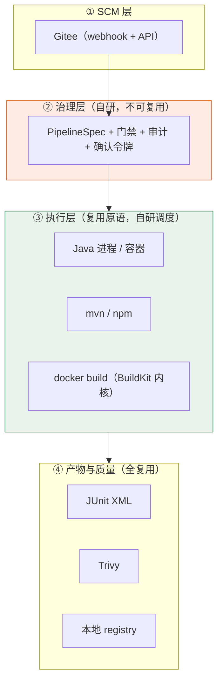

# 有没有现成开源 CI 可以集成复用？· 调研 v1

> 日期：2026-11-07 ｜ 方法：GitHub REST API 实测 + 仓库目录结构取证 + 官方文档
> 前置：[Jenkins 能力复刻与复用 · 规划](Jenkins能力复刻与复用-规划-v1.md)

---

## 0. 结论

**一句话：没有可以「整体复用」的现成开源 CI —— 不是能力不够，是 SCM 绑死了。**

| 层 | 能否复用开源件 | 结论 |
|---|---|---|
| **CI 引擎整体**（SCM 集成 + 队列 + UI + 日志） | ❌ | 主流开源 CI 的 SCM 驱动里**没有 Gitee**（已取证，见 §2） |
| **可嵌入的 Jenkins 执行器** | 🟡 | `jenkinsfile-runner` 存在（1.2k★，MIT），但**它跑的仍是 Groovy**，等于把安全边界又打开了 |
| **构建执行引擎**（容器化 DAG） | ❌ | Dagger 的 Java SDK **官方标注 experimental**（"不要用于 mission-critical"） |
| **执行原语**（Maven/npm/docker build/scan/report） | ✅ | 已经在用，继续复用 |
| **持久化工作流编排**（若将来需要） | ✅ | Temporal Java SDK 可用，但**当前不需要** |
| **Gitee 官方 CI（Gitee Go）** | ✅? | **唯一与 Gitee 原生集成的方案**，但它是平台产品不是开源件 → 见 §5 的路线分叉 |

**最重要的发现**：自研引擎的正当性不取决于"开源 CI 够不够好"，而取决于**「Gitee Go 能不能用」**。这一条要先确认，它能直接决定 §5 走 A 还是 B。

---

## 1. 候选清单（2026-11-07 实测）

| 项目 | ★ | 语言 | 许可 | 定位 | 与我们的关系 |
|---|---|---|---|---|---|
| **Woodpecker CI** | 8,125 | Go | Apache-2.0 | 轻量 CI（Drone 社区续作） | 架构最接近需求，但见 §2 |
| **Drone** | 38,853 | Go | Apache-2.0 | 容器原生 CI（已并入 Harness） | 同上 |
| **Gitea / Forgejo Actions** | 58,941 | Go | MIT | 代码托管 + Actions（act_runner） | 必须用 Gitea，不能用 Gitee |
| **Tekton** | 9,095 | Go | Apache-2.0 | K8s 原生流水线 | 需要 K8s（我们明确不上） |
| **Argo Workflows** | 17,084 | Go | Apache-2.0 | K8s 通用工作流 | 同上 |
| **Dagger** | 16,593 | Go | Apache-2.0 | 容器化 pipeline-as-code + 多语言 SDK | Java SDK 实验性，见 §3 |
| **jenkinsfile-runner** | 1,206 | Java | MIT | 无 controller 跑 Jenkinsfile | 可嵌入，但保留 Groovy 风险 |
| **Jenkins Gitee 插件** | **5** | Java | — | Jenkins 的 Gitee 集成 | ★ 5 —— 这是"装 Jenkins"路线的硬伤 |
| **Testcontainers** | 8,760 | Java | MIT | 测试用容器生命周期 | 面向 JUnit，不适合生产 runner |
| **BuildKit** | 10,377 | Go | Apache-2.0 | 镜像构建引擎 | ✅ 已通过 `docker build` 复用 |
| **Trivy** | 39,094 | Go | Apache-2.0 | 漏洞/配置扫描 | ✅ 计划复用于门禁 |
| **Temporal Java SDK** | 443 | Java | MIT | 持久化工作流 | 备选（当前不需要） |

> 数据来源：`api.github.com/repos/<owner>/<repo>`，抓取于 2026-11-07；复核命令见 §7。

---

## 2. 决定性约束：SCM 驱动里没有 Gitee

**取证方法**：拉取仓库的 git tree，列出 forge 驱动目录。

```
woodpecker-ci/woodpecker:
   server/forge/bitbucket
   server/forge/forgejo
   server/forge/gitea
   server/forge/github
   server/forge/gitlab        ← 没有 gitee
```

Drone 的 SCM 同样只覆盖 GitHub/GitLab/Gitea/Bitbucket 系。

### 为什么这条是决定性的

CI 引擎不是"跑命令的程序"，它是**一个 SCM 的边车**：

| 它依赖 SCM 的东西 | 没有驱动会怎样 |
|---|---|
| webhook 收推送事件 | 无法自动触发，只能手动 |
| 拉代码（含私有仓库鉴权） | 需要自己塞 token，且 OAuth/Deploy Key 流程不可用 |
| PR/MR 状态回写（绿/红） | 门禁形同虚设——PR 上看不到构建结果 |
| 分支/标签/提交元数据 | 无法做"分支过滤""按标签发布" |

**结论**：任何"整装 CI"接 Gitee，都得自己写一个 forge 驱动（≈ 3–5 人日 + 长期跟上游 API 变更），**这已经不属于"复用"了**。

---

## 3. 三个「看得见但用不了」的陷阱

### 3.1 Dagger 的 Java SDK 是实验性的

`dagger/dagger` 的 `sdk/java/README.md` 原文（本次实取）：

> **WARNING**: This SDK is experimental. Please do not use it for anything mission-critical.
> Possible issues include: Missing features / Stability issues / Performance issues / Lack of polish / Upcoming breaking changes / Incomplete or out-of-date documentation

Dagger 本身很优秀（把"容器 + 缓存 + DAG"做得极干净），但**我们的流水线是生产发布链路**，不能建在一个自己声明"别用于关键业务"的 SDK 上。
→ 若要用 Dagger，只能走 **CLI 子进程**（Go 侧成熟），代价是多一个运行时依赖，且失去类型安全。**当前不划算。**

### 3.2 Jenkins 的 Gitee 插件只有 5 个 star

如果"装 Jenkins"是 fallback，那 Gitee 集成就是命门。实测 `jenkinsci/gitee-plugin` **5 star**——这种量级的插件意味着：出问题基本只能自己修，且随时可能停更。

→ **"装 Jenkins" 这条 fallback 比之前评估的更弱**（上一份规划里它还是"退出策略"，现在要降级为"最后手段"）。

### 3.3 K8s 系（Tekton / Argo）与我们的部署形态冲突

我们明确是**单机 Docker，短期不上 K8s**。引入 Tekton/Argo 等于为了 CI 先上一个 K8s 集群——成本收益完全倒挂。

---

## 4. 可以且应该复用的部分（分层看）



| 层 | 复用什么 | 我们只做 |
|---|---|---|
| SCM | Gitee webhook/API | 事件解析、幂等、分支过滤 |
| 治理 | —— | **全部自研**（这是差异化，也是没有任何开源件能替的部分） |
| 执行 | Docker / Maven / npm / git / BuildKit | 调度、缓存编排、超时取消、日志 |
| 产物 | JUnit XML / Trivy / registry | 解析、门禁判定、展示 |

**结论**：能复用的都在"执行原语"和"周边工具"，**没有任何项目能替我们承担"治理层"**——这恰好和之前几份文档的结论一致。

---

## 5. 路线分叉：取决于 Gitee Go 是否可用

| 路线 | 前提 | 自研范围 | 人日 |
|---|---|---|---|
| **A. 用 Gitee Go** | 套餐包含 Gitee Go | 只做：`PipelineSpec` 编排 + 门禁 + 审计 + 确认 + 前端面板；**不写执行器** | **≈ 10–14** |
| **B. 自研窄引擎**（原计划） | 无 Gitee Go，或需要内网/离线 | 执行器 + 调度 + 日志 + 缓存（原 P0/P1） | **≈ 22** |
| C. 装 Jenkins | 有人愿意长期维护 + 接受 5★ 插件 | 治理层照做 + Jenkins 适配器 | ≈ 18（但运维面变大） |

**建议**：先去 Gitee 控制台确认「流水线 / Gitee Go」是否可用（企业版通常含）。
- 可用 → 走 **A**，把省下的 8 人日投到治理与评测集上（那才是差异化）；
- 不可用 → 走 **B**，但把 P2（并行/依赖）永久砍掉。

> ⚠️ 注意：即便走 A，**治理层仍然要自研**——Gitee Go 不会替你判断"这次发布该不该批准"。

---

## 6. 建议的最终组合

| 能力 | 选型 | 理由 |
|---|---|---|
| 代码托管 / webhook | **Gitee** | 已定 |
| 流水线执行 | **Gitee Go**（若可用）；否则**自研窄引擎** | SCM 原生 vs 无外部依赖 |
| 描述语言 | **自研 PipelineSpec（YAML）** | 无论走 A/B 都要，是治理的载体 |
| 镜像构建 | `docker build`（BuildKit） | 稳定、无额外依赖 |
| 报告 | **JUnit XML** | 事实标准，零集成成本 |
| 扫描 | **Trivy** | 39k★，单二进制 |
| 制品 | 本地 `registry:2`（见前文） | 解决跨机与回滚 |
| 持久化编排（将来） | Temporal | 仅当出现"跨天、多阶段、需恢复"的长流水线时 |

---

## 7. 附：数据快照与复核方法

```powershell
# 仓库基本数据（stars / 语言 / 许可 / 最近推送）
$repos = @('woodpecker-ci/woodpecker','harness/drone','go-gitea/gitea','dagger/dagger',
           'tektoncd/pipeline','argoproj/argo-workflows','jenkinsci/jenkinsfile-runner',
           'jenkinsci/gitee-plugin','testcontainers/testcontainers-java','moby/buildkit',
           'aquasecurity/trivy','temporalio/sdk-java')
foreach ($r in $repos) {
  $x = Invoke-RestMethod "https://api.github.com/repos/$r" -Headers @{'User-Agent'='spec-check'}
  "{0,-34} {1,7} {2,-6} {3} {4}" -f $r,$x.stargazers_count,$x.language,$x.license.spdx_id,$x.pushed_at
}

# SCM 驱动取证：看仓库里有哪些 forge 目录
$t = Invoke-RestMethod "https://api.github.com/repos/woodpecker-ci/woodpecker/git/trees/HEAD?recursive=1"
$t.tree | Where-Object { $_.path -match 'forge/(gitee|gitea|gitlab|github|bitbucket|forgejo)$' } | Select-Object path
```

| 结论 | 证据等级 |
|---|---|
| 各项目 star / 语言 / 许可 | **A**（API 实测，2026-11-07） |
| Woodpecker 无 Gitee 驱动 | **A**（仓库目录结构） |
| Dagger Java SDK 实验性 | **A**（README 原文） |
| Jenkins Gitee 插件 5★ | **A**（API 实测） |
| "forge 驱动缺失 ⇒ 无法自动触发/回写" | **B/D**（CI 通用机制 + 推断） |
| 各路线人日估算 | **D**（按前几份文档的拆解推算） |

> 未取证项：Drone 的完整 SCM 列表（其驱动多数已拆到独立仓库）、Gitee Go 的实际能力与套餐归属、Temporal Java SDK 的生产案例。这三项不影响结论，但若要落地路线 A，需要补。
