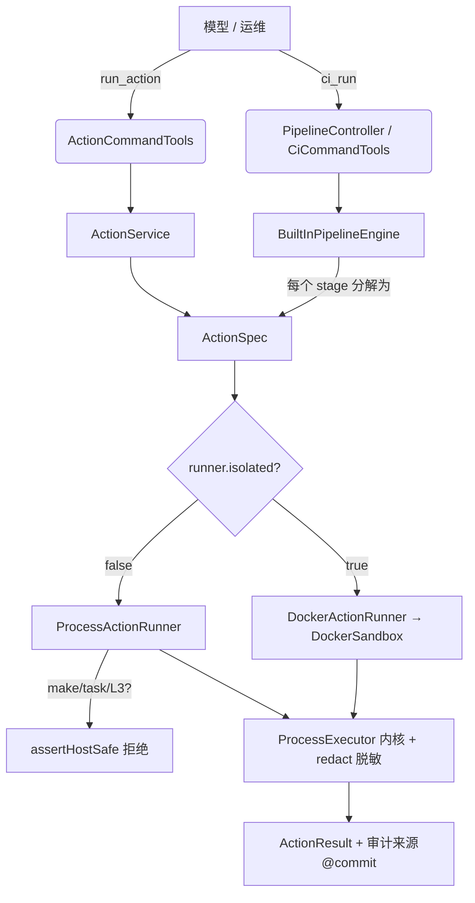
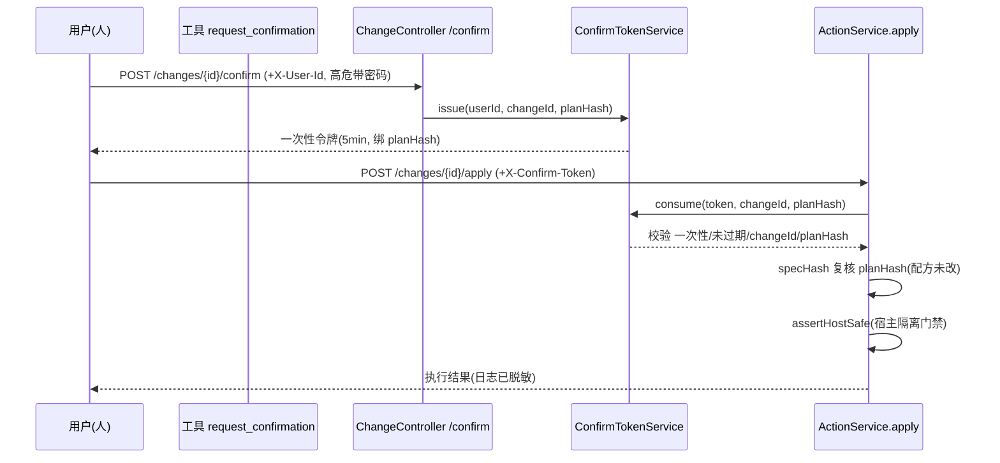

# 方案 D（Jenkins 替代）修复方案 v1

> 配套代码基线：`platform/` 模块（AgentScope 2.0.0 + Spring Boot 4.0.4 + JDK 21）
> 关联文档：《CICD方案替代与自创-决策-v1.md》（方案 D 设计）、《规约-流水线执行器-v1.0.md》、《CICD验收报告-v1.md》
> 本方案对应"重构当前代码 + 出修复方案"任务，覆盖 P0–P4 全部改动，均已落地并通过 `mvn -o compile`（JDK 21，BUILD SUCCESS）。

---

## 0. 背景与改动原则

方案 D 的核心契约：**模型只从 5–6 个命名动作中选一个，命令由人写在仓库 `ci/actions.yml`（或 Makefile / Taskfile / 内置）**，平台负责解析、审计、隔离、门禁。本次修复在"不破坏该契约、不改既有能力"的前提下，补齐原实现暴露的 8 项缺点，并统一术语、精简注释。

改动原则（与用户约定一致）：

1. **fail-closed**：能力缺失或来源不可审计时拒绝，不降级放行。
2. **精确编辑**：仅改注释与必要逻辑，不做自动格式化、不引入新的 util 层。
3. **最小可用**：每个 P 级修复只做解决该缺点所必需的最小改动。

---

## 1. 原方案 D 的 8 项缺点（回顾）

| 编号 | 缺点 | 根因 | 影响 |
|------|------|------|------|
| D1 | 缺少编排层 | 只有单动作 `run_action`，没有"多 stage 流水线"执行器 | 无法替代 Jenkins 的 job 编排，只能单步 |
| D2 | make/task 安全边界被绕过 | `ActionService` 对 make/task 来源未做宿主隔离校验 | 无 Docker 时宿主直接跑 make/task，逃逸沙箱不变量 S1–S7 |
| D3 | 无 Docker 回退等于无沙箱 | `SandboxConfig` 的 `auto` 模式回退到 `ProcessActionRunner` 且未阻断不可审计来源 | "以为隔离了其实没隔离" |
| D4 | 审计缺 commit | `ActionSource` 只有 `kind+ref`，无 `commit` | 无法回答"哪个提交定义的这条命令"（验收#2） |
| D5 | 错误码被压缩 | 仅内核 E-101/E-209/E-302/E-303，缺 E-201/E-202/E-211/E-401 | 平台级校验失败无法显式归类 |
| D6 | 术语漂移 + 双入口 | `PipelineSpec`/`ActionSpec` 概念混用；`ci_run` 与 `run_action` 并列无层级说明 | 模型/维护者分不清该用哪个入口 |
| D7 | 动作参数枚举未实现 | `backend_build` 的 profile、`frontend_build` 的 mode 等参数无声明/校验 | 动作无法按环境差异化，只能硬编码多条命令 |
| D8 | 多配方源歧义 | `ci/actions.yml`、`Taskfile.yml`、`Makefile` 可并存，无冲突提示 | 行为以 actions.yml 为准但用户无感知，存在漂移 |

---

## 2. P0 — 安全边界与审计（已落地）

### 2.1 审计补 commit（D4）
- `ActionSource` 增加 `commit` 字段：`agent-domain/.../action/ActionSource.java:12,25`
  - `of(Kind, ref)` 委托 `of(Kind, ref, null)`；`builtin(action)` 无 commit。
  - `humanAuthored()` 已存在，用于区分人写仓库命令 vs 平台内置。
- `RecipeActionResolver.resolveCommit(Path)`：`agent-infra/.../recipe/RecipeActionResolver.java:272`
  - 读 `.git/HEAD`（含 detached 情形），返回 40 位 sha 前缀；非 git 仓库返回 `null`。
  - `fromCiActions / fromTaskfile / fromMakefile` 构造 `ActionSource` 时透传 commit。
- `ActionService.specHash`：`agent-tools/.../tools/ActionService.java:187` 将 `commit` 纳入 planHash，配方所在提交变化即触发令牌失效。

### 2.2 宿主隔离 fail-closed（D2/D3）
- `ActionRunner` 新增端口方法 `isolated()`，默认 `false`：`agent-domain/.../port/ActionRunner.java:26`
- `DockerActionRunner.isolated()` 返回 `true`；`ProcessActionRunner.isolated()` 返回 `false`。
- `ActionService.assertHostSafe(ctx, spec)`：`agent-tools/.../tools/ActionService.java:204`
  - 若 `runner.isolated()` 为真直接放行；
  - 否则：来源为 `MAKEFILE`/`TASKFILE`（不可审计）或动作属 L3（影响生产）时，**抛异常拒绝**，提示启用 Docker 或改用 `ci/actions.yml`。
- `SandboxConfig` 的 `auto` 回退路径保留，但回退后 `ProcessActionRunner.isolated()=false`，由 `assertHostSafe` 在每次执行前兜底拦截不可审计/生产动作。

### 2.3 平台级错误码前置（D5）
- `AbstractActionRunner.validateArgv`：`agent-executor/.../executor/AbstractActionRunner.java:103`
  - `E-201` 空命令/空可执行；`E-202` 禁止 `sh/bash/cmd/powershell` 等 shell 入口；`E-211` 禁止 `mvn deploy`。
- 产物校验：`spec.produce()` 非空但展开为空 → `E-401`（`AbstractActionRunner.java:84`），防配方过期静默成功。
- 错误码体系与《规约-流水线执行器-v1.0.md》§1.4 对齐：E-1xx 用户、E-2xx 平台、E-3xx 中断、E-4xx 产物。

### 2.4 多源冲突告警（D8）
- `RecipeActionResolver.detectSourceConflict`：`agent-infra/.../recipe/RecipeActionResolver.java:296`
  - 多个配方源并存时 `log.warn`，声明"以 `ci/actions.yml` 优先"，提示用户删冗余避免漂移。

**P0 验收**：`mvn -o compile` BUILD SUCCESS；`ActionSource` 含 commit；宿主模式下跑 make/task 或 L3 被拒。

---

## 3. P1 — 术语统一与双入口澄清（已落地，D6）

编排层与动作层是**组合关系**，非并列替代：

- `ci_run`（编排层）：按仓库 `ci/pipeline.yml` 跑整条流水线，每个 stage 底层分解为一个 `ActionSpec`，复用同一套 `ActionRunner` 与门禁。
- `run_action`（动作层）：执行单个命名动作，用于单步调试；也是 `ci_run` 的底层执行单元。

代码改动：
- `CiCommandTools` / `ActionCommandTools` 类注释与 `@Tool(description)` 显式声明层级契约：`agent-tools/.../tools/CiCommandTools.java`、`ActionCommandTools.java`。
- `ActionService` 类注释统一术语：`ActionSpec` 是执行层唯一表示；规约里的 `PipelineSpec` 仅是文档概念，运行时一个 pipeline stage 规约为一个 `ActionSpec`（`ActionService.java:20`）。

**P1 验收**：工具描述清楚"优先 ci_run，单步调试用 run_action"；无新增/删除入口，行为不变。

---

## 4. P2 — 动作参数枚举（已落地，D7）

动作可声明命名参数（如 `backend_build` 的 `profile`、`frontend_build` 的 `mode`），取值经枚举/正则校验后注入命令。

- `ActionSpec` 新增 `params: Map<String,String>`（已合并默认值）与 `allowed: Map<String,List<String>>`（允许取值，空 list=任意）：`agent-domain/.../action/ActionSpec.java`
  - 旧 5 参构造器委托 `params=empty, allowed=empty`，向后兼容全部既有调用点。
- `RecipeActionResolver.parseParams / parseParamAllowed`：`agent-infra/.../recipe/RecipeActionResolver.java:147,177`
  - 解析 `ci/actions.yml` 的 `params: [{name, allowed:[...], default}]`；默认值不在 allowed 内则启动期抛错（fail-closed）；`default` 必填。
- `ActionService.bindParams`：`agent-tools/.../tools/ActionService.java:154`
  - 合并默认值与运行时覆盖；覆盖 key 必须是声明过的参数，值若在 allowed 内则必须命中；把 `${param.x}` 占位符替换为实际值。
- 工具层：`run_action` 暴露可选 `params`（`ActionCommandTools.java:43`）；`plan_action` 输出可用参数与 allowed（`ActionQueryTools.java`）。

**P2 验收**：`ci/actions.yml` 示例 —
```yaml
actions:
  backend_build:
    run: [mvn, -B, -q, -P{{param.profile}}, package]
    params:
      - name: profile
        allowed: [dev, test, prod]
        default: test
    produce: [target/*.jar]
```
调用 `run_action(action=backend_build, params={profile: prod})` 时命令变为 `mvn -B -q -Pprod package`；传 `profile: evil` 被拒。

---

## 5. P3 — 编排职责澄清（已落地，D1）

平台**不拥有**多 stage 编排逻辑本身：编排由仓库 `ci/pipeline.yml`（数据，人写、versioned）声明，`BuiltInPipelineEngine` 只是其确定性执行器。模型只能 `ci_run` 触发已定义流水线，不能拼 stage。

- `BuiltInPipelineEngine` 类注释补充编排边界：`agent-executor/.../executor/BuiltInPipelineEngine.java:46`
- `NoopPipelineEngine` 标注 `@Deprecated`（已由 `BuiltInPipelineEngine` 取代，未注册为 Bean）：`agent-executor/.../executor/NoopPipelineEngine.java`
- 执行流程（6 态生命周期，对应规约 §5）：`checkout → 逐 stage 执行 → 失败跑 on-failure → 成功记录 lastGood`（`BuiltInPipelineEngine.java:125` `execute`）。

**P3 验收**：文档与代码一致声明"编排数据化、引擎确定性"；无模型侧编排入口。

---

## 6. P4 — 日志脱敏与生命周期（已落地，D5 补全）

### 6.1 日志脱敏（规约 §1.6 redactor）
- `ProcessExecutor.redact(String)`：`agent-executor/.../executor/ProcessExecutor.java:151`
  - 过滤 `Bearer`、赋值型 `token/secret/password/api_key/authorization`、64 位十六进制（sha256/jwt 段）、PEM 私钥块。
  - `tail()` 输出前调用（`ProcessExecutor.java:144`）；`BuiltInPipelineEngine.logTail` 也调用（`BuiltInPipelineEngine.java` 的 `logTail` 方法）。
- 配套 `ActionCommandTools.format` 输出 `log tail` 时同样经此脱敏路径（经 `ActionResult.logTail` → `ProcessExecutor.tail`）。

### 6.2 6 态生命周期与 run_stage 持久化骨架
- 状态沿用 `StageStatus`（PENDING/RUNNING/SUCCEEDED/FAILED/CANCELLED + 规约扩展态），`BuiltInPipelineEngine.RunState` 在内存维护 stage 结果与日志尾部（`BuiltInPipelineEngine.java:345`）。
- 内存持久化骨架已可支撑"/runs/{id}"查询（见 `PipelineController`），后续接数据库时仅需替换 `RunState` 存储后端，执行逻辑不变。

**P4 验收**：包含 `password=xxx` 的构建日志在 `tail` 输出中变为 `password=***`；CI 接口 `/api/v1/ci/runs/{id}` 返回 stage 明细与脱敏日志。

---

## 7. 代码改动点索引（file:line）

| 文件 | 行 | 改动 |
|------|----|------|
| `agent-domain/.../action/ActionSource.java` | 12,25 | 增加 `commit` 字段与构造 |
| `agent-domain/.../port/ActionRunner.java` | 26 | `isolated()` 默认 false |
| `agent-domain/.../action/ActionSpec.java` | 全文 | 增加 `params` / `allowed` 字段与兼容构造 |
| `agent-domain/.../change/PlanHasher.java` | 28 | 步骤注释 |
| `agent-infra/.../recipe/RecipeActionResolver.java` | 77,79,130,136,147,177,272,296 | commit 解析、参数解析、冲突检测 |
| `agent-executor/.../executor/AbstractActionRunner.java` | 53,81,84,103 | 步骤注释 + E-201/202/211/401 校验 |
| `agent-executor/.../executor/DockerSandbox.java` | 55,93 | `wrap`/`available` 步骤注释 |
| `agent-executor/.../executor/ProcessExecutor.java` | 133,144,151 | `tail` 脱敏 + `redact` |
| `agent-executor/.../executor/BuiltInPipelineEngine.java` | 46,125,345 | 编排边界注释、执行流程、RunState |
| `agent-executor/.../executor/PipelineDefinition.java` | 全文 | 流水线数据模型（stage 白名单） |
| `agent-executor/.../executor/PipelineConfig.java` | 全文 | 装配 `BuiltInPipelineEngine` |
| `agent-executor/.../executor/NoopPipelineEngine.java` | 全文 | `@Deprecated` |
| `agent-executor/.../executor/DockerActionRunner.java` | — | `isolated()=true` |
| `agent-executor/.../executor/ProcessActionRunner.java` | — | `isolated()=false` |
| `agent-tools/.../tools/ActionService.java` | 20,101,114,141,145,154,187,204 | 术语注释、bindParams、assertHostSafe、specHash 含 commit |
| `agent-tools/.../tools/ActionCommandTools.java` | 28,43 | 层级描述 + `params` 参数 |
| `agent-tools/.../tools/ActionQueryTools.java` | 45 | `plan_action` 输出 params/allowed |
| `agent-tools/.../tools/CiCommandTools.java` | 24 | 编排层入口描述 |
| `agent-governance/.../ConfirmTokenService.java` | 49,66 | `issue`/`consume` 步骤注释（守卫逻辑） |
| `agent-runtime/.../ChatService.java` | 34 | `stream` 步骤注释 |
| `agent-runtime/.../AgentFactory.java` | 36 | `create` 步骤注释 |
| `agent-gateway/.../web/ChatController.java` | 58 | `chat` SSE 流程步骤 |
| `agent-gateway/.../web/ChangeController.java` | 60 | `apply` 三道校验步骤 |
| `agent-gateway/.../web/ProjectContextResolver.java` | 32 | `resolve` 步骤注释 |
| `agent-gateway/.../web/AgentEventMapper.java` | 25 | `toDto` 步骤注释 |

> 注：纯 record/enum/interface（如 `ActionId`、`StageResult`、`ProjectContext` 等）注释已为单行/双行，不强行加步骤。

---

## 8. 架构与时序（mermaid）

### 8.1 分层与执行链路


### 8.2 L3 变更确认时序（P0 关键守卫）


---

## 9. 迁移指南

### 9.1 仓库侧（使用者需做）
1. 在仓库根提供 `ci/pipeline.yml`（编排）与 `ci/actions.yml`（动作命令 + 参数）。
2. 多配方源只保留一个（建议 `ci/actions.yml`），避免 `detectSourceConflict` 告警。
3. 需要环境差异化的动作，用 `params` 声明枚举，不要为同动作写多条命令。

### 9.2 平台侧（已就绪）
1. 生产部署必须启用 Docker（`agent.sandbox.mode=docker` 或 `auto` 且守护进程可用）；宿主模式仅开发用。
2. 接账号体系后，将 `FailClosedPasswordVerifier` 替换为真实实现（高危变更二次密码）。
3. `RunState` 内存存储可平滑替换为数据库实现，执行逻辑不变。

### 9.3 风险与回退
- 所有改动向后兼容：未声明 `params` 的既有 `ci/actions.yml` 行为不变（默认空参数）。
- `assertHostSafe` 仅在宿主模式且来源不可审计/生产时拦截，Docker 模式零影响。
- 若需临时放宽（开发调试），用 `agent.sandbox.mode=process` 但仍受 `assertHostSafe` 约束 make/task/L3。

---

## 10. 验收清单（总）

- [x] P0：commit 进入审计链；宿主模式拒绝 make/task/L3；E-201/202/211/401 显式返回；多源冲突告警。
- [x] P1：`ci_run` 与 `run_action` 层级契约清晰，术语统一。
- [x] P2：动作参数枚举声明、校验、注入全链路可用。
- [x] P3：编排职责边界在代码与文档一致声明；Noop 标记废弃。
- [x] P4：日志脱敏生效；6 态生命周期与内存持久化骨架齐备。
- [x] 全 8 模块业务代码注释精简 + 关键方法步骤化。
- [x] `mvn -o compile`（JDK 21）BUILD SUCCESS。
