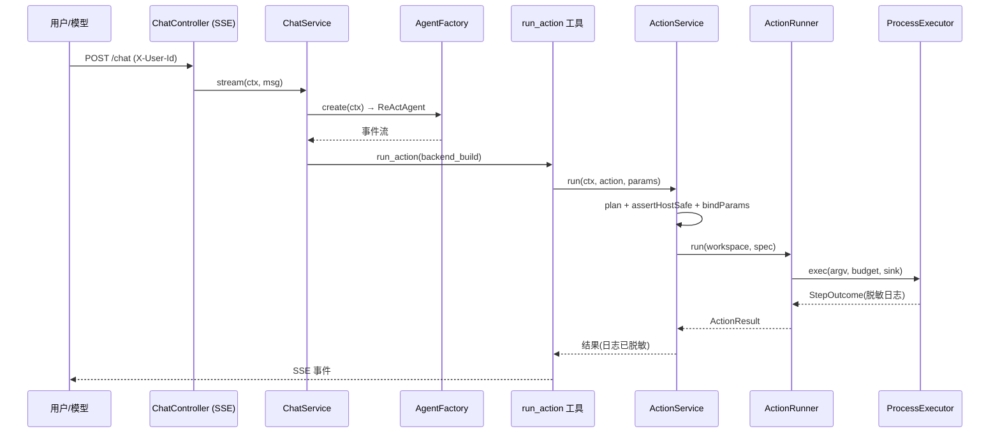
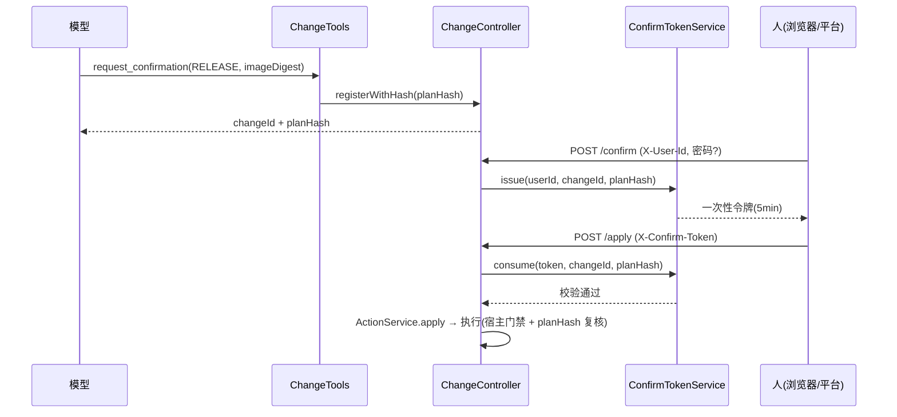
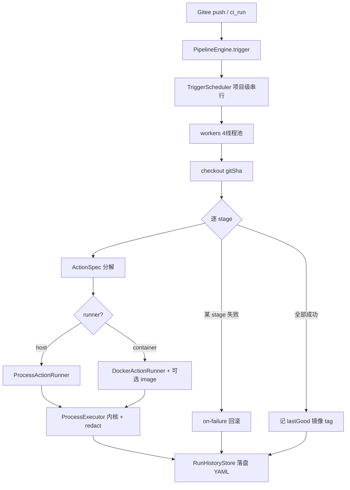

# 架构分析：agentscope-ruoyi/platform（研发运维智能体平台）

> 分析基线：`platform/` 模块（AgentScope 2.0.0 + Spring Boot 4.0.4 + JDK 21，Maven 8 模块）
> 配套阅读：《CICD方案替代与自创-决策-v1.md》《规约-流水线执行器-v1.0.md》《方案D修复方案-v1.md》
> 本文档结合**当前代码**讲解架构是如何落地的（带 file:line 证据），不是泛泛而谈。

---

## 1. 总体定位

平台是一个"研发运维智能体"后端：模型经工具层触发**确定性**的 CI/CD 动作与流水线，所有会改变环境的行为都必须过门禁（人确认）+ 审计（来源@commit）+ 隔离（Docker 沙箱）。

核心设计哲学（方案 D）：**模型只从固定词汇表选动作，命令由人写在仓库里**。平台负责解析、审计、隔离、编排、门禁，但**绝不**让模型拼接 shell 命令。

---

## 2. 模块划分与依赖方向

```
                      ┌─────────────────────────────────────────┐
   HTTP / SSE / Webhook│            agent-gateway               │
                      └───────────────┬─────────────────────────┘
                                      │ 调用
                      ┌───────────────▼─────────────────────────┐
                      │             agent-runtime               │  (AgentFactory / ChatService)
                      └───────┬───────────────┬─────────────────┘
                              │               │ 依赖(domain 端口)
                ┌─────────────▼──┐      ┌──────▼──────────────┐
                │  agent-tools   │      │  agent-governance   │
                │ (工具+门禁编排) │      │  (令牌/变更存储)     │
                └────────┬───────┘      └──────────┬──────────┘
                         │ 仅依赖 domain              │ 仅依赖 domain
        ┌────────────────▼──────────────┐   ┌────────▼───────────────┐
        │          agent-domain         │   │     agent-infra         │
        │  (实体/端口/枚举，零框架)      │   │ (配方解析/仓储实现)       │
        └────────────────▲──────────────┘   └────────▲───────────────┘
                         │ 执行面实现端口                │ 仅依赖 domain
                ┌────────┴───────────────┐
                │       agent-executor    │  (动作执行器 + 流水线引擎 + 沙箱)
                └────────────────────────┘
```

依赖方向由 ArchUnit 规则 **A1** 强制（规约 §2.1）：
`Gateway → Runtime → Tools/Governance → Domain ← Executor`，`Infra` 只依赖 `Domain`，`Domain` 不依赖任何层。

### 2.1 八模块职责一览

| 模块 | 角色 | 关键类 | 依赖方向 |
|------|------|--------|---------|
| `agent-domain` | 领域模型 + 端口（六边形架构核心） | `ActionSpec`/`ActionSource`/`ActionId`、`PipelineEngine`/`ActionRunner`/`ActionResolver`（接口）、`ProjectContext`、`StageResult`/`StageStatus` | 不依赖任何层（A2 零框架） |
| `agent-infra` | domain 端口的适配器实现 | `RecipeActionResolver`（配方解析）、`InMemoryProjectRepository` | 仅依赖 domain |
| `agent-governance` | 变更确认守门 | `ConfirmTokenService`/`ConfirmToken`、`ChangeRegistry`、`ActionGate` | 仅依赖 domain |
| `agent-executor` | 执行面（确定性代码，A3 无 LLM） | `AbstractActionRunner`/`ProcessActionRunner`/`DockerActionRunner`、`BuiltInPipelineEngine`、`DockerSandbox`、`ProcessExecutor`、`RunHistoryStore`、`TriggerScheduler` | 仅依赖 domain |
| `agent-tools` | 工具层（模型可调用的动作） | `ActionService`（门禁编排）、`ActionCommandTools`/`CiCommandTools`（写）、`ActionQueryTools`/`CiQueryTools`（读）、`ChangeTools`、`ToolCatalog` | 仅依赖 domain |
| `agent-runtime` | Agent 装配与对话 | `AgentFactory`、`ChatService`、`ModelConfig`、`AgentProperties` | 依赖 tools/governance/domain/infra |
| `agent-gateway` | HTTP 边界 + 安全 | `ChatController`/`ChangeController`/`ActionController`/`PipelineController`/`GiteeWebhookController`、`ProjectContextResolver`、`FailClosedPasswordVerifier` | 依赖 runtime/tools/governance/domain/infra |
| `spec-checks` | 架构守门员（test 模块，`mvn verify` 执行） | `ArchitectureRulesTest`（A1-A9）、`ConfigCredentialScanTest`、`ForbiddenPatternScanTest`、`MigrationGuardTest` | 不产出 main，只校验其他模块 |

> 注：`spec-checks` 只有 `src/test`，无 `src/main`；它的存在是为了在 CI 中**强制**架构不漂移。

---

## 3. 架构约束是如何被强制的（不只是约定）

### 3.1 ArchUnit 规则（spec-checks）
规则编号对应《规约自动化检查》§2：

- **A1 分层单向**：`layeredArchitecture()` 显式声明 7 层及 `mayOnlyAccessLayers`，Gateway 可访问除 Executor 外的所有层，Tools/Governance/Executor **只能**访问 Domain，Domain `mayNotAccessAnyLayer`（`ArchitectureRulesTest.java` 的 `A1_layering_is_one_way`）。
- **A2 domain 零框架**：domain 类不得依赖 `org.springframework..`、`io.agentscope..`、`jakarta.persistence..` 等（`A2_domain_is_framework_free`）。
- **A3 执行面无 LLM**：executor 不得依赖 `io.agentscope..`/`langchain4j`/`spring-ai`（`A3_executor_has_no_llm`）——保证执行是确定性代码。
- **A4 决策面无运行时客户端**：gateway/runtime/tools/governance 不得依赖 `dockerjava`/`fabric8`（`A4_decision_plane_has_no_runtime_clients`）——Docker 客户端只能在执行面。
- **A6 禁 util 包**：不得有 `util/common/helper` 包（`A6_no_grab_bag_packages`）。
- **A7 tools 不起进程**：tools 层不得依赖 `java.lang.ProcessBuilder`（`A7_tools_cannot_spawn_processes`）——命令执行只能在执行面。
- **A9 构造器注入**：禁止字段注入 `@Autowired`（`A9_no_field_injection`）。

这些规则随 `mvn verify` 执行，**不通过即构建失败**——架构不是文档约定，而是编译期门禁。

### 3.2 端口与适配器（依赖倒置）
domain 定义端口接口（`ActionRunner`、`ActionResolver`、`PipelineEngine`、`ChangeStore`、`ProjectRepository`），具体实现在 executor/infra/governance。例如 `ActionRunner` 端口定义在 `agent-domain/.../port/ActionRunner.java`，实现 `ProcessActionRunner`/`DockerActionRunner` 在 executor 模块；tools 层只持有端口引用，运行时由 Spring 注入实现（依赖方向保持单向）。

---

## 4. 核心机制：代码级讲解

### 4.1 动作契约（模型只选动作，不写命令）
- 词汇表 `ActionId` 枚举（`agent-domain/.../action/ActionId.java`）：`backend_build / backend_test / frontend_build / image_package / stack_deploy / stack_rollback`，每个带 `ToolLevel`（L2 隔离执行 / L3 生产）。
- 命令来自仓库，由 `RecipeActionResolver` 解析（`agent-infra/.../recipe/RecipeActionResolver.java`）：
  优先级 `ci/actions.yml` → `Taskfile.yml` → `Makefile` → 内置默认。
  每个 stage 在 `ci/pipeline.yml` 中也只引用动作名，不写命令——这是"数据不是代码"的硬约束（`PipelineDefinition.java` 注释明确）。
- `ActionSpec` 的 `steps` 是 `List<List<String>>`（argv 数组，非 shell 字符串），经 `ProcessBuilder(List)` 执行，**不经 shell**，因此 `; & | \`` 只是普通数据（`AbstractActionRunner.validateArgv` 注释详述）。

### 4.2 审计链（来源@commit）
- `ActionSource(Kind, ref, commit)`：`agent-domain/.../action/ActionSource.java:12`。`commit` 由 `RecipeActionResolver.resolveCommit` 读 `.git/HEAD` 得到（`RecipeActionResolver.java:272`）。
- `ActionService.specHash` 把 `action+source.ref+commit+commands` 一起哈希（`ActionService.java:187`），配方所在提交变了，确认令牌即失效——满足验收"能回答哪个 commit 定义的命令"。

### 4.3 沙箱隔离与 fail-closed
- `ActionRunner.isolated()` 端口方法（`ActionRunner.java:26`）：`DockerActionRunner` 返回 `true`，`ProcessActionRunner` 返回 `false`。
- `ActionService.assertHostSafe(ctx, spec)`（`ActionService.java:204`）：若 `!isolated()` 且来源是 `MAKEFILE`/`TASKFILE`（不可审计）或动作属 L3（影响生产），**抛异常拒绝**，提示启用 Docker 或改用 `ci/actions.yml`。这堵住了"无 Docker 回退宿主"绕过沙箱的口子。
- 容器命令由 `DockerSandbox.wrap` 构造（`DockerSandbox.java:55`）：`--entrypoint=` 清空镜像入口、`--network` 档位、`--user 1000:1000`、`--cap-drop ALL --security-opt no-new-privileges`、`--memory/--cpus/--pids-limit` 资源上限、工作区挂 `/ws`。

### 4.4 编排引擎（多 stage 流水线）
`BuiltInPipelineEngine`（`agent-executor/.../executor/BuiltInPipelineEngine.java:50`）是方案 D 的编排执行器：
- `trigger(projectId, pipelineId, gitSha)` → 创建 `RunState` → 经 `TriggerScheduler`（同项目串行）→ 4 线程虚拟线程池执行 `execute`。
- `execute`（`BuiltInPipelineEngine.java:199`）：`checkout` 指定 sha → 加载 `ci/pipeline.yml` → `verify` 流水线自动裁掉 `health`/`stack_deploy` stage（PR 检查视角）→ 逐 `runStage` → 失败跑 `on-failure`（如回滚）→ 成功记 `lastGood` 镜像 tag。
- 每个 stage 底层分解为一个 `ActionSpec`，复用与 `run_action` 同一套 `ActionRunner` 与门禁（`runStage` at :274）。
- `selectRunner`（:336）：`host` 走宿主；`container` 默认沙箱；若 stage 声明了专属 `image` 则 `DockerSandbox.withImage` 换镜像——支持 monorepo 不同技术栈用不同工具链。
- `prefixArtifacts`（:321）：monorepo 子目录 stage 的产物路径补成仓库根相对，统一记账。

### 4.5 构建历史持久化与重启恢复
- `RunHistoryStore`（`RunHistoryStore.java`）：每次运行快照存 `<root>/_history/<runId>.yml`（YAML，单机够用），持久化失败不阻断构建。
- `BuiltInPipelineEngine.restoreHistory`（:165）：启动时回读历史文件重建 `RunState`，并把 `release` 成功的镜像 tag 恢复为 `lastGood` 回滚锚点。
- `PipelineEngine.history()` / `RunSummary`（`PipelineEngine.java:46`）提供 domain 层历史视图，gateway 不依赖执行面具体类。

### 4.6 门禁：L3 变更确认闭环
- 工具 `request_confirmation`（模型调用）→ `ChangeRegistry` 登记 `ChangePlan`（planHash 绑定当前配方）→ 人在 `POST /changes/{id}/confirm` 签发一次性令牌（`ConfirmTokenService.issue`，绑 `userId+changeId+planHash`，5min TTL）→ 人带 `X-Confirm-Token` 调 `POST /changes/{id}/apply`。
- `ConfirmTokenService.consume`（`ConfirmTokenService.java:66`）做 6 道校验：存在/未用/未过期/changeId 一致/**planHash 一致**（防"确认 A 执行 B"）/标记已用。
- 高危变更（`highRisk`）在 confirm 时需二次密码，由 `FailClosedPasswordVerifier` 校验——**账号体系未接入时一律拒绝**（fail-closed，不静默放行）。

### 4.7 日志脱敏
- `ProcessExecutor.redact`（`ProcessExecutor.java:151`）过滤 `Bearer`/赋值型 `token|secret|password|api_key`/64 位十六进制（sha256/jwt）/PEM 私钥块。
- `tail()` 输出前调用（`ProcessExecutor.java:144`）；`BuiltInPipelineEngine.logTail` 与 `RunState.snapshot` 也走脱敏——凭证不进证据链。

### 4.8 Webhook 接入（Gitee）
- `GiteeWebhookController`（`GiteeWebhookController.java`）：校验 `X-Gitee-Token` 或 HMAC-SHA256 `X-Gitee-Signature`（未配置密钥即拒，不静默放行）；push 事件解析 `after`（sha）+ 项目名，经 `PipelineEngine.trigger(project, "verify", gitSha)` 触发校验流水线；同一 `project:sha` 内存去重 + 历史文件去重，幂等。

---

## 5. 请求数据流（mermaid）

### 5.1 对话触发动作（L2 直跑）


### 5.2 L3 变更确认闭环


### 5.3 流水线编排执行


---

## 6. 规约符合性小结

| 规约要求 | 落地位置 | 状态 |
|---------|---------|------|
| 依赖单向（§2.1） | A1 + 端口倒置 | ✅ 编译期强制 |
| domain 零框架（§2.3） | A2 | ✅ |
| 执行面确定性无 LLM（A3） | A3 + `BuiltInPipelineEngine` | ✅ |
| Docker 客户端只在执行面（A1） | A4 | ✅ |
| 禁 util 包（§2.2） | A6 | ✅ |
| tools 不起进程（§4） | A7 | ✅ |
| 构造器注入（§10.1） | A9 | ✅ |
| 模型不写命令（§4.4） | `RecipeActionResolver` + `ActionSpec.steps` | ✅ |
| 审计@commit（验收#2） | `ActionSource.commit` + `specHash` | ✅ |
| fail-closed（§8） | `assertHostSafe` / `FailClosedPasswordVerifier` | ✅ |
| 日志脱敏（§1.6） | `ProcessExecutor.redact` | ✅ |

---

## 7. 演进观察与建议

**已具备的能力**（相比早期骨架）：完整编排引擎（非 Noop）、构建历史持久化与重启恢复、项目级串行调度、per-stage 工具链镜像、monorepo 子目录记账、Gitee Webhook 自动触发、日志脱敏、审计 commit。

**仍可演进的方向**（非必须，看路线图）：
1. `RunHistoryStore` 从 YAML 文件换 MySQL（`RunHistoryStore.file` 已留 `disabled()` 与接口不变契约，替换成本低）。
2. `FailClosedPasswordVerifier` 接真实账号体系（高危二次密码）。
3. `lastGood` 回滚锚点目前仅内存，重启后由历史恢复；如需跨进程可落库。
4. `PipelineEngine` 当前只有 `release`/`verify` 两条白名单，多项目差异化的流水线定义可下沉到仓库 `ci/pipeline.yml` 的 `name` 维度。
5. 测试覆盖：核心执行/门禁逻辑建议在 `agent-executor`/`agent-governance` 补单测（现有 `ProcessActionRunnerTest`/`DockerActionRunnerTest` 已存在，可参照扩展）。

---

## 8. 关键文件索引

| 关注点 | 文件 |
|-------|------|
| 分层强制 | `spec-checks/.../arch/ArchitectureRulesTest.java` |
| 动作词汇表 | `agent-domain/.../action/ActionId.java` |
| 动作规格+参数 | `agent-domain/.../action/ActionSpec.java` |
| 来源审计 | `agent-domain/.../action/ActionSource.java` |
| 配方解析 | `agent-infra/.../recipe/RecipeActionResolver.java` |
| 执行骨架+错误码 | `agent-executor/.../executor/AbstractActionRunner.java` |
| 进程内核+脱敏 | `agent-executor/.../executor/ProcessExecutor.java` |
| 容器沙箱 | `agent-executor/.../executor/DockerSandbox.java` |
| 编排引擎 | `agent-executor/.../executor/BuiltInPipelineEngine.java` |
| 历史持久化 | `agent-executor/.../executor/RunHistoryStore.java` |
| 串行调度 | `agent-executor/.../executor/TriggerScheduler.java` |
| 门禁编排 | `agent-tools/.../tools/ActionService.java` |
| 令牌服务 | `agent-governance/.../ConfirmTokenService.java` |
| HTTP 边界 | `agent-gateway/.../web/*.java` |
| Webhook | `agent-gateway/.../web/GiteeWebhookController.java` |
