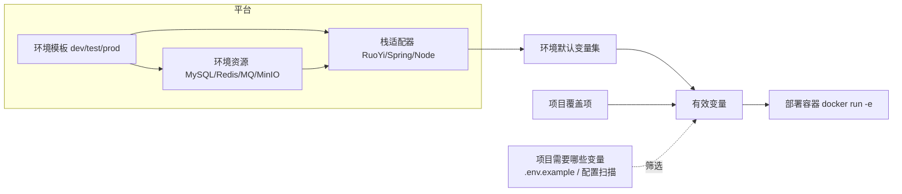

# 环境模板与中间件自动注入 · 可行性分析与实施计划 v1

> ⚠️ 本文已被 [v2](环境变量与环境模板设计-v2.md) 取代（决策已更新：test-* 非标准、远程发现、端口冲突处理、Agent 确认后运行）。保留本文仅作历史记录。
>
> 状态：方案评审稿（未实施）
> 关联：[流水线工作台使用指南](流水线工作台-使用指南-v1.md) §3.5 ｜ [发布编排与平台部署器](发布编排与平台部署器-v1.md)
> 目标读者：平台后端 / 前端 / 交付

---

## 0. 结论摘要

你的诉求可以拆成三件事，**都可行，但不能混成一件**：

| 诉求 | 可行性 | 结论 |
|---|---|---|
| 开发 / 测试 / 生产三套**环境模板**，默认变量按环境自动注入 | 可行 | 改成"环境模板 + 项目覆盖"两层，替代现在"每个项目手工配一遍" |
| 把数据库/中间件（MySQL、Redis、RabbitMQ、MinIO…）里已有的配置**自动放上去** | 可行（本机 Docker 可自动发现；远程服务器需 SSH/compose 来源） | 增加"环境资源"模型 + Docker 自动发现导入 |
| Agent 根据 `.env` / 项目**自己挑选环境**并自动注入 | 部分可行 | Agent 可以做"识别需要哪些变量 + 建议映射 + 建议环境"，**不能**在部署时自主读取密钥/选择生产环境；必须人确认后由平台确定性注入 |

一句话方案：

> **环境（dev/test/prod）是变量注入的第一优先级；环境里挂中间件资源与默认变量；项目只写覆盖项；运行前把"有效变量"展示成人能核对的清单；Agent 只参与配置期建议，不参与运行期取值。**

---

## 1. 现状与真实问题

### 1.1 现在是什么样

- 已实现：`project_env_vars` 按 **(projectId, env)** 存变量，AES-GCM 加密，部署时 `docker run -e` 注入（上一轮完成）。
- 现在的问题（也是你截图里"0 个变量"的原因）：
  1. **没有"环境"这一层**：每接一个项目都要把 `DB_HOST/REDIS_HOST/...` 重配一遍；
  2. **没有中间件资源**：平台不知道测试环境的 MySQL/Redis 在哪、账号是什么；
  3. **没有继承/覆盖关系**：项目特殊配置无法表达"只改一个库名，其余用测试环境默认"；
  4. **没有自动发现**：本机 `test-mysql`、`test-redis`、`test-rabbitmq`、`test-minio` 已经存在，但平台完全不知道。

### 1.2 本机环境的实际事实（已核对）

```text
test-mysql      mysql:8.0                network=test_default   未映射宿主端口
test-redis      redis:7-alpine           network=test_default   未映射宿主端口
test-rabbitmq   rabbitmq:3.12-management network=test_default   未映射宿主端口
test-minio      minio/minio:latest       network=test_default   未映射宿主端口
```

这带来一个**必须一起解决的部署问题**：

- 中间件没有 `-p` 映射，应用容器**不能**通过 `127.0.0.1:3306` 访问；
- 应用容器必须加入 `test_default` 网络，并用容器名 DNS（`test-mysql` / `test-redis`）访问；
- 当前 `DockerDeployer` 只在默认 bridge 上 `docker run`，**没有 `--network`** —— 即使把变量注进去，`DB_HOST=test-mysql` 也解析不了。

另外，RuoYi 项目自身需要 **20+ 个变量**（来自 `ruoyi-admin/docker/.env`）：

```text
DB_HOST DB_PORT DB_NAME DB_USERNAME DB_PASSWORD DB_USE_SSL
REDIS_HOST REDIS_PORT REDIS_DATABASE REDIS_PASSWORD
TOKEN_SECRET TOKEN_EXPIRE_TIME RONGX_AES_KEY RONGX_AES_IV
SERVER_PORT TZ DRUID_* JAVA_OPTS LOG_LEVEL_APP DASHSCOPE_API_KEY ...
```

这些值目前只在 Jenkinsfile / 本地 `.env` 里，平台侧没有结构化来源。

### 1.3 当前代码的相关位置

| 能力 | 现在 | 需要改 |
|---|---|---|
| 变量存储 | `project_env_vars(project_id, env, key, ...)` | 增加环境模板表；现有行迁移为项目覆盖 |
| 中间件 | 无 | 新增 `env_resources`（mysql/redis/rabbitmq/minio…） |
| 部署注入 | `DeployRequest.env` → `docker run -e` | 再传 `--network`、健康预检 |
| 环境选择 | 流水线页环境胶囊 | 绑定"默认流水线 + 部署目标 + 变量集" |
| 自动填充 | 手工/批量粘 `.env` | Docker 发现、`.env` 导入、栈适配器 + Agent 建议 |

---

## 2. 目标模型：三层结构



### 2.1 环境模板（全局，只有 3 个）

每个环境固定包含：

- 中间件资源：MySQL / Redis / RabbitMQ / MinIO / PostgreSQL…（可多条）；
- 环境默认变量：由中间件通过**栈适配器**派生，也可手工补充；
- 部署默认：默认部署目标、网络、端口、健康路径；
- 生命周期：中间件是否由平台托管（compose up/down）或仅登记连接信息。

### 2.2 项目覆盖（可选）

只存"这个项目与环境的差异"，例如：

```text
环境：测试
  继承：test 环境模板（12 个变量）
  覆盖：DB_NAME=ry-vue-wnz   REDIS_DATABASE=1
```

合并规则（后者覆盖前者）：

```text
环境模板中间件派生
  → 环境模板手工变量
    → 项目覆盖
      → 运行参数（本次触发的 deploy.target 等，不覆盖变量）
```

### 2.3 运行快照

触发时把"本次实际生效的变量"冻结进运行记录（只存 key + 来源 + hash，**不存明文**），
失败排查时能回答："这次用的是测试环境模板还是项目覆盖？哪个值变了？"

---

## 3. 环境里"有什么"：中间件资源模型

### 3.1 表结构（建议）

```sql
CREATE TABLE env_resources (
  id            TEXT PRIMARY KEY,
  env           TEXT NOT NULL,          -- dev / test / prod
  kind          TEXT NOT NULL,          -- mysql / redis / rabbitmq / minio / postgres / mongo
  name          TEXT NOT NULL,          -- 展示名，如 "测试-MySQL"
  host          TEXT NOT NULL,          -- 应用容器视角：test-mysql / 10.0.0.12
  port          INTEGER NOT NULL,
  database_name TEXT,
  username      TEXT,
  password_enc  TEXT,
  password_iv   TEXT,
  network       TEXT,                   -- docker network，如 test_default
  options       TEXT,                   -- JSON：ssl、vhost、bucket、region…
  source        TEXT,                   -- DISCOVERED / MANUAL / COMPOSE / DOTENV
  enabled       INTEGER NOT NULL DEFAULT 1,
  updated_at    INTEGER NOT NULL
);

CREATE TABLE env_vars (                  -- 环境模板的额外/派生变量
  env        TEXT NOT NULL,
  var_key    TEXT NOT NULL,
  value_enc  TEXT NOT NULL,
  value_iv   TEXT NOT NULL,
  is_secret  INTEGER NOT NULL DEFAULT 1,
  source     TEXT,                      -- RESOURCE / MANUAL
  PRIMARY KEY (env, var_key)
);

CREATE TABLE project_env_overrides (    -- 迁移自现有 project_env_vars
  project_id TEXT NOT NULL,
  env        TEXT NOT NULL,
  var_key    TEXT NOT NULL,
  value_enc  TEXT NOT NULL,
  value_iv   TEXT NOT NULL,
  is_secret  INTEGER NOT NULL DEFAULT 1,
  PRIMARY KEY (project_id, env, var_key)
);
```

迁移：现有 `project_env_vars` 全部转成 `project_env_overrides`（语义不变，不丢数据）。

### 3.2 自动发现（本机 Docker）

对每个容器执行 `docker inspect`（**不启动容器**）：

| 镜像族 | 识别字段 | 可导入信息 |
|---|---|---|
| mysql / mariadb | `MYSQL_ROOT_PASSWORD` / `MYSQL_DATABASE` / `MYSQL_USER` | host=容器名、port=3306、user、password |
| redis | 启动命令 / `REDIS_PASSWORD` | host、port=6379、password（可空） |
| rabbitmq | `RABBITMQ_DEFAULT_USER/PASS/VHOST` | host、port=5672、user/pass/vhost |
| minio | `MINIO_ROOT_USER/PASSWORD` | host、port=9000、access/secret key |
| postgres | `POSTGRES_PASSWORD/DB/USER` | host、port=5432、db/user/pass |

同时读取 `NetworkSettings.Networks`，得到 `network=test_default`，作为部署时的 `--network`。

**能力边界**：
- 本机 Docker：可以全自动发现；
- 远程生产服务器：需要 SSH（已有 `SshAccess`）执行 `docker inspect` 或读取远端 compose；
- 手工/云数据库：只能登记，不能"发现"。

### 3.3 从资源到变量：栈适配器

不同技术栈键名不同，不能让中间件直接"全量导出"。建议按项目类型或 `.env.example` 选择适配器：

| 资源 | RuoYi（`type=ruoyi-plus`） | Spring Boot 通用 | Node 通用 |
|---|---|---|---|
| MySQL | `DB_HOST/PORT/NAME/USERNAME/PASSWORD/USE_SSL` | `SPRING_DATASOURCE_URL/USERNAME/PASSWORD` | `DATABASE_URL` |
| Redis | `REDIS_HOST/PORT/DATABASE/PASSWORD` | `SPRING_DATA_REDIS_*` | `REDIS_URL` |
| RabbitMQ | `RABBITMQ_HOST/PORT/USERNAME/PASSWORD/VHOST` | `SPRING_RABBITMQ_*` | `AMQP_URL` |
| MinIO | `MINIO_ENDPOINT/ACCESS_KEY/SECRET_KEY/BUCKET` | 同左（自定义） | 同左 |

项目是 `generic-java` 且没有已知模板时：读 `.env.example` / `application*.yml` 里的占位符，
按命名规则（`*_HOST`、`*_PORT`、`*_PASSWORD`）匹配资源，**生成草案，不直接生效**。

### 3.4 网络与预检（必须做）

1. `env_resources` 带 `network`，`DockerDeployer` 增加 `--network <env.network>`；
2. 部署前增加 **环境预检**：
   - 中间件容器是否 running（当前 4 个 test-* 都是 `Exited`）；
   - 从构建网络/应用网络能否解析并 TCP 连通 `host:port`；
   - 失败直接给出可读原因，不再等到健康检查超时；
3. 可选：平台托管中间件生命周期（`docker compose up -d`），或在页面提供"启动测试环境中间件"按钮。

---

## 4. Agent 能力边界：哪些能做，哪些不能做

### 4.1 可以做（配置期，人确认）

- 扫描项目（`.env.example`、`application*.yml`、`Dockerfile`、`docker-compose.yml`），
  列出"这个项目需要哪些变量"；
- 把这些 key 映射到环境模板里的资源（`DB_HOST → test-mysql`），生成绑定草案；
- 根据分支/项目命名建议环境（`develop → 测试`、`main → 生产`），只作为建议；
- 生成"差异清单"：哪些变量缺失、哪些项目覆盖会覆盖环境默认值。

### 4.2 不能做（运行期）

- **不能读取 `.env` 里的真实密钥**：当前 Agent 工具可读用户仓库，`.env` 是未提交文件，
  一旦读入就进入模型上下文。必须加"敏感文件读取拦截"，或者让平台本地解析、只把 key 名给 Agent；
- **不能在部署时自主决定环境**：生产发布必须显式选择 + 确认令牌（现有 DeployGate 机制）；
- **不能自己发明变量值**：值只能来自环境模板/项目覆盖/人工输入，Agent 只能选映射。

### 4.3 推荐交互

```text
接入项目 / 首次运行
  → 平台扫描出"需要 12 个变量"
  → 给出草案：DB_* ← 测试环境 MySQL，REDIS_* ← 测试环境 Redis
  → 人点「应用」→ 写入项目覆盖（可只写差异）
  → 运行：平台按 环境模板 + 覆盖 解析出有效变量 → 注入
```

---

## 5. 页面与交互改造

### 5.1 设置页

把现在的「项目环境」拆成两个视图：

```text
设置 → 环境
  ┌ 开发环境 ────────────────┐ ┌ 测试环境 ────────────────┐ ┌ 生产环境 ────────────────┐
  │ 中间件：MySQL / Redis     │ │ 中间件：MySQL / Redis     │ │ 中间件：MySQL / Redis     │
  │ 变量：8 个（4 敏感）       │ │ 变量：12 个（8 敏感）      │ │ 变量：12 个（8 敏感）      │
  │ 网络：test_default        │ │ 网络：test_default        │ │ 网络：prod-net            │
  │ [编辑模板] [从 Docker 导入]│ │ [编辑模板] [从 Docker 导入]│ │ [编辑模板]                │
  └───────────────────────────┘ └───────────────────────────┘ └───────────────────────────┘

设置 → 项目覆盖
  项目 [RUOYIWNZ] 环境 [测试]
  继承：测试环境（12 个变量）
  ┌ 变量名     值              来源        操作 ┐
  │ DB_NAME    ry-vue-wnz      项目覆盖    编辑 │
  │ DB_HOST    test-mysql      环境模板    继承 │
  └────────────────────────────────────────────┘
  [+ 添加覆盖] [查看有效变量]
```

### 5.2 流水线工作台

- 选中环境 → 自动切换默认流水线/部署目标（已有逻辑，保留）；
- 「将执行」旁边加一行：
  `变量：测试环境 12 个 + 项目覆盖 2 个（3 个敏感）`
- 展开可看**有效变量清单**（敏感值掩码、来源标记），不做明文回显；
- 运行详情记录"变量快照来源"，失败时能定位是环境模板变了还是项目覆盖写错了。

---

## 6. 实施计划

### P0 · 模型与解析（约 1.5–2 天）

- [ ] 新增 `env_resources` / `env_vars` / `project_env_overrides` 表；
- [ ] 迁移现有 `project_env_vars` → `project_env_overrides`；
- [ ] `EnvironmentProfileRepository` + `resolveEffective(projectId, env)`：
      环境模板 → 项目覆盖，返回 `{key, value, source, secret}`；
- [ ] 部署请求增加 `network`；`DockerDeployer` 增加 `--network`；
- [ ] 单元测试：合并优先级、敏感掩码、迁移。

**验收**：不配项目覆盖时，RUOYIWNZ/test 能解析出环境模板变量；配一条覆盖能覆盖同名 key。

### P1 · 环境模板 + 中间件发现（约 2–3 天）

- [ ] 设置 → 环境：三张卡片 + 中间件列表 + 变量列表；
- [ ] Docker 发现：`docker inspect` 识别 mysql/redis/rabbitmq/minio，预览后一键导入；
- [ ] 远程服务器发现：复用 `SshAccess` 执行 `docker inspect`（可先只做本机）；
- [ ] 中间件连通性预检（容器 running + TCP）；
- [ ] 平台托管生命周期（可选：compose up/down）。

**验收**：测试环境一键导入 4 个 `test-*` 中间件，生成 MySQL/Redis/MQ/MinIO 资源与 `test_default` 网络。

### P2 · 栈适配器 + 项目覆盖（约 2 天）

- [ ] RuoYi 适配器（DB/Redis/JWT/AES 等 20+ 个变量映射）；
- [ ] 通用适配器：读 `.env.example` / `application*.yml` 的 key 名；
- [ ] 项目覆盖 UI（继承/覆盖/来源、有效变量预览）；
- [ ] 运行详情记录变量来源快照。

**验收**：RUOYIWNZ/test 不再手工配 12 个变量；只写 1–2 个项目覆盖即可运行；
生产环境使用生产模板，绝不混入测试变量。

### P3 · Agent 辅助（约 2 天，可后置）

- [ ] 项目扫描 → 缺失变量清单 + 映射草案（不读明文）；
- [ ] 人确认后写入项目覆盖；
- [ ] 分支 → 环境建议（只建议，不自动执行）；
- [ ] 敏感文件读取拦截（`.env` 不进模型上下文）。

**验收**：新项目接入时，Agent 能给出"需要哪些变量、分别来自哪个环境资源"的草案，
人工确认后一次应用；生产环境仍需显式确认令牌。

### P4 · 收尾（约 1 天）

- [ ] 文档、使用指南、错误码（E-7xx 环境变量缺失/中间件不可达）；
- [ ] 回归：现有项目无覆盖时行为不变；
- [ ] 安全复核：日志/接口/模型上下文均不含明文。

**总量估计：7–10 个工作日**（P0+P1 是 MVP，约 4–5 天）。

---

## 7. 风险与对策

| 风险 | 影响 | 对策 |
|---|---|---|
| 中间件容器当前是 `Exited` | 注入正确变量也连不上 | 环境预检 + 一键启动；错误码明确写"中间件未运行" |
| 应用容器网络不对 | `test-mysql` 无法解析 | 环境模板存 `network`，部署强制 `--network` |
| 变量键名不匹配（DB_* vs SPRING_*） | 注入了但应用不认 | 栈适配器 + `.env.example` 驱动；预览有效变量 |
| Agent 读到 `.env` 明文 | 密钥进模型上下文 | 文件读取拦截；平台本地解析，只传 key 名/资源 ID |
| 生产误用测试变量 | 数据事故 | 环境隔离 + 生产确认令牌 + 有效变量预览 + 审计 |
| 中间件密码轮换 | 平台配置过期 | 资源版本/最后验证时间；预检失败提示重新导入 |
| 现有 `project_env_vars` 迁移丢数据 | 运行失败 | 迁移脚本 + 回归测试；迁移后保留旧表只读一段时间 |

---

## 8. 需要你确认的决策

1. **`test-*` 四个容器是不是测试环境的标准中间件？** 平台是否要负责它们的启停（compose up/down），还是只读取连接信息？
2. **开发 / 生产环境的中间件来源**：目前只发现 test-*；生产 `.env` 指向 `111.230.60.71`。生产模板是手工登记，还是也做远程发现？
3. **项目特殊配置的粒度**：只允许覆盖已有 key，还是允许项目新增任意 key？（建议：允许新增，但必须显示"仅本项目"）
4. **Agent 自动化的边界**：是否接受"Agent 生成映射草案 + 人确认"，而不是"Agent 自动选择环境并部署"？（建议后者不做）
5. **中间件生命周期**：平台是否管理 Docker 中间件（启动/停止/备份），还是坚持"平台只读连接信息"？

---

## 9. 最小可用路径（建议先做）

如果只想最快让 RUOYIWNZ 跑绿：

1. 建 3 个环境模板（先只做 test），导入 `test-mysql/test-redis`；
2. RuoYi 适配器生成 `DB_* / REDIS_*` 默认变量；
3. `DockerDeployer` 加 `--network test_default`；
4. 启动 `test-mysql/test-redis`，跑 release；
5. 再补 JWT/AES 等项目专属变量（项目覆盖）。

这条路径约 **2–3 天**，就能验证"环境默认注入 + 项目覆盖"是否满足预期，再决定是否投入 Agent 自动化。
