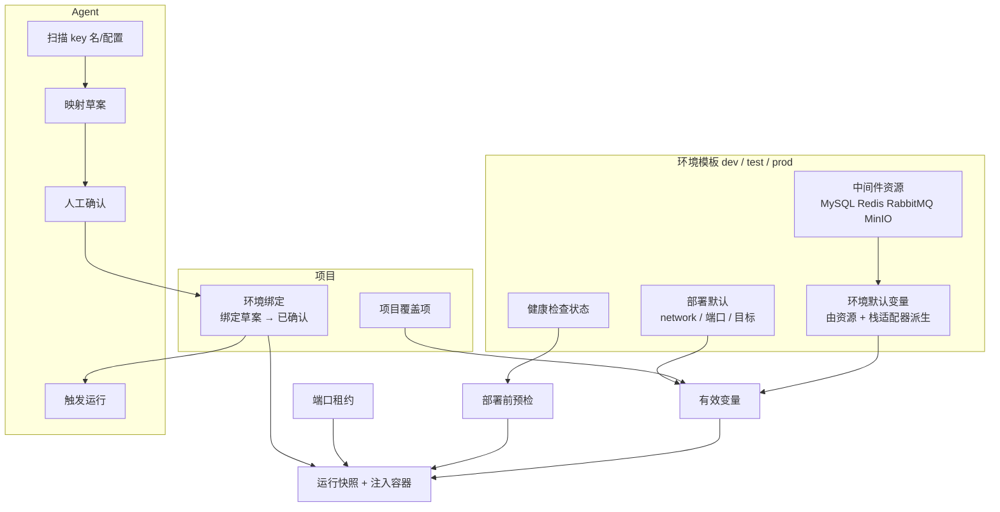

# 环境模板与中间件自动注入 · 可行性分析与实施计划 v2

> 状态：已按 2026-11-09 决策修订，待实施
> 关联：[流水线工作台使用指南](流水线工作台-使用指南-v1.md) §3.5 ｜ [发布编排与平台部署器](发布编排与平台部署器-v1.md)
> 目标读者：平台后端 / 前端 / 交付

---

## 0. 决策记录与结论

| # | 问题 | 你的决定 | 本方案落实方式 |
|---|---|---|---|
| 1 | `test-*` 是否标准中间件？平台是否负责启停？ | **不是；需要** | `test-*` **不预设为标准中间件**，只作为"发现候选"；环境模板通过发现/登记构建。按第 5 条，平台**只读 + 健康检测，不启停中间件** |
| 2 | 开发 / 生产中间件来源 | **远程发现也做** | 本机 Docker 发现 + 远程 SSH `docker inspect` 发现 + 手工登记，三种来源统一进环境模板 |
| 3 | 项目特殊配置粒度 | **覆盖** | 环境模板提供默认变量；项目只写**覆盖项**（覆盖同名 key；项目专属 key 标"仅本项目"） |
| 4 | Agent 自动化边界 | **生成映射后人工确认再给 Agent 跑；遇端口冲突执行处理** | Agent 只生成映射草案；人确认后落库；Agent 用绑定 ID 触发运行；端口冲突由平台预检/租约自动处理并回报 |
| 5 | 中间件生命周期 | **只读 + 健康检测** | 不做 compose 启停；只做连接信息登记、定时/手动健康检查、部署前预检 |

一句话方案：

> **三套环境模板（dev/test/prod）持有中间件资源与默认变量；项目只写覆盖；部署前做中间件健康检查与端口租约；Agent 生成映射草案，人确认后才允许触发运行。**

---

## 1. 现状与约束

### 1.1 现有实现

- `project_env_vars(project_id, env, key, ...)`：AES-GCM 加密，部署时 `docker run -e` 注入；
- 环境只存在于项目配置里（`app_url/compose_dir`），没有"环境模板"；
- `DockerDeployer` 没有 `--network`，端口固定来自 `pipeline.yml`（`deploy.port`）；
- 中间件没有任何登记，平台不知道账号、网络、健康状态。

### 1.2 本机事实

```text
test-mysql      mysql:8.0                network=test_default   未映射宿主端口   Exited
test-redis      redis:7-alpine           network=test_default   未映射宿主端口   Exited
test-rabbitmq   rabbitmq:3.12-management network=test_default   未映射宿主端口   Exited
test-minio      minio/minio:latest       network=test_default   未映射宿主端口   Exited
```

结论：
- 这些容器**不能当作标准中间件**，只作为"发现候选"；
- 应用若加入 `test_default`，应使用容器名 DNS（`test-mysql`）而不是 `127.0.0.1`；
- 容器当前未运行 → 健康检查会失败；平台只报告、不启动（第 5 条）。

### 1.3 RuoYi 项目变量规模

`ruoyi-admin/docker/.env` 有 20+ 个 key，包括：

```text
DB_HOST DB_PORT DB_NAME DB_USERNAME DB_PASSWORD DB_USE_SSL
REDIS_HOST REDIS_PORT REDIS_DATABASE REDIS_PASSWORD
TOKEN_SECRET TOKEN_EXPIRE_TIME RONGX_AES_KEY RONGX_AES_IV
SERVER_PORT DRUID_* JAVA_OPTS LOG_LEVEL_APP DASHSCOPE_API_KEY ...
```

必须由"环境模板 + 项目覆盖"承担，不能再逐项目手填。

---

## 2. 目标架构



### 2.1 三层职责

| 层 | 内容 | 谁来维护 |
|---|---|---|
| **环境模板**（3 个） | 中间件资源、环境默认变量、部署网络/端口、健康检查 | 平台管理员（发现/登记） |
| **项目覆盖** | 只存与环境的差异；可覆盖同名 key，也可新增"仅本项目" key | 项目负责人；Agent 可生成草案 |
| **运行快照** | 本次生效的变量来源、端口、绑定 ID（只存 key + 来源 + hash，不存明文） | 平台自动 |

生效顺序：

```text
环境模板资源派生
  → 环境模板手工变量
    → 项目覆盖
      → 本次运行参数（deployTarget 等；不覆盖变量）
```

### 2.2 环境与流水线的关系

- **环境是变量的第一优先级**；流水线只决定"跑哪些 stage"；
- 选"测试环境"→ 自动用测试模板变量 + 测试默认目标（docker）；
- 选"生产环境"→ 自动用生产模板变量 + 生产默认目标（server）；
- 切换流水线（发布/检查构建）**不改变环境变量集**；
- 生产仍保留显式确认令牌（现有 DeployGate），不因环境模板而放宽。

### 2.3 环境模板的固定字段

```text
env: dev | test | prod
network: 部署时 --network（如 test_default / prod-net）
defaultTarget: docker | host | server
defaultPort: 期望宿主端口（可被项目覆盖）
healthPath: 默认健康路径（可被 pipeline deploy 覆盖）
resources: 中间件资源列表
vars: 环境默认变量（资源派生 + 手工）
```

---

## 3. 中间件资源：发现、只读、健康检查

### 3.1 资源模型

```sql
CREATE TABLE env_resources (
  id            TEXT PRIMARY KEY,
  env           TEXT NOT NULL,          -- dev / test / prod
  kind          TEXT NOT NULL,          -- mysql / redis / rabbitmq / minio / postgres / mongo
  name          TEXT NOT NULL,
  host          TEXT NOT NULL,          -- 应用容器视角：test-mysql / 10.0.0.12
  port          INTEGER NOT NULL,
  database_name TEXT,
  username      TEXT,
  password_enc  TEXT,
  password_iv   TEXT,
  network       TEXT,                   -- 应用侧 docker network
  options       TEXT,                   -- JSON：vhost / bucket / ssl / region…
  source        TEXT,                   -- LOCAL_DOCKER / REMOTE_DOCKER / MANUAL / COMPOSE
  running       INTEGER,                -- 最近一次健康检查
  last_check_at INTEGER,
  last_error    TEXT,
  updated_at    INTEGER NOT NULL
);
```

**只读语义**：平台不启动/停止/删除中间件，只读取连接信息并做健康检查。

### 3.2 本机 Docker 发现

`docker inspect`（不启动容器）提取：

| 镜像族 | 字段 | 说明 |
|---|---|---|
| mysql / mariadb | `MYSQL_ROOT_PASSWORD` / `MYSQL_DATABASE` / `MYSQL_USER` | host=容器名，port=3306 |
| redis | 启动命令 / `REDIS_PASSWORD` | port=6379 |
| rabbitmq | `RABBITMQ_DEFAULT_USER/PASS/VHOST` | port=5672 |
| minio | `MINIO_ROOT_USER/PASSWORD` | port=9000 |
| postgres | `POSTGRES_PASSWORD/DB/USER` | port=5432 |

同时读取 `NetworkSettings.Networks` 得到 `network`，以及 `State.Running` 得到运行状态。

### 3.3 远程发现（本次要做）

复用现有 `SshAccess`（设置页服务器）：

1. 在目标服务器执行 `docker ps -a --format` 和 `docker inspect <id>`；
2. 解析同一套镜像族字段；
3. 读取远端容器网络与端口（含 `-p` 映射）；
4. 结果写入环境模板，`source=REMOTE_DOCKER`；
5. 凭据只回显掩码，值加密落库。

远程发现的要求：
- 服务器需要已配置 SSH（现有 `deploy_servers`）；
- 远端 Docker 可用；
- 平台只读，不启动/停止远端容器。

### 3.4 健康检查

每个资源记录：

- 最近检查时间、是否 running、错误信息；
- 检查方式（只读）：
  - 本机：容器 `State.Running` + TCP connect `host:port`；
  - 远程：SSH `docker inspect State.Running` + 从平台发 TCP 连接（或远端 `ss`/`nc`）；
- 触发：设置页手动"检查"、部署前预检、可选的定时任务；
- 失败时给出可操作提示：`中间件 test-mysql 未运行，请先手动启动`（平台不代启动）。

---

## 4. 端口冲突处理（第 4 条决定）

### 4.1 问题

当前 `deploy.port` 来自 `pipeline.yml`（如 8687），多项目/多环境在同一台机器部署时会冲突；
RuoYi 项目已有端口范围 `8100–8199`（`projects.port_start/port_end`）。

### 4.2 端口租约模型

```sql
CREATE TABLE deploy_port_leases (
  project_id    TEXT NOT NULL,
  env           TEXT NOT NULL,
  container_port INTEGER NOT NULL,
  host_port     INTEGER NOT NULL,
  run_id        TEXT,
  updated_at    INTEGER NOT NULL,
  PRIMARY KEY (project_id, env, container_port)
);
```

### 4.3 分配流程（平台确定性执行）

```text
期望端口 = 环境模板 defaultPort 或 pipeline deploy.port
  → 查已有租约（同 project+env+containerPort）
  → 检查宿主端口是否空闲（docker ps + OS 监听 + 远程 ss）
  → 空闲：沿用；冲突：在项目端口范围 [start,end] 内取下一个空闲
  → 写入租约；健康检查 URL 用最终 host_port
  → 运行日志明确记录：`[port] 8687 被占用 → 分配 8100`
  → 回滚默认沿用租约；租约端口冲突时重新分配并记录
```

原则：

- **不杀未知进程**；只替换本项目同名容器（现有逻辑）；
- 冲突自动换端口，不阻断发布；
- 端口租约保证同一项目多次发布端点稳定；
- 远程部署同样在远端做端口检查（SSH `ss -ltn` / `docker ps`）。

### 4.4 Agent 与端口

- 端口处理由平台预检完成，Agent 不自行 `kill`/改宿主配置；
- Agent 触发运行后，从运行日志读取"端口冲突已处理"的结果并向人汇报；
- 若端口范围内无可用端口，运行失败并给出明确错误（E-7xx），由人处理。

---

## 5. Agent 流程：映射 → 人工确认 → 运行

### 5.1 配置期

1. **扫描**（只读）：项目结构、`.env.example`、`application*.yml`、`Dockerfile`、compose；
2. **提取 key 名**：只读取变量名，不读取 `.env` 明文；
3. **生成映射草案**：
   ```json
   {
     "projectId": "RUOYIWNZ",
     "env": "test",
     "mappings": [
       {"key": "DB_HOST", "resourceId": "mysql-test", "from": "host"},
       {"key": "DB_NAME", "value": "ry-vue"},
       {"key": "TOKEN_SECRET", "source": "project", "secret": true}
     ],
     "missing": ["RONGX_AES_KEY"],
     "warnings": ["test-mysql 当前未运行"]
   }
   ```
4. **人工确认**：设置页展示草案（来源、缺失、冲突），人点「应用」；
5. **落库**：生成 `env_binding`（项目+环境+映射 hash）；草案过期/变更需重新确认。

### 5.2 运行期

1. 人确认后，Agent 可用 `bindingId` 触发运行；
2. 平台校验 binding 与项目/环境/hash 一致且未过期；
3. 平台解析有效变量（含项目覆盖），做中间件健康检查、端口租约；
4. 注入容器并执行；Agent 只拿到运行结果，不接触明文。

### 5.3 安全边界

- Agent **不能**读取 `.env` 值：平台拦截敏感文件内容，只把 key 名/元数据给模型；
- Agent **不能**自主切到生产：生产需显式环境 + 确认令牌；
- Agent **不能**修改中间件或端口配置：只能建议，平台落库；
- 所有 Agent 触发的运行在日志里标记 `actor=agent` + 确认人。

---

## 6. 数据模型与接口

### 6.1 新增/迁移表

```sql
env_templates(env PK, network, default_target, default_port, health_path, updated_at)
env_resources(...)          -- 见 §3.1
env_vars(env, var_key, value_enc, value_iv, is_secret, source)
project_env_overrides(project_id, env, var_key, value_enc, value_iv, is_secret, updated_at)
env_bindings(id PK, project_id, env, mapping_hash, confirmed_by, confirmed_at, expires_at)
deploy_port_leases(...)     -- 见 §4.2
```

迁移：现有 `project_env_vars` → `project_env_overrides`，不丢数据。

### 6.2 接口（草案）

```text
GET    /api/v1/settings/envs                      三套模板概览
GET    /api/v1/settings/envs/{env}                模板 + 资源 + 变量 + 健康状态
POST   /api/v1/settings/envs/{env}/discover       本机/远程发现（body: source, serverId）
POST   /api/v1/settings/envs/{env}/resources      手工登记
POST   /api/v1/settings/envs/{env}/resources/{id}/check   健康检查
GET    /api/v1/settings/projects/{id}/overrides?env=
PUT    /api/v1/settings/projects/{id}/overrides
GET    /api/v1/settings/projects/{id}/effective?env=      有效变量（掩码 + 来源）
POST   /api/v1/projects/{id}/env-binding/draft      Agent 扫描生成草案
POST   /api/v1/projects/{id}/env-binding/confirm    人工确认落库
POST   /api/v1/ci/pipelines/{id}/run                body 增加 bindingId（Agent 触发）
GET    /api/v1/deploy/ports?projectId&env          端口租约查询
```

### 6.3 运行快照

运行记录新增：

```yaml
envSnapshot:
  env: test
  bindingId: bind-xxxx
  sources: {envTemplate: 12, projectOverride: 2, portLease: 8100}
  keyHashes: {DB_HOST: sha256:..., TOKEN_SECRET: sha256:...}
```

只记录来源与 hash，不记录明文。

---

## 7. 页面改造

### 7.1 设置 → 环境（三张卡片）

```text
┌ 开发环境 ──────────────┐ ┌ 测试环境 ──────────────┐ ┌ 生产环境 ──────────────┐
│ 中间件 2 个（1 异常）   │ │ 中间件 4 个（4 未运行） │ │ 中间件 3 个（远程）     │
│ 变量 8 个（4 敏感）     │ │ 变量 20+ 个（8 敏感）   │ │ 变量 20+ 个（8 敏感）   │
│ 网络 test_default       │ │ 网络 test_default       │ │ 网络 prod-net           │
│ [检查健康] [发现/登记]  │ │ [检查健康] [发现/登记]  │ │ [检查健康] [远程发现]   │
└─────────────────────────┘ └─────────────────────────┘ └─────────────────────────┘
```

- 资源列表：名称/类型/host:port/来源/运行状态/最后检查；
- 变量列表：key/掩码值/来源（资源派生/手工/覆盖）/敏感标记；
- **只读提示**：中间件未运行时显示"请先手动启动"，不提供启动按钮。

### 7.2 设置 → 项目覆盖

```text
项目 [RUOYIWNZ]  环境 [测试]
继承：测试环境模板（20+ 个变量）
┌ key          值              来源       操作 ┐
│ DB_HOST      test-mysql      环境模板   继承 │
│ DB_NAME      ry-vue-wnz      项目覆盖   编辑 │
│ DASHSCOPE... ****            仅本项目   编辑 │
└────────────────────────────────────────────┘
[+ 添加覆盖] [查看有效变量] [Agent 生成映射草案]
```

### 7.3 流水线工作台

- 环境选择 → 自动套用模板（变量集/网络/默认端口/目标）；
- 运行卡显示：

  ```text
  变量：测试环境 20 个 + 项目覆盖 2 个（8 敏感）
  网络：test_default    端口：8100（8687 被占用，已自动分配）
  中间件：4 个可用 / 1 个未运行
  ```

- 中间件未运行时，运行按钮旁给出明显告警（但不阻止人强行运行？建议阻止，fail-closed）。

---

## 8. 实施计划（修订）

### P0 · 环境模板 + 有效变量 + 端口租约（3 天）

- [ ] `env_templates / env_resources / env_vars / project_env_overrides / deploy_port_leases` 建表与迁移；
- [ ] `resolveEffective(projectId, env)`：模板 → 覆盖，返回 `{key, value, source, secret}`；
- [ ] `DockerDeployer` / `HostDeployer` / `ServerDeployer` 增加 `--network` 与端口租约；
- [ ] 端口预检（本机 + 远程）与自动分配、回滚沿用；
- [ ] 单测：优先级、掩码、迁移、端口冲突。

**验收**：RUOYIWNZ/test 不配覆盖即可解析模板变量；8687 被占用时自动用 8100，日志可见。

### P1 · 中间件发现（本机 + 远程）+ 健康检查（4 天）

- [ ] 本机 `docker inspect` 发现（mysql/redis/rabbitmq/minio/postgres）；
- [ ] 远程 SSH 发现（复用 `SshAccess`）；
- [ ] 手工登记 + 发现预览 + 一键导入模板；
- [ ] 健康检查（running + TCP），设置页展示状态与错误；
- [ ] 部署前预检：中间件不可用 → fail-closed，错误码 E-7xx。

**验收**：测试环境导入 4 个 `test-*`（标注"发现候选，不是标准"）；生产服务器远程发现 2 个中间件；
4 个 test-* 未启动时预检明确报"未运行，请手动启动"。

### P2 · 栈适配器 + 项目覆盖（3 天）

- [ ] RuoYi 适配器（DB/Redis/JWT/AES 等 20+ key）；
- [ ] 通用适配器（`.env.example` / `application*.yml` 的 key 名）；
- [ ] 项目覆盖 UI（继承/覆盖/仅本项目、有效变量预览）；
- [ ] 运行快照（来源 + hash）。

**验收**：RUOYIWNZ 只需 1–2 条覆盖；生产模板与测试模板完全隔离。

### P3 · Agent 映射 → 确认 → 运行（3 天）

- [ ] 项目扫描（只读 key 名，拦截 `.env` 明文）；
- [ ] 映射草案（资源 ID + 缺失项 + 警告）；
- [ ] 人工确认落库 `env_bindings` + hash/过期；
- [ ] Agent 用 `bindingId` 触发运行；日志标记 actor/确认人；
- [ ] 端口冲突结果回报（平台处理，Agent 只汇报）。

**验收**：Agent 对 RUOYIWNZ 生成 20+ key 映射草案；人确认后触发运行成功；
`.env` 明文不出现在模型上下文/日志；端口冲突被自动处理并记录。

### P4 · 收尾（2 天）

- [ ] 文档、指南、错误码 E-7xx（中间件未运行 / 端口耗尽 / 绑定过期）；
- [ ] 回归：无覆盖项目行为不变；
- [ ] 安全复核：API/日志/Agent 上下文均无明文。

**总计：约 12–14 个工作日**（P0+P1+P2 是可交付 MVP，约 8–10 天）。

---

## 9. 风险与对策

| 风险 | 影响 | 对策 |
|---|---|---|
| `test-*` 不是标准中间件，却被误导入 | 配置错误 | 发现结果只作候选，必须人工指定环境；页面标注来源 |
| 中间件未运行（当前全部 Exited） | 部署失败 | 只读健康检查 + 预检 fail-closed；提示手动启动 |
| 应用容器网络不对 | 容器名 DNS 无法解析 | 环境模板存 network，部署强制 `--network` |
| 端口冲突/竞态 | 发布失败或端点漂移 | 端口租约 + 预检 + 自动分配；不杀未知进程 |
| 远程发现的凭据泄露 | 安全 | 加密落库、接口掩码、日志脱敏、仅管理员 |
| Agent 读到 `.env` 明文 | 密钥进模型上下文 | 文件读取拦截；平台本地解析 key，不传值 |
| Agent 自动选生产 | 数据事故 | 生产必须显式环境 + 确认令牌；Agent 只建议 |
| 绑定过期/配置变更 | 用了错误变量 | binding hash + 过期时间；变更后必须重新确认 |

---

## 10. 验收场景（端到端）

1. **环境模板默认**：RUOYIWNZ 选测试 → 自动得到测试模板变量与 `test_default` 网络；不改项目配置。
2. **项目覆盖**：只覆盖 `DB_NAME` 与 `DB_PASSWORD`，其余继承；有效变量预览可见来源。
3. **端口冲突**：8687 被占用 → 自动分配 8100 → 容器启动 → 健康检查使用 8100 → 日志记录转换。
4. **中间件未运行**：预检失败，提示"test-mysql 未运行，请手动启动"，不进入部署。
5. **远程发现**：通过 SSH 发现生产 MySQL/Redis，生成生产模板；生产部署使用生产变量。
6. **Agent 流程**：生成草案 → 人确认 → Agent 触发运行；`.env` 明文不在模型上下文；运行日志 `actor=agent, confirmedBy=admin`。
7. **隔离**：测试环境运行绝不注入生产变量（快照可审计）。

---

## 11. 仍需你确认的一个小点

**项目覆盖是否允许新增"环境模板里没有的 key"？**

- 建议：允许，但必须标记「仅本项目」，用于 `DASHSCOPE_API_KEY` 这类项目专属配置；
- 若你希望严格只允许覆盖已有 key，我会在 P2 调整。

其余决策已按本轮回答固化，无需再确认。
