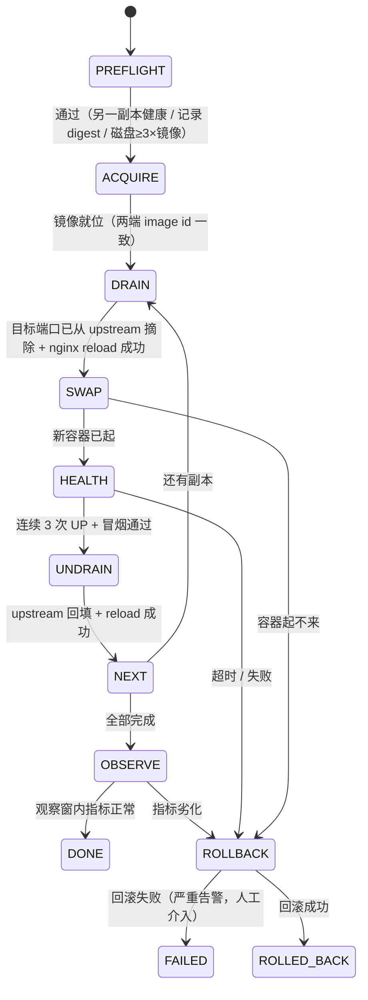
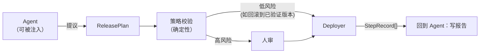

# 窄控制器设计：单机滚动部署器（Compose 版）
## 15–20 人日 · 不调度、不扩缩容、不跨主机

> 日期：2026-11-07 ｜ 前置：[执行面设计（K8s/Jenkins/Flyway）](devops-agent-执行面设计-k8s-jenkins-flyway.md)
> 定位：**执行面**的一个确定性执行器（不含 LLM），只接受结构化 `ReleasePlan`

---

## 0. 一句话定义

> 在一台宿主机上，把「A 镜像的两个副本」安全地换成「B 镜像的两个副本」，中途**不丢请求**、**失败能退回**、**每一步有记录**。

**它不是**：编排器、调度器、扩缩容工具、多机部署工具、配置管理中心、回滚到任意历史版本的时光机。

---

## 1. 现状核实（A 级，逐行读过 `script/docker/docker-compose.yml`）

| # | 事实 | 对控制器的影响 |
|---|---|---|
| 1 | **所有服务 `network_mode: "host"`**，且带 `privileged: true` | 无端口映射表，直接操作宿主端口；**容器即 root**，见 §8 |
| 2 | `ruoyi-server1` 用 `SERVER_PORT: 8080`，`ruoyi-server2` 用 `8081` | 滚动的基本单位是「端口」 |
| 3 | 两个副本**同一个镜像 tag** `ruoyi/ruoyi-server:6.1.0` | ⚠️ **不能用 tag 做回滚锚点**，必须用 digest（见 §5） |
| 4 | nginx `upstream server { 127.0.0.1:8080; 127.0.0.1:8081; }`，无 `max_fails`/`fail_timeout` | 只有被动失败检测；**主动摘流必须靠改配置 + reload** |
| 5 | `nginx.conf` 是**文件级 bind mount**（`/docker/nginx/conf/nginx.conf:/etc/nginx/nginx.conf`） | ⚠️ **必须原地覆写**，不能 `mv`（inode 陷阱，见 §4.2） |
| 6 | compose 里**没有 `healthcheck`**、没有 `restart:` | 控制器的健康判定要**自己做**，不能依赖 Docker |
| 7 | server 容器**只挂了 logs 目录**，没有挂配置文件 | ⚠️ 改 `application.yml` = 重打镜像；除非新增挂载（见 §9 建议） |
| 8 | actuator 全开但需 **Basic Auth**（`spring.boot.admin.client.*`） | 健康端点可用，但要配机读凭证 |

> 第 3、5、7 三条是**开工前必须先解决的阻塞项**，见 §9。

---

## 2. 范围与非目标

| ✅ 做 | ❌ 不做 |
|---|---|
| 单机两个固定端口的滚动替换 | 跨主机、多节点 |
| 镜像预拉、健康门禁、nginx 摘流/回填 | 自动扩缩容（副本数固定为 2） |
| 失败自动回滚（回到 digest） | 回滚到任意历史版本（只保留上一版） |
| 步骤级审计、变更报告 | 配置中心、密钥管理 |
| 与 Jenkins/变更编排器对接 | 触发构建（只消费产物） |
| 演练模式 `dry-run` | 数据库迁移（由 Migrator 负责） |

---

## 3. 领域模型（四个对象，够用且不多）

```java
/** 部署意图：由 CI 产出或人工填写，agent 只能"提议"，落地由人审 */
public record AppSpec(
        String appId,            // ruoyi-server
        String composeProject,   // 部署目录
        List<Replica> replicas,  // [{name:"ruoyi-server1", port:8080}, {name:"ruoyi-server2", port:8081}]
        String healthPath,       // /actuator/health
        Duration bootTimeout,    // 180s
        Duration observeWindow,  // 10m
        CapacityPolicy capacity  // SINGLE_REPLICA_OK | REQUIRE_TWO
) {}

/** 发布计划：一次发布的完整意图（不可变，落库） */
public record ReleasePlan(
        String planId,
        String appId,
        String imageRef,         // repo:tag
        String imageDigest,      // sha256:...（镜像就位后回填，真正的锚点）
        String previousDigest,   // 上一版 digest（preflight 填入）
        List<String> order,      // ["ruoyi-server2","ruoyi-server1"]，先换谁
        boolean dryRun
) {}

/** 发布实例：状态机的载体 */
public class Release {
    String releaseId; String planId;
    ReleaseState state;      // PREFLIGHT..DONE / ROLLED_BACK / FAILED
    List<StepRecord> steps;  // 每步：名称/命令摘要/耗时/结果/输出摘要
    String operator;         // 人（不是服务账号）
    String approvalId;       // 审批单
}

public record StepRecord(String name, Instant start, long costMs,
                         StepResult result, String digestOfOutput) {}
```

---

## 4. 状态机：8 步，每步可重入



**每步的前置条件、动作、失败处理**

| 步 | 动作（**argv 数组，不经 shell**） | 失败处理 |
|---|---|---|
| **1 PREFLIGHT** | ① `docker inspect` 另一副本健康（见 §4.1）② 记录当前两副本 `Image` digest ③ `df` 检查磁盘 ≥ 5GB ④ 校验 `imageRef` 格式 | 直接失败，**不动任何东西** |
| **2 ACQUIRE** | 有仓库：`docker pull <ref>`；无仓库：`docker save <image> \| ssh 业务机 'docker load'`。回填 `imageDigest`，并**比对两端 image id 一致** | 失败即中止（**在摘流之前**，此时零影响）；重试 ≤ 2 次 |
| **3 DRAIN** | ① 渲染 nginx.conf（去掉目标端口）② `nginx -t` ③ `nginx -s reload` ④ sleep 5s | `nginx -t` 失败 → **回滚配置文件**，中止，不换容器 |
| **4 SWAP** | `docker compose up -d --no-deps --force-recreate <svc>`（compose 是唯一事实源） | 失败 → 回到 DRAIN 状态（upstream 仍只有健康的那个），走 ROLLBACK |
| **5 HEALTH** | 轮询 `GET /actuator/health`（Basic Auth），3s 间隔，超时 `bootTimeout`，**连续 3 次 UP** | 超时 → ROLLBACK |
| **6 UNDRAIN** | ① 渲染 nginx.conf（加回端口）② `nginx -t` ③ reload | 重试 3 次；仍失败 → 保持在"单副本服务"状态并**告警**（可用性下降但不宕） |
| **7 NEXT** | 若还有副本 → 回 DRAIN；否则 OBSERVE | — |
| **8 OBSERVE** | 10 分钟：`/actuator/health`、错误率、P99、关键接口成功率 | 劣化超阈 → ROLLBACK |

### 4.1 「另一副本健康」判定（关键前置）
```
GET http://127.0.0.1:<port>/actuator/health   (Basic Auth)
期望: {"status":"UP"}
    且 components.db.status == UP（若 actuator 返回了 db 组件）
    且 components.redis.status == UP（RedisHealthIndicator 启用时才有）
```
**必须先确认另一副本健康，才允许动这一台**——否则双副本变 0 副本。

### 4.2 nginx 摘流的两个坑（都会真的踩到）

**坑 A：bind mount 的 inode 陷阱**
`nginx.conf` 是**文件**挂载，容器持有旧 inode。若用"写临时文件 + rename"的方式，容器看到的还是旧内容，`reload` 无效——你会以为摘流了，其实没有。
✅ **正确做法：原地覆写**（打开同一文件、truncate、写入、flush、close）。

```java
// ✅ 原地覆写，保持 inode
try (var ch = FileChannel.open(path, StandardOpenOption.WRITE, StandardOpenOption.TRUNCATE_EXISTING)) {
    ch.write(ByteBuffer.wrap(rendered.getBytes(UTF_8)));
    ch.force(true);
}
// ❌ 不要 Files.write(tmp) + Files.move(tmp, path) —— 容器看不到
```

**坑 B：`reload` 前必须 `nginx -t`**
配置写错 = 整站 502。`docker exec nginx-web nginx -t` 通过才 reload；不通过就把原文件写回去。

### 4.3 upstream 用「托管块」，别做字符串手术

建议改一次 nginx.conf，加上标记：

```nginx
upstream server {
    # BEGIN MANAGED-BY-DEPLOYER
    server 127.0.0.1:8080;
    server 127.0.0.1:8081;
    # END MANAGED-BY-DEPLOYER
}
```

控制器只渲染**块内**内容，从「当前活跃副本集合」这个状态推导。好处：
- 不会误伤其他配置；
- 回填/摘除是同一段逻辑（幂等）；
- 出问题只需恢复整块（原文备份在 preflight 里）。

---

## 5. 回滚：锚点必须是 digest，不是 tag

**问题**：两个副本共用 `ruoyi/ruoyi-server:6.1.0`。若你们按同 tag 重推镜像，**tag 会指向新 digest**，此时"回滚到 6.1.0"等于回滚到新版本。

**做法**：

| 项 | 做法 |
|---|---|
| 锚点 | `docker inspect --format '{{.Image}}'` 拿容器实际运行的 **digest**（`sha256:...`），存进 `ReleasePlan.previousDigest` |
| 回滚 | 用 digest 起容器：推荐 `image: ${APP_IMAGE}` + 环境变量传入 `repo@sha256:...`（compose 是否直接接受 digest 写法取决于版本，接入时实测一次即可） |
| 保留 | 回滚提交后 24h 内**禁止** `docker image prune`（控制器持有锁标记）；镜像仓库侧保留至少 2 个历史版本 |
| 快速回滚 | 容器 recreate 约 30–60s（JVM 冷启）。可接受；若嫌慢，见 §11 的"预热副本"进阶 |

> 配套建议（重要）：CI 打 tag 请用 `6.1.0-<git-sha 前 7 位>`，**不要复用 `6.1.0`**。这样 tag 本身就是锚点，回滚逻辑立刻简单一半。

---

## 6. 并发、锁与变更窗口

| 控制 | 实现 |
|---|---|
| 同一 app 同时只能有一个 Release | 文件锁 `<composeDir>/.deploy.lock`（含 pid + 持有者 + 开始时间），或 DB 行锁 |
| 锁超时 | 30 分钟自动释放（防进程被 kill 后死锁），释放前写告警 |
| 变更窗口 | 配置项 `allowedWindows: ["02:00-05:00"]`；窗口外需 `--force` + 二次确认 |
| 幂等 | 每步先查状态再动作（"已经摘流了"就跳过）；`releaseId` 相同的请求直接返回已有结果 |
| 断点续跑 | `Release` 落库，进程重启后可 `resume`，从最后一个 `SUCCESS` 步继续 |

---

## 7. 与 Agent / 变更编排器的边界



- **Agent 只能产出 `ReleasePlan`**（选镜像、选顺序、写理由），**不能调用 `docker`**；
- 计划要经过**确定性校验**：镜像是否来自可信仓库、digest 是否已存在、是否在变更窗口、是否需要审批；
- 执行结果以 `StepRecord[]` 返回，agent 只负责**总结成人话**。

---

## 8. 安全：这台机器上有个"root 开关"

**现状**：所有容器 `privileged: true` + host 网络；控制器要操作 Docker → 需要 `/var/run/docker.sock`，**而挂 docker.sock 等价于宿主机 root**。

| 风险 | 缓解 |
|---|---|
| 控制器被入侵 = 宿主 root | ① 控制器只监听 **127.0.0.1 / 内网白名单**；② 认证用 **mTLS 或预共享 token**；③ 不与业务网互通 |
| Docker API 过宽（可 `exec`、可删卷） | **用 socket proxy 白名单**（如 `tecnativa/docker-socket-proxy`），只放行：`CONTAINERS=1`、`IMAGES=1`、`EXEC=0`、`VOLUMES=0`、`SYSTEM=0` |
| 命令注入 | **全部用 argv 数组**（`ProcessBuilder(List.of(...))` / docker-java），**不拼 shell 字符串**；镜像名/容器名走正则白名单 |
| `privileged: true` 本身 | 建议逐项收敛：`ruoyi-server` 只需读写日志目录 + 网络，**不需要 privileged**；mysql 也不需要（除非特殊需求） |
| 凭证泄露 | actuator Basic Auth 凭证存 env / Vault，**不进日志**；`StepRecord.digestOfOutput` 只存摘要 |

> 控制器自身的攻击面要小：**不开 Web UI、只暴露 3 个接口**（`plan` / `apply` / `status`）。

---

## 9. 开工前必须先解决的三个阻塞项

| # | 阻塞项 | 为什么阻塞 | 建议改法 | 成本 |
|---|---|---|---|---|
| 1 | **单副本能否扛全量** | 滚动期间另 1 个副本承担 100% 流量；扛不住 = 每次发布都掉性能 | 压测确认；不行就加第 3 个端口/副本（`8082`）做"临时金丝雀位" | 0.5–1 人日 |
| 2 | **镜像 tag 复用 `6.1.0`** | tag 会漂移，回滚锚点失效 | CI 改打 `6.1.0-<sha>`；或控制器强制按 digest 回滚 | 1 人日（CI 改动） |
| 3 | **配置没有外挂挂载** | 改 `application.yml` 只能重打镜像，"配置变更"这类需求做不了 | 给 server 容器加 `- /docker/serverN/config:/ruoyi/server/config:ro`，用 Spring Boot 外部配置 | 1 人日 |

> 这三项不做，控制器能跑但会带着三个"必然出问题"的隐患上线。

---

## 10. 测试计划（这部分不能省）

| 层级 | 用例 | 通过标准 |
|---|---|---|
| 单元 | upstream 渲染、argv 构造、digest 解析 | 覆盖边界（0/1/2 副本、非法镜像名） |
| **演练** | 用 `nginx:alpine` + 假后端做完整 8 步 | 全绿、步骤记录完整 |
| 混沌 1 | 第 5 步 health 永不 UP | 自动回滚，站点全程可用 |
| 混沌 2 | nginx.conf 被改成语法错误 | `nginx -t` 拦截，配置还原，**站点不受影响** |
| 混沌 3 | 第 4 步期间 kill 控制器 | 锁超时释放；`resume` 能继续 |
| 混沌 4 | 拉镜像超时 | 在摘流前中止，零影响 |
| 混沌 5 | 磁盘写满 | preflight 拦截 |
| 回归 | 连续发布 10 次 | 无残留容器、无配置漂移、日志可追溯 |

---

## 11. 人日拆解（15–20）

| 模块 | 内容 | 人日 |
|---|---|---|
| 领域模型 + 状态机骨架 | `AppSpec/ReleasePlan/Release/StepRecord` + 状态机 + 落库 | 2 |
| Docker 适配 | compose 调用、inspect、镜像就位（含跨机导入）、锁 | 2.5 |
| nginx 摘流/回填 | 托管块渲染、原地覆写、`-t`、reload、还原 | 2.5 |
| 健康门禁 | Basic Auth 轮询、连续成功、超时、组件级判定 | 1.5 |
| 回滚 | digest 起容器、部分回滚、失败告警 | 2 |
| 观测与审计 | step 记录、变更报告、dry-run | 1.5 |
| 接口层 | 3 个端点 + 鉴权 + 幂等 | 1 |
| 测试 | 演练 + 5 个混沌用例 | 3 |
| 文档与演练 | 运维手册 + 一次真实灰度演练 | 1.5 |
| **合计** | | **17.5**（±2.5） |

**进阶（可选，不加也行）**：预热副本（第 3 个端口，先起新版本、验完再切、旧版最后停）——可把发布延迟从 60s 降到 0，约 +3 人日。

---

## 12. 验收标准（DoD）

1. 一次发布中，**前端 0 个 5xx**（用 200 QPS 压测验证）；
2. 任意一步失败，**10 分钟内自动回滚**，站点恢复；
3. 每次发布产出**变更报告**：镜像 before/after（digest）、每步耗时、是否回滚、操作人；
4. `dry-run` 能完整走完 8 步的"只读版"，输出将执行的命令清单；
5. 控制器被 kill 后**不产生半完成状态**（锁 + resume）；
6. 全流程代码中 **0 处 shell 字符串拼接**。

---

## 13. 演进：迁到 K8s 时保留什么

| 保留 | 丢掉 |
|---|---|
| `AppSpec` / `ReleasePlan` / `Release` 模型 | DRAIN（nginx 那套） |
| 状态机与步骤语义 | SWAP 的 compose 调用 |
| 审计与报告 | digest 锚点（K8s 用 image digest + `rollout undo`） |
| 健康判定策略 | 自研健康轮询（用 readinessProbe） |

**换的只是 executor**：`DockerComposeExecutor` → `K8sExecutor`，其余不动。这也是为什么 §3 的模型要抽象出来——**别把 docker 命令写进状态机里**。

---

## 14. 结论

| 问题 | 答案 |
|---|---|
| 15–20 人日够吗 | **够**（估 17.5，含测试与演练）；前提是三个阻塞项先解决 |
| 最大技术坑 | **bind mount 的 inode 陷阱** + **tag 复用导致回滚失效**，这两个最容易让人"以为做对了" |
| 最大运营坑 | **单副本扛不住全量**——这不是代码问题，是容量问题 |
| 什么时候该换成 K8s | 副本数 > 2、需要跨机、需要自动扩缩容、或发布频率 > 每天 2 次，任一成立就该迁 |
| 现在最该先做的 | 不是控制器，而是：**加 healthcheck** + **CI 打 sha tag** + **给 server 挂配置目录**。这三件事各 1 人日，收益立刻兑现 |

> 最后一句：这个控制器的价值不在"能重启容器"，而在于**它把"发布"变成了一次可审计、可回滚、可演练的确定事务**。20 人日买的是这个确定性，不是 20 行 docker 命令。
