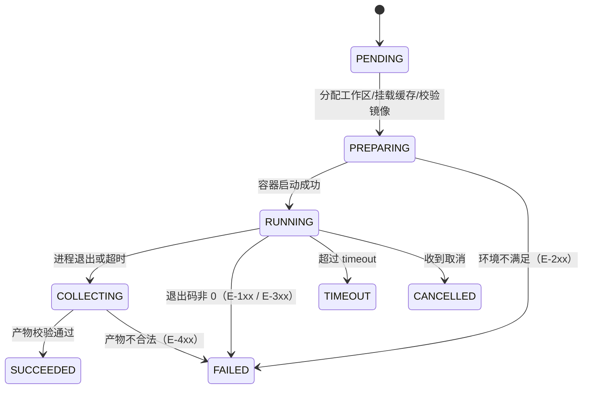

# 规约：流水线 Stage 执行器 v1.0

> 日期：2026-11-07 ｜ 状态：Draft for review ｜ 范围：`mvn` / `npm` / `docker-build` / `static-publish` 四种 stage 的**接口契约与行为规约**
> 上游：[PRD v1.6 §4.7](PRD-DevOps-Agent平台-v1.0.md) ｜ [流水线设计 Java+Vue](流水线设计-Java与Vue双栈.md)
> 本文是**引擎与执行器之间的契约**：引擎只依赖本文声明的行为，执行器实现必须满足本文。

---

## 0. 术语与边界

| 术语 | 含义 |
|---|---|
| **Run** | 一次流水线运行（一个 commit / 一次手动触发） |
| **Stage** | Run 内的一个执行单元，对应 `PipelineSpec.stages[]` 的一项 |
| **Executor** | stage 的执行器实现（本文规约的对象） |
| **Workspace** | 本次 Run 的独立工作树（`/ws`），每 Run 一个，不复用 |
| **Artifact** | stage 产出物（镜像 / 静态目录 / 报告文件） |

**边界**：本文只管"一个 stage 怎么执行、怎么失败、产出什么"。Run 级调度、审批、部署不在本文范围。

---

## 1. 通用契约

### 1.1 生命周期（6 态，不可跳过）



> `PREPARING` 失败 = **平台问题**；`RUNNING` 失败 = 通常是**用户代码问题**。这个区分决定重试与告警对象（见 §1.4）。

### 1.2 输入契约

```java
record StageContext(
    String runId,
    String stageId,
    String stageType,          // mvn | npm | docker-build | static-publish
    Path   workspace,          // /ws，读写
    Map<String,String> env,    // 已通过白名单过滤
    List<String> argv,         // 已校验：非空、无 shell、无元字符
    Duration timeout,
    List<String> cacheMounts,  // 已解析为实际卷名
    String pinnedImage,        // digest 形式
    Map<String,Object> options // stage type 专属，见 §3
) {}
```

**input 校验（引擎侧，先于任何容器操作）**：

| 规则 | 失败码 |
|---|---|
| `argv` 非空且首元素在允许的可执行名白名单内（`mvn` / `pnpm` / `npm` / `yarn` / `node`） | E-201 |
| `argv` 任一元素含 `sh`/`bash`/`cmd`/`powershell`，或含 shell 元字符（分号、与号、竖线、反引号、`$`、`<`、`>`、换行） | E-202 |
| `pinnedImage` 匹配 `^(?:[^@]+@)?sha256:[0-9a-f]{64}$` | E-203 |
| `timeout` ∈ [30s, 60m] | E-204 |
| `env` 键全部命中白名单；值不含换行 | E-205 |
| `workspace` 存在且为目录 | E-206 |

### 1.3 输出契约

```java
record StageResult(
    String stageId,
    StageStatus status,        // SUCCEEDED | FAILED | TIMEOUT | CANCELLED
    int exitCode,
    String errorCode,          // null 表示成功
    String errorSummary,       // ≤200 字，面向人
    List<ArtifactRef> artifacts,
    long durationMs,
    long logBytes,
    int retryCount
) {}

record ArtifactRef(String kind, String ref, String digest, long sizeBytes, Map<String,String> meta) {}
// kind ∈ {image, static, report, file}
```

### 1.4 错误分类与重试矩阵

**这是本规约最重要的一张表**——同一次失败，责任不同，处理完全不同。

| 类别 | 错误码段 | 典型原因 | 重试 | 告警给谁 | 面向人的文案 |
|---|---|---|---|---|---|
| **用户代码失败** | E-1xx | 编译错误、单测红、锁文件不一致 | ❌ 不重试 | 发起人 | 「构建失败：第 12 行编译错误」 |
| **平台/环境失败** | E-2xx | 拉镜像失败、磁盘满、权限错误、卷挂载失败 | ✅ 最多 2 次 | 平台 owner | 「平台异常：镜像拉取失败，已自动重试」 |
| **执行中断** | E-3xx | OOM(SIGKILL)、超时、取消 | ❌（超时/取消）/✅（OOM 一次） | 发起人 + 平台 | 「超出内存上限 2GB」 |
| **产物不合法** | E-4xx | 产物缺失、digest 不匹配、静态目录不含 index.html | ❌ | 发起人 | 「产物校验失败：未生成 index.html」 |

> **禁止把 E-1xx 重试**。构建失败重试三次只是浪费 3 倍时间和钱，而且掩盖真实原因。

### 1.5 取消与超时

| 事件 | 行为 | 退出码 |
|---|---|---|
| 用户取消 | 先 `SIGTERM` → 等 10s → `SIGKILL` | 143 |
| 超时 | 同上 | 124 |
| 平台关闭 | 同上，状态记 `CANCELLED` | 143 |

取消后**不产出 Artifact**；`COLLECTING` 阶段跳过。

### 1.6 日志规约

- 每行加前缀 `[<stageId>]`，结构化写入 `run_stage_log(runId, stageId, seq, ts, line)`；
- **保留策略**：头 200 行 + 尾 500 行 + **全部命中错误模式的行**；中间折叠并标注 `...（省略 N 行）`；
- 错误模式（正则，用于摘要与 `errorSummary`）：
  ```
  ERROR|FATAL|Exception|Caused by:|BUILD FAILURE|npm ERR!|ERR_PNPM|error TS\d+
  ```
- 单行超 8KB 截断；
- 输出前过 **redactor**（已知密钥值全文匹配 + 正则 `(?i)(password|secret|token|access[_-]?key)\s*[:=]\s*\S+`）。

### 1.7 安全不变量（每个 executor 都必须满足）

| # | 不变量 | 校验方式 |
|---|---|---|
| S1 | 容器**非 root**（`--user 1000:1000`） | 启动参数断言 |
| S2 | 只挂 `/ws` 与声明的缓存卷；**不挂宿主路径** | 挂载列表断言 |
| S3 | 网络为 `build-net`，**禁公网** | 网段断言 + 容器内 `curl` 外网必须失败（测试用例） |
| S4 | 内存/CPU/pids 有上限 | 启动参数断言 |
| S5 | 凭证**只经 env 注入**，不写文件、不进日志 | redactor 测试 |
| S6 | 容器一次性（`--rm`），不复用 | 名称带 runId+stageId+nonce |
| S7 | **唯一允许写宿主目录的是 `static-publish`**（见 §3.4），且路径必须命中白名单 | 路径校验 |

---

## 2. 跨 stage 共享约定

### 2.1 目录约定

```
/ws                 工作区（源码 + 构建产物），读写
/ws/target          Maven 产出（mvn 写）
/ws/dist            Vue 产出（npm 写）
/cache/m2           Maven 本地仓库（命名卷 m2-<project>）
/cache/pnpm-store   pnpm store（命名卷 pnpm-<project>）
/cache/npm          npm 缓存（命名卷 npm-<project>）
/config/settings.xml  Maven 配置（只读挂载，平台注入）
/config/.npmrc        npm 配置（只读挂载，平台注入）
```

> 缓存卷**只允许**挂到上述固定路径；其他路径一律拒绝（防"用缓存卷绕过隔离"）。

### 2.2 环境变量白名单（只允许这些）

| stage | 允许的 env |
|---|---|
| `mvn` | `MAVEN_OPTS`、`JAVA_HOME`、`TZ`、`LANG` |
| `npm` | `NODE_OPTIONS`、`NPM_CONFIG_*`（只读项）、`CI`、`TZ`、`LANG` |
| `docker-build` | `DOCKER_BUILDKIT`、`TZ` |
| `static-publish` | `TZ` |

> `NODE_OPTIONS` 只允许 `--max-old-space-size=<n>`；出现 `--require`/`--loader`/`--inspect` 直接拒绝（可执行任意代码）。

### 2.3 缓存命中与失效

| 场景 | 行为 |
|---|---|
| 锁文件变更（`pom.xml`/`pnpm-lock.yaml` 的 hash 变化） | 缓存**继续使用**（增量），但记录 `cacheKeyChanged=true` |
| 缓存卷损坏/不可挂载 | E-207，**不重试**，提示平台人工清理 |
| 缓存卷写满 | E-208，告警平台 |

---

## 3. 四种 Stage 的详细规约

### 3.1 `mvn`

**专属 options**

| 字段 | 类型 | 必填 | 说明 |
|---|---|---|---|
| `goals` | `string[]` | 否 | 默认由 `argv` 决定；若同时提供 `argv` 则拒绝（二选一，防歧义） |
| `skipTests` | bool | 否 | 若为 true，argv 中必须显式带 `-DskipTests`，否则 E-210 |

**执行语义**

- 强制注入 `-B`（batch mode，禁用交互）与 `-Dmaven.repo.local=/cache/m2`；
- **禁止** `deploy`（防推送到远程仓库）；出现 `deploy` 目标 → E-211；
- `settings.xml` 从 `/config/settings.xml` 只读挂载（阿里云 mirror）；
- 若 `pom.xml` 声明 `java.version`，与基础镜像 JDK 主版本不符 → E-212（**不自动降级/升级**）。

**产出**：`ArtifactRef(kind=file, ref="file:target/<jar>")`，若 `target/` 下无 jar 且非 `skipTests` 则为 E-401。

**验收用例**

1. 正常构建 → SUCCEEDED，产出 jar；
2. 故意编译错误 → FAILED + E-101 + 摘要含首个 `ERROR` 行；
3. `argv=["mvn","deploy"]` → 被拒 E-211（在 PREPARING 阶段，不启动容器）；
4. JDK 版本不符 → E-212；
5. 二次构建耗时 ≤ 首次 40%（缓存生效）。

---

### 3.2 `npm`（含 pnpm / yarn）

**专属 options**

| 字段 | 类型 | 必填 | 说明 |
|---|---|---|---|
| `packageManager` | `auto\|pnpm\|npm\|yarn` | 否，默认 `auto` | `auto` 按锁文件识别；多锁文件并存 → E-213 |
| `ignoreScripts` | bool | 否，默认 **true** | 控制 `--ignore-scripts`；显式 false 需审计留痕 |
| `registry` | string | 否 | 默认注入 `npmmirror`；私有 scope 走凭证 |

**执行语义**

- **锁文件必须与 `package.json` 一致**：不一致 → E-102（不静默修复）；
- 安装命令固定：`pnpm install --frozen-lockfile --prefer-offline --ignore-scripts`（或 `npm ci --ignore-scripts`）；
- **禁止** `npm publish` / `pnpm publish` / `yarn publish` → E-214（防代码外发）；
- Node 版本：`.nvmrc` → `package.json engines` → 项目配置；三者冲突 → E-215；
- store 目录固定：`pnpm config set store-dir /cache/pnpm-store`（通过 env `PNPM_HOME`/config 注入，不写宿主）。

**产出**：`ArtifactRef(kind=static, ref="dir:dist")`，`dist/index.html` 必须存在（否则 E-402）。

**验收用例**

1. 正常构建 → 产出 `dist/index.html` + `assets/`；
2. `package.json` 与锁文件不一致 → E-102；
3. 存在 `postinstall` 脚本且 `ignoreScripts=true` → 脚本**未执行**（用测试包验证）；
4. `argv` 含 `publish` → E-214；
5. 二次构建 ≤ 首次 40%。

---

### 3.3 `docker-build`

> **例外**：本 stage **不在沙箱容器内运行**——它由执行器直接调用宿主 Docker（构建容器本身需要 Docker 能力）。因此它的安全约束比前两种更严。

**专属 options**

| 字段 | 类型 | 必填 | 说明 |
|---|---|---|---|
| `dockerfile` | string | 否，默认 `Dockerfile` | 必须位于工作区根或 `--file` 相对路径内 |
| `tagPattern` | string | ✅ | **必须包含 `${gitSha7}`**，否则 E-216（防标签漂移） |
| `buildArgs` | `map<string,string>` | 否 | **仅允许非敏感键**；`*SECRET*`/`*TOKEN*`/`*PASSWORD*` → E-217 |
| `platform` | string | 否 | 默认 `linux/amd64` |

**执行语义**

- `docker build --file <dockerfile> --tag <tag> --label git.sha=<sha> --label build.run=<runId> .`
- **必须**禁用 `--network=host`；构建网络按以下**三档策略**，默认 `bridge`（见下）：
- **网络策略（2026-11-07 修订）**

  | 档位 | 何时用 | 说明 |
  |---|---|---|
  | `bridge` | **默认**，日常构建 | 能拉公网依赖；也能访问内网 ⚠️ |
  | `build-net` | 生产推荐 | 专用 bridge 网络（`docker network create build-net`），配合防火墙限制内网段 |
  | `none` | 发布构建 / 构建不可信代码 | 完全断网，**前提是依赖缓存已预热** |

  > 早期版本规定"一律 `build-net`"、实现阶段一度收紧为"一律断网"，两者都不可取：
  > 无私服时断网会使真实构建**永远无法执行**。默认取可用性，隔离按场景显式收紧。
- 上下文限制：工作区大小 > 1GB → 警告；> 2GB → E-218（防误把 `node_modules` 打进上下文）；
- `.dockerignore` 若存在则强制生效；
- 构建完成后立即 `docker inspect` 取 `image id` 与 `RepoDigests`（可能为空，见 §3.3.1），写入 Artifact。

**3.3.1 digest 的两种来源（与"无仓库"直接相关）**

| 来源 | 可用锚点 | `ArtifactRef.digest` |
|---|---|---|
| 已 push 到 registry | `RepoDigests[0]` | `sha256:...`（repo digest） |
| 仅本地 | `Image`（image id） | `sha256:...`（local id） |

执行器必须**同时记录两者（若存在）**，并在 `meta` 里标 `digestSource=repo|local`。下游（Deployer）按 `digestSource` 决定是 pull 还是导入。

**产出**：`ArtifactRef(kind=image, ref="<repo>:<tag>", digest=..., meta={digestSource, sizeBytes})`

**验收用例**

1. 正常构建 → 得到 image + digest；
2. `tagPattern` 不含 sha → E-216；
3. `buildArgs` 含 `DB_PASSWORD` → E-217；
4. 工作区 2.5GB → E-218；
5. 构建失败（Dockerfile 语法错）→ FAILED + E-103 + 摘要含 `ERROR:` 行。

---

### 3.4 `static-publish`

> **本 stage 是唯一允许写宿主目录的执行器**（因为 nginx 静态目录在宿主上）。它也是唯一需要"原子性"与"回滚"语义的 stage。

**专属 options**

| 字段 | 类型 | 必填 | 说明 |
|---|---|---|---|
| `target` | string | ✅ | 必须命中项目配置的**静态目录白名单**（例：`/docker/nginx/html`）；否则 E-219 |
| `keepVersions` | int | 否，默认 5 | 保留版本数，范围 2–20 |
| `verifyUrl` | string | 否 | 发布后自检的 URL（默认 `http://127.0.0.1/`） |
| `gzipAssets` | bool | 否，默认 true | 校验 `.gz` 与源文件同存在（对应 `gzip_static on`） |

**执行算法（严格按序，任一步失败即中止并回滚）**

```
1. 校验    dist/index.html 存在；dist/assets/ 非空；target 在白名单内且可写
2. 备份    target/index.html → target/.releases/<ts>/index.html（保留 keepVersions 份）
3. 传资源  rsync -a --exclude index.html dist/ target/
           ★ 绝不使用 --delete：旧 hash 文件必须保留供回滚
4. 预检    解析新 index.html 引用的所有 assets → 逐个 HTTP 200 或文件存在
           （gzipAssets=true 时同时校验 .gz 存在）
5. 换入口  写 target/index.html.tmp → fsync → rename 为 target/index.html
           （同目录 rename 是原子的；target 是"目录挂载"，内部 rename 安全）
6. 后检    verifyUrl → 200；首页引用的 assets → 200
7. 清理    删除超过 keepVersions 的版本，且仅删除"未被任何保留 index.html 引用"的资源
```

**回滚语义**：`restoreIndex(ts)` = 把 `.releases/<ts>/index.html` 拷回 `target/index.html`。**不重新构建、不重启 nginx**。目标耗时 ≤ 5s。

**产出**：`ArtifactRef(kind=static, ref="<ts>", digest=sha256(index.html), meta={versionDir, keepVersions})`

**验收用例**

1. 正常发布 → 首页 200，新 assets 可访问，旧 index 已备份；
2. 发布中断（第 3 步后 kill）→ index.html **未被替换**，站点仍为旧版本；
3. 新 index 引用缺失资源 → 第 4 步中止，站点不受影响；
4. 回滚 → ≤5s 恢复旧版本，`curl` 首页 200；
5. `target` 不在白名单（如 `/etc`）→ E-219；
6. 100 QPS 持续请求下发布 → **0 个 404 / 0 个 5xx**。

---

## 4. 错误码总表

| 码 | 名称 | 类别 | 重试 | 说明 |
|---|---|---|---|---|
| E-101 | `COMPILE_FAILED` | 用户 | ❌ | 编译/构建失败 |
| E-102 | `LOCKFILE_MISMATCH` | 用户 | ❌ | 锁文件与 package.json 不一致 |
| E-103 | `DOCKERFILE_ERROR` | 用户 | ❌ | Dockerfile 语法/引用错误 |
| E-104 | `TEST_FAILED` | 用户 | ❌ | 单测失败 |
| E-201 | `ARGV_INVALID` | 平台 | ❌ | argv 为空/首元素不在白名单 |
| E-202 | `SHELL_REJECTED` | 平台 | ❌ | 出现 shell 或元字符 |
| E-203 | `IMAGE_NOT_PINNED` | 平台 | ❌ | 镜像非 digest |
| E-204 | `TIMEOUT_OUT_OF_RANGE` | 平台 | ❌ | 超时配置越界 |
| E-205 | `ENV_NOT_ALLOWED` | 平台 | ❌ | env 不在白名单 |
| E-206 | `WORKSPACE_INVALID` | 平台 | ❌ | 工作区不存在/非目录 |
| E-207 | `CACHE_UNAVAILABLE` | 平台 | ❌ | 缓存卷不可挂载 |
| E-208 | `CACHE_FULL` | 平台 | ❌ | 缓存卷写满 |
| E-209 | `EXECUTABLE_NOT_FOUND` | 平台 | ❌ | 命令不存在或无法启动（构建镜像缺工具链） |
| E-210 | `SKIP_FLAG_MISMATCH` | 平台 | ❌ | skipTests 与 argv 不一致 |
| E-211 | `MVN_DEPLOY_FORBIDDEN` | 平台 | ❌ | 出现 deploy 目标 |
| E-212 | `JDK_MISMATCH` | 平台 | ❌ | JDK 版本与 pom 不符 |
| E-213 | `MULTIPLE_LOCKFILES` | 用户 | ❌ | 同时存在多种锁文件 |
| E-214 | `PUBLISH_FORBIDDEN` | 平台 | ❌ | 出现 publish 命令 |
| E-215 | `NODE_VERSION_CONFLICT` | 平台 | ❌ | Node 版本声明冲突 |
| E-216 | `TAG_PATTERN_INVALID` | 平台 | ❌ | tag 不含 git sha |
| E-217 | `BUILDARG_SENSITIVE` | 平台 | ❌ | buildArgs 含敏感键 |
| E-218 | `CONTEXT_TOO_LARGE` | 用户 | ❌ | 构建上下文过大 |
| E-219 | `TARGET_NOT_ALLOWED` | 平台 | ❌ | 静态目录不在白名单 |
| E-301 | `OOM_KILLED` | 执行 | ✅×1 | 超内存被 SIGKILL |
| E-302 | `TIMEOUT` | 执行 | ❌ | 超过 timeout |
| E-303 | `CANCELLED` | 执行 | ❌ | 用户取消 |
| E-401 | `ARTIFACT_MISSING` | 产物 | ❌ | 声明的产物未生成 |
| E-402 | `INDEX_MISSING` | 产物 | ❌ | `dist/index.html` 缺失 |
| E-403 | `DIGEST_MISMATCH` | 产物 | ❌ | digest 与预期不符 |
| E-404 | `ASSET_UNREACHABLE` | 产物 | ❌ | 新 index 引用的资源不可达 |

---

## 5. 观测与审计字段

每个 stage 必须落库（`run_stage` 表）：

| 字段 | 说明 |
|---|---|
| `run_id` / `stage_id` / `stage_type` | 标识 |
| `status` / `exit_code` / `error_code` | 结果 |
| `started_at` / `finished_at` / `duration_ms` | 时序 |
| `image_digest` | 实际使用的镜像 |
| `cache_key_changed` | 缓存是否因依赖变更而失效 |
| `log_bytes` / `log_truncated` | 日志规模 |
| `artifacts` | JSON 数组（kind/ref/digest/size） |
| `retry_count` / `retry_reasons` | 重试记录 |
| `resource_peak` | 内存/CPU 峰值（可采则采） |

> 审计要求：**能回答"这次构建用了哪个镜像、跑了什么命令、产出了什么"**。三件事缺一，事后无法复盘。

---

## 6. PipelineSpec 字段 → 行为映射

| PipelineSpec 字段 | 生效点 | 约束 |
|---|---|---|
| `type` | 选 executor | 必须 ∈ 4 种 |
| `image` | 容器镜像 | 必须 digest（E-203） |
| `run[]` | argv | 白名单 + 禁 shell（E-201/E-202） |
| `timeout` | 超时 | 30s–60m（E-204） |
| `env{}` | 注入 | 白名单（E-205） |
| `cache[]` | 卷挂载 | 只允许 3 个固定名 |
| `continueOnError` | 失败后是否继续 | 仅对 `test` 类 stage 允许 true |
| `options.*` | stage 专属 | 见 §3 |

---

## 7. 规约测试清单（每个 executor 的 DoD）

| # | 测试 | 覆盖 |
|---|---|---|
| T1 | 正常路径成功 | 全链路 |
| T2 | 用户代码失败 → E-1xx 且**不重试** | §1.4 |
| T3 | 平台失败 → E-2xx 且**重试 ≤2** | §1.4 |
| T4 | 超时 → E-302，容器被 SIGTERM→SIGKILL | §1.5 |
| T5 | 取消 → E-303，无 Artifact | §1.5 |
| T6 | shell 命令被拒（不进容器） | §1.2 |
| T7 | 容器内访问公网失败 | S3 |
| T8 | 日志含密钥 → 被 redact | §1.6 |
| T9 | 日志超长 → 头尾保留 + 中间折叠 | §1.6 |
| T10 | 缓存命中后二次构建 ≤ 首次 40% | §2.3 |
| T11 | `static-publish` 中断不改变线上版本 | §3.4 |
| T12 | `static-publish` 回滚 ≤5s | §3.4 |

---

## 8. 规约的变更管理

| 规则 | 说明 |
|---|---|
| **错误码只增不改** | 已有码的语义不可变；废弃用 `deprecated` 标注 |
| **新增 stage type** | 必须补：options 表、执行语义、产出契约、错误码段、验收用例，并走评审 |
| **安全不变量 S1–S7 不可放宽** | 任何放宽需安全评审 + 记录例外理由 |
| **契约测试先行** | executor 实现前先写 T1–T12（可用假 stage 跑通） |
