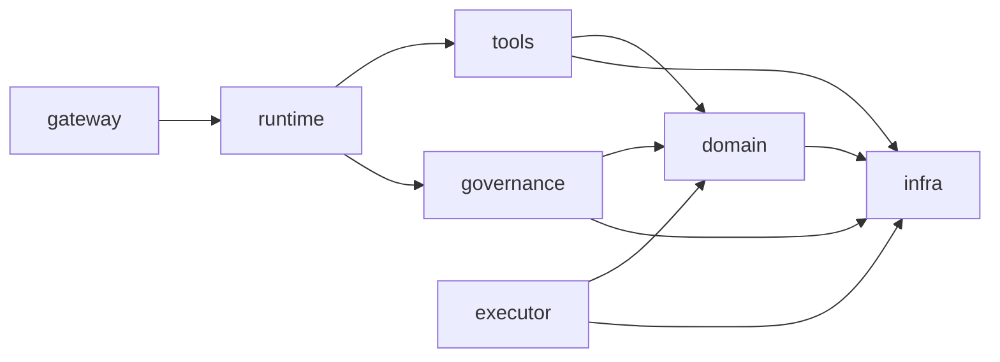

# 《研发运维智能体平台》项目规约 v1.0

> 日期：2026-11-07 ｜ 状态：Draft for review ｜ 效力：**项目级最高约束**
> 适用：本平台全部代码、配置、脚本、文档与流程
> 说明：文中 **MUST / MUST NOT / SHOULD / MAY** 为强制等级，含义见 §0.2

---

## 0. 规约的地位与体系

### 0.1 四层规约体系

| 层 | 文档 | 管什么 | 谁可以改 |
|---|---|---|---|
| **L1 项目规约** | **本文** | 边界、分层、禁止项、交付流程 | 技术负责人 + 评审 |
| L2 领域规约 | [PRD v1.6](PRD-DevOps-Agent平台-v1.0.md)、[多项目托管 v4](多项目托管设计-v4.md) | 做什么、不做什么、验收标准 | 产品 + 技术 |
| L3 契约规约 | [流水线执行器 v1.0](规约-流水线执行器-v1.0.md)、[窄控制器](窄控制器设计-单机滚动部署器.md) | 组件间接口与行为 | 模块 owner |
| L4 编码规约 | 本文 §10 / §11 | 怎么写代码 | 技术负责人 |

### 0.2 强制等级

| 词 | 含义 | 违反后果 |
|---|---|---|
| **MUST** | 必须做，无例外 | 阻断合入 |
| **MUST NOT** | 禁止做，无例外 | 阻断合入 |
| **SHOULD** | 默认要做，偏离需在 PR 说明理由 | 评审可能驳回 |
| **MAY** | 可选 | — |

### 0.3 冲突裁决顺序

`本文 > L3 契约规约 > L4 编码规约`；**任何文档与本文冲突，以本文为准**。发现冲突 MUST NOT 自行选择，MUST 提 issue 由技术负责人裁决。

### 0.4 规约的变更

- 修改本文 MUST 走 PR + 至少 1 人 approve；
- 收紧规则（新增 MUST NOT）：1 人 approve 即可；
- 放宽规则（删除 MUST / 新增例外）：MUST 2 人 approve，且在 §13 登记豁免记录。

---

## 1. 系统边界规约

### 1.1 三条不可协商的架构约束

> 这三条是整个平台的安全地基，**MUST NOT 以任何理由放宽**，包括"临时调试"。

| # | 约束 | 实现层面的含义 |
|---|---|---|
| **A1** | **AI 决策面不持有写凭证** | Agent 进程的配置里 MUST NOT 出现 kubeconfig / DDL 账号 / 部署权限；写凭证只存在执行面组件 |
| **A2** | **projectId 由服务端绑定** | 任何 tool MUST NOT 接受 `projectId` 参数；项目上下文 MUST 从会话 `RuntimeContext` 注入 |
| **A3** | **执行面不含 LLM** | Deployer / Migrator / Publisher / 流水线执行器 MUST 是确定性代码，MUST NOT 调用模型 |

**验证方式**：`A1` 用配置扫描（CI 检查 agent 模块不含凭证键）；`A2` 用契约测试（构造跨项目请求，断言被拒）；`A3` 用依赖检查（执行面模块 MUST NOT 依赖模型 SDK）。

### 1.2 能力分级的使用规约

| 级别 | 定义 | MUST NOT |
|---|---|---|
| L0 只读 | 无副作用 | — |
| L1 建议 | 产出计划/报告，人执行 | MUST NOT 自动落地 |
| L2 隔离环境执行 | 沙箱/测试环境真实执行 | MUST NOT 触碰生产资源 |
| L3 生产执行 | 影响线上 | MUST NOT 无 `confirmToken` 执行；MUST NOT 跳过观察窗 |

> 新增任何 tool MUST 先声明级别；未声明级别的 tool MUST NOT 注册。

### 1.3 平台与被管对象的边界

- 平台 MUST NOT 成为代码托管、CI 引擎的替代品（见 PRD Non-Goals）；
- 平台 MUST NOT 直连业务库做写操作（只读账号 + 白名单）；
- 业务系统 MUST NOT 反向依赖平台（除 Webhook 回调）；
- 平台到业务网的网络 MUST 单向可控（业务网 → 平台默认禁止）。

---

## 2. 模块与分层规约

### 2.1 模块清单与依赖方向

```
agent-gateway       认证 / 会话 / SSE / 审计入口
agent-runtime       Agent 编排 / 模型路由 / 预算
agent-tools         代码 · 工单 · 日志 · 指标 · CI · 部署（工具适配器）
agent-governance    门禁 / 确认令牌 / 风险分级
agent-executor      执行面：Deployer · Migrator · Publisher · Pipeline
agent-domain        实体 / 仓储接口（无框架依赖）
agent-infra         数据库 / 缓存 / 外部客户端实现
agent-console       前端（Vue3）
```

**依赖方向（MUST 单向）**：



| 规则 | 等级 |
|---|---|
| 依赖 MUST 沿箭头方向，禁止反向与跨层直达 | MUST |
| `domain` MUST NOT 依赖 Spring / MyBatis / AgentScope / 任何外部 SDK | MUST NOT |
| `executor` MUST NOT 依赖 `runtime`、`tools`（执行面不感知 AI） | MUST NOT |
| `gateway` MUST NOT 直接调 `infra`（必须经 service） | MUST NOT |
| 模块间 MUST 通过接口通信，MUST NOT 直接引用对方 Mapper/Repository 实现 | MUST NOT |

### 2.2 包结构（按领域，不按技术）

```
org.example.agent.<module>.<domain>/
  ├── api/          (对外 DTO 与接口)
  ├── app/          (应用服务/用例编排)
  ├── domain/       (实体、值对象、领域服务、仓储接口)
  └── infra/        (仓储实现、外部客户端)
```

| 规则 | 等级 |
|---|---|
| MUST NOT 出现 `util` / `common` / `helper` 这类无领域语义的包 | MUST NOT |
| 一个类 MUST 只属于一个领域包，MUST NOT 跨领域堆放 | MUST |
| 新增工具方法前 MUST 先检索同模块与 `domain` 中的既有能力（禁止重复造） | MUST |

### 2.3 分层职责

| 层 | 可以做 | 禁止做 |
|---|---|---|
| `api`（Controller） | 参数校验、鉴权、DTO 转换、调用 app | MUST NOT 写业务逻辑、MUST NOT 直接调 Repository |
| `app`（Service） | 用例编排、事务边界、事件发布 | MUST NOT 处理 HTTP 细节 |
| `domain` | 业务规则、不变量、领域事件 | MUST NOT 依赖框架、MUST NOT 访问网络/DB |
| `infra` | 持久化、外部调用、缓存 | MUST NOT 包含业务判断 |

---

## 3. 对外接口规约（REST / SSE）

| 规则 | 等级 |
|---|---|
| 路径 MUST 以 `/api/v1/` 开头，资源名用复数名词 | MUST |
| MUST 使用语义化方法：GET 查、POST 建、PUT 全量改、PATCH 局部改、DELETE 删 | MUST |
| 成功 MUST 返回 2xx；错误 MUST 使用 4xx/5xx 且**不返回 200 + 错误码** | MUST |
| 统一响应体 MUST 为 `{code, message, data, traceId}`；`code` 为业务码（0 成功） | MUST |
| 列表接口 MUST 分页，MUST NOT 返回无上限集合；默认 `pageSize ≤ 50`，上限 200 | MUST |
| 写接口 MUST 支持 `Idempotency-Key` 头；重复键 MUST 返回首次结果 | MUST |
| 破坏性变更 MUST 走新版本路径（`/v2/`），MUST NOT 原地改语义 | MUST |
| 时间 MUST 用 RFC3339（带时区）；ID MUST 用字符串传输（防 JS 精度丢失） | MUST |
| 错误响应 MUST 含 `traceId`，且 MUST NOT 含堆栈、SQL、内部路径 | MUST |

**SSE 规约**

| 规则 | 等级 |
|---|---|
| 事件 MUST 有 `id`（单调递增），MUST 支持 `Last-Event-ID` 续传 | MUST |
| 事件 MUST 有 `type`（枚举），payload MUST 为 JSON | MUST |
| 心跳 MUST ≤ 30s 一次 | MUST |
| 单连接 MUST 有上限时长（默认 24h），到期 MUST 主动重连 | MUST |
| 连接建立 MUST 校验登录态与项目作用域 | MUST |

---

## 4. 工具规约（Agent Tool）

| 规则 | 等级 |
|---|---|
| 命名 MUST 为 `snake_case` 动词短语（`query_user`、`create_pr`） | MUST |
| 每个 tool MUST 声明：级别（L0–L3）、是否只读、是否幂等、超时 | MUST |
| 参数 MUST 有 JSON Schema；**优先枚举**，自由文本参数 MUST 说明用途与长度上限 | MUST |
| 参数 MUST NOT 直接进入 shell / SQL / 路径拼接 | MUST NOT |
| 返回值 MUST 精简（≤ 4KB 文本或等价结构），MUST 带 `evidence`（文件:行、URL、记录 ID） | MUST |
| 失败 MUST 返回结构化错误（`code` + 面向模型的可行动消息），MUST NOT 抛裸异常给模型 | MUST |
| 列表类 tool MUST 有 `limit`（默认 ≤20，上限 100） | MUST |
| 任何 tool MUST NOT 暴露 `shell` / `exec` / `kubectl` / `psql` 类自由命令能力 | MUST NOT |
| 任何 tool MUST NOT 提供 `confirm` / `approve` 能力 | MUST NOT |
| 写类 tool MUST 只接受 `confirmToken`（而非"用户说可以"） | MUST |
| tool 描述 MUST 说明"什么时候该用/不该用"，而不仅是"做什么" | SHOULD |

---

## 5. 数据规约

### 5.1 命名与结构

| 规则 | 等级 |
|---|---|
| 表名 `snake_case` 复数（`projects`、`run_stages`）；关联表 `a_b` | MUST |
| 主键 `id`（bigint 自增或 snowflake），MUST NOT 用业务字段做主键 | MUST |
| 每表 MUST 有 `created_at`、`updated_at`（timestamptz） | MUST |
| 需要审计的表 MUST 有 `created_by`、`updated_by` | MUST |
| 软删统一 `deleted_at`（NULL 表示未删）；MUST NOT 用 `is_deleted` 布尔 | MUST |
| 枚举 MUST 存字符串（可读、可扩展），MUST NOT 存魔法数字 | MUST |
| 金额 MUST 用 `numeric(18,4)`，MUST NOT 用 float/double | MUST |
| 时间 MUST 用 `timestamptz`，MUST NOT 用字符串存时间 | MUST |
| 敏感字段（token/密码/密钥）MUST NOT 明文入库 | MUST NOT |

### 5.2 迁移规约

| 规则 | 等级 |
|---|---|
| 迁移 MUST 用 Flyway，命名 `V<version>__<desc>.sql` | MUST |
| 迁移 MUST 与应用启动解耦（MUST NOT 在应用启动时自动执行，多副本会并发） | MUST NOT |
| 高风险变更 MUST 附回滚脚本 `U<version>__<desc>.sql` | MUST |
| 破坏性变更 MUST 走 expand-contract（先加后删，跨两个版本） | MUST |
| 已执行的迁移 MUST NOT 修改（校验和会变） | MUST NOT |
| 每个迁移 MUST 在注释里写"失败后人工恢复步骤"（MySQL DDL 无事务） | MUST |

### 5.3 查询规约

| 规则 | 等级 |
|---|---|
| MUST NOT `SELECT *` | MUST NOT |
| 列表查询 MUST 带分页与排序（排序字段白名单） | MUST |
| 大表查询 MUST 走索引；新增查询 MUST 附 `EXPLAIN` 结论 | MUST |
| MUST NOT 在循环里发查询（N+1） | MUST NOT |
| 跨表统计 MUST 走只读视图或独立查询，MUST NOT 在应用层拼装大集合 | SHOULD |

---

## 6. 安全规约

| # | 规则 | 等级 |
|---|---|---|
| S1 | 凭证 MUST 加密存储（AES-GCM），主密钥 MUST 与密文分离 | MUST |
| S2 | 凭证 MUST 只在执行面解密；MUST NOT 出现在日志、事件、API 响应、模型上下文 | MUST NOT |
| S3 | 所有外部输入（日志行、工单正文、代码注释、网页内容）MUST 视为不可信数据 | MUST |
| S4 | 不可信文本进入模型前 MUST 结构化/截断；MUST NOT 作为指令区内容拼接 | MUST |
| S5 | 容器 MUST 非 root、MUST 有内存/CPU/pids 限额、MUST 禁公网 | MUST |
| S6 | 镜像 MUST 按 digest 钉死；MUST NOT 使用浮动 tag | MUST |
| S7 | 生产写操作 MUST 经 `confirmToken`（绑 userId + planHash + 5min 有效 + 一次性） | MUST |
| S8 | 凭证 MUST 支持单条吊销；吊销 MUST 立即生效（缓存失效） | MUST |
| S9 | 高危变更（含 SQL / 依赖升级 / 安全配置）MUST 二次密码确认 | MUST |
| S10 | 平台 MUST 记录三件套审计：操作、变更、决策（事件流） | MUST |

---

## 7. 可观测规约

| 规则 | 等级 |
|---|---|
| 日志 MUST 为结构化（JSON 或 key=value），MUST 含 `traceId`、`projectId`、`operator` | MUST |
| 日志 MUST NOT 打印凭证、完整 SQL、大对象（>4KB 需截断并标注） | MUST NOT |
| 每个跨组件调用 MUST 透传 `traceId` | MUST |
| 关键路径（发布、迁移、工具调用）MUST 有耗时与结果指标 | MUST |
| 告警 MUST 区分"用户代码失败"与"平台故障"（对应 E-1xx / E-2xx） | MUST |
| 平台自身 MUST 有健康检查与独立告警（谁看住看门人） | MUST |

---

## 8. 配置规约

| 规则 | 等级 |
|---|---|
| 配置键 MUST 为 `kebab-case`，按域前缀（`pipeline.*`、`security.*`） | MUST |
| 密钥类配置 MUST 来自环境变量或密钥文件，MUST NOT 写进 yml/代码 | MUST NOT |
| 每个配置项 MUST 有默认值（密钥类除外）与启动校验 | MUST |
| 默认值 MUST 取安全侧（默认关闭、默认只读、默认超时短、默认限流严） | MUST |
| 环境差异 MUST 用 profile 表达；MUST NOT 在代码里 `if (env=="prod")` | MUST NOT |
| 危险开关（如放宽门禁）MUST 在生产启动时校验并拒绝 | MUST |

---

## 9. 测试规约

### 9.1 分层要求

| 层 | 覆盖对象 | 门槛 |
|---|---|---|
| 单元测试 | domain 规则、校验器、状态机 | **domain 层行覆盖 ≥ 80%** |
| 契约测试 | 接口/工具/执行器契约（本文 L3 规约） | 每个契约 MUST 有正反用例 |
| 集成测试 | 仓储、外部客户端（用容器化依赖） | 关键路径 100% |
| 端到端 | 一条完整链路（提单→定位→PR / 构建→发布→回滚） | 每里程碑至少 1 条 |
| 评测集 | AI 输出质量（E1–E5，见 PRD §3.3） | 达门槛才可上线 |

### 9.2 必须存在的反向测试（MUST）

| # | 场景 | 断言 |
|---|---|---|
| 1 | 跨项目访问 | 被拒（A2） |
| 2 | 工具里传 `projectId` | 参数被忽略/拒绝 |
| 3 | 缺 `confirmToken` 执行生产变更 | 401/403 |
| 4 | `confirmToken` 复用于另一 change | 拒绝 |
| 5 | token 过期 | 拒绝 |
| 6 | 模型输出含 shell 命令 | 被参数校验拦截，不进容器 |
| 7 | 日志含密钥 | 被 redact |
| 8 | 工单正文含指令注入 | 不触发写工具 |
| 9 | 容器内访问公网 | 失败 |
| 10 | 发布中断 | 线上版本不变 |

### 9.3 测试纪律

| 规则 | 等级 |
|---|---|
| MUST NOT 提交被 `@Disabled`/`skip` 的测试而不说明 | MUST NOT |
| 修 bug MUST 先写失败用例（回归资产） | MUST |
| MUST NOT 用 `Thread.sleep` 等待异步结果（用 Awaitility 或显式同步点） | MUST NOT |
| 测试 MUST 可重复（不依赖外部网络、不依赖执行顺序） | MUST |
| 涉及时间的逻辑 MUST 注入 Clock，MUST NOT 直接 `now()` | MUST |

---

## 10. 代码规约（Java 21）

### 10.1 基本

| 规则 | 等级 |
|---|---|
| 语言级别 MUST 为 Java 21；MUST NOT 使用 preview 特性 | MUST |
| 所有 public 类型与 public 方法 MUST 有 Javadoc（一行为宜） | MUST |
| MUST 使用构造器注入；MUST NOT 使用字段注入（`@Autowired` 在字段上） | MUST NOT |
| MUST NOT 返回 `null` 集合；MUST 返回空集合 | MUST NOT |
| MUST 用 `Optional`/明确空值语义处理可空返回值，MUST NOT 依赖调用方猜 | MUST |
| 时间 MUST 用 `java.time`；MUST NOT 用 `Date`/`Calendar` | MUST NOT |
| 金额/精确小数 MUST 用 `BigDecimal`，MUST 指定 scale 与舍入模式 | MUST |

### 10.2 并发与线程

| 规则 | 等级 |
|---|---|
| MUST NOT 在请求线程上做无界阻塞（除显式声明的同步执行路径） | MUST NOT |
| MUST NOT 跨线程依赖 `ThreadLocal`（含 Sa-Token/Shiro 上下文） | MUST NOT |
| MUST NOT `new Thread()`；MUST 用受管线程池或虚拟线程执行器 | MUST NOT |
| 共享可变状态 MUST 有明确同步策略；MUST NOT 用 `HashMap` 做并发缓存 | MUST NOT |
| 异步任务 MUST 有超时与取消语义 | MUST |

### 10.3 异常与事务

| 规则 | 等级 |
|---|---|
| 业务异常 MUST 用统一异常类型 + 错误码；MUST NOT 抛 `RuntimeException("...")` | MUST NOT |
| MUST NOT 吞异常（`catch {}`）；MUST 记录或包装后抛出 | MUST NOT |
| 事务 MUST 在 app 层声明；MUST NOT 在 domain/infra 层开事务 | MUST NOT |
| 事务内 MUST NOT 做网络调用/长耗时操作 | MUST NOT |
| 外部调用失败 MUST 有明确重试策略（见 L3 规约错误码分类），MUST NOT 盲目重试 | MUST |

### 10.4 字符串与命令

| 规则 | 等级 |
|---|---|
| 执行外部命令 MUST 用 `ProcessBuilder(List<String>)`；MUST NOT 拼接 shell 字符串 | MUST |
| SQL MUST 用参数绑定；MUST NOT 字符串拼接 SQL（含"内部可信变量"） | MUST NOT |
| 路径拼接 MUST 用 `Path.resolve` + 规范化 + 边界校验；MUST NOT 拼字符串 | MUST |
| 正则 MUST 有长度上限，避免灾难性回溯 | MUST |

### 10.5 禁止项清单（一票否决）

- ❌ `Runtime.getRuntime().exec(String)`
- ❌ 任何形式的 `eval` / 动态加载执行
- ❌ 在日志里打印 `toString()` 的完整请求体（可能含凭证）
- ❌ 把 `Map<String,Object>` 直接当领域对象在层间传递
- ❌ 用 `double` 存金额/比率
- ❌ 在 `domain` 层 import `org.springframework.*`

---

## 11. 前端规约（Vue3 + Element Plus）

| 规则 | 等级 |
|---|---|
| 组件 MUST 按功能分目录，MUST NOT 出现"通用组件大杂烩" | MUST |
| 所有接口调用 MUST 走统一 `api/` 层；MUST NOT 在组件里写 `fetch/axios` | MUST NOT |
| 类型 MUST 与后端 DTO 对齐（`types.ts` 与后端同源生成或手工校对） | MUST |
| 危险操作 MUST 二次确认弹窗，且必须展示**结构化影响面**（实例数、镜像 digest、是否含 SQL） | MUST |
| 确认弹窗 MUST NOT 只显示自然语言摘要 | MUST NOT |
| 长任务 MUST 有进度与可取消；MUST NOT 只有 loading 转圈 | MUST |
| 错误提示 MUST 含 `traceId`（便于排查） | MUST |
| MUST NOT 在前端存任何长期凭证（token 用 HttpOnly cookie 或内存 + 刷新） | MUST NOT |

---

## 12. 交付规约

### 12.1 分支与提交

| 规则 | 等级 |
|---|---|
| 分支命名 MUST `feat/<issue>-<slug>`、`fix/<issue>-<slug>`、`chore/...` | MUST |
| MUST NOT 直推 `main`/`develop`（分支保护强制） | MUST NOT |
| 提交信息 MUST 为 `type(scope): 摘要`，type ∈ feat/fix/refactor/test/docs/chore | MUST |
| 一个 PR MUST 只做一件事；MUST NOT 混入无关格式化 | MUST |

### 12.2 PR 与评审

| 规则 | 等级 |
|---|---|
| PR 模板 MUST 含：变更目的、影响面、回滚方式、测试证据 | MUST |
| PR MUST 通过：编译、单测、静态检查、依赖扫描 | MUST |
| 涉及 L1 规约（本文）或安全不变量的改动 MUST 单独标注并由技术负责人评审 | MUST |
| 单 PR 行数 SHOULD ≤ 400 行（不含生成代码） | SHOULD |

### 12.3 发布与回滚

| 规则 | 等级 |
|---|---|
| 发布 MUST 走 Release Train（后端镜像 + 前端 dist 成对绑定） | MUST |
| 发布顺序 MUST 后端 → 前端；回滚顺序 MUST 前端 → 后端 | MUST |
| 每次发布 MUST 有回滚方式（镜像 digest / 上一版 index.html） | MUST |
| 生产发布 MUST 进观察窗（默认 10 分钟），指标劣化 MUST 自动回滚 | MUST |
| 生产发布 SHOULD 限速 ≤3 次/小时 | SHOULD |

---

## 13. 例外与豁免

任何 MUST / MUST NOT 的例外：

1. MUST 在 PR 描述里写明「违反哪条 + 理由 + 失效条件 + 补做计划」；
2. MUST 由技术负责人 approve；
3. MUST 在下方登记表留档，**有效期不超过 1 个迭代**，到期未补做则回退。

| 日期 | 规约条款 | 原因 | 批准人 | 失效条件 |
|---|---|---|---|---|
| — | — | — | — | — |

---

## 14. 附录：PR 自查清单（20 条）

提交前逐条勾选，任一条"否" MUST NOT 提 PR：

1. [ ] 新增 tool 是否声明了级别（L0–L3）？
2. [ ] 是否有任何 tool 接受了 `projectId`？
3. [ ] 执行面是否引入了模型 SDK 或 LLM 调用？
4. [ ] 是否有裸 `null` 返回或吞异常？
5. [ ] 是否拼接了 shell / SQL / 路径字符串？
6. [ ] 是否跨线程依赖了 ThreadLocal？
7. [ ] 新增配置是否有默认值且默认安全？
8. [ ] 是否打印了可能含凭证的内容？
9. [ ] 迁移是否附了回滚脚本与恢复说明？
10. [ ] 是否改了已执行的迁移文件？
11. [ ] 新查询是否带分页与排序白名单？
12. [ ] 是否有 `SELECT *` 或循环内查询？
13. [ ] 写接口是否支持 `Idempotency-Key`？
14. [ ] 错误响应是否含 `traceId` 且不含内部细节？
15. [ ] 生产写操作是否经 `confirmToken`？
16. [ ] 是否有对应的反向测试（§9.2）？
17. [ ] domain 层是否仍不依赖 Spring？
18. [ ] 依赖方向是否仍然单向（§2.1）？
19. [ ] PR 是否只做了一件事、是否附了回滚方式？
20. [ ] 是否新增了豁免？如有，是否已登记 §13？
